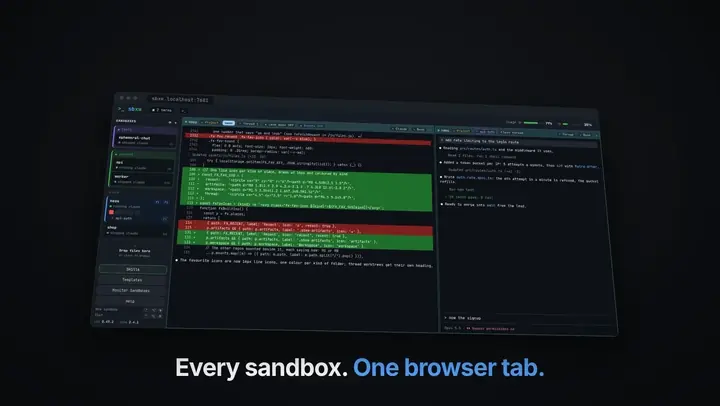
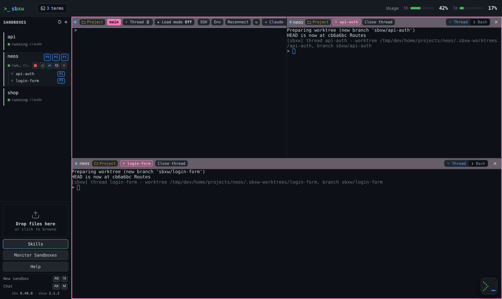

# sbxw

<p align="center">
  <a href="docs/media/sbxw-teaser.mp4">
    
  </a>
  <br>
  <sub>▶ <a href="docs/media/sbxw-teaser.mp4">Watch with sound</a></sub>
</p>

**Run Claude Code in isolated sandboxes, and drive them all from one browser tab.**

sbxw is a light Rust wrapper around Docker's standalone
[`sbx`](https://docs.docker.com/reference/cli/sbx) CLI (Docker Sandboxes). One
command gives an agent a microVM with your project mounted, a restrictive
network allowlist, your dev server's ports on the host, and a browser terminal.
sbxw only ever calls `sbx`, never `docker sandbox`.



## What you get

| | |
|---|---|
| 🖥️ **One web UI for every sandbox** | Terminals, file browser, ports, network policy and usage in one tab. [Web UI →](docs/web-ui.md) |
| 🔒 **Isolation by default** | Only the project folder is shared. Egress is an allowlist, never `**`. [Security →](docs/security.md) |
| ⑂ **Several agents in one sandbox** | Each thread gets its own git worktree and branch, side by side on screen. [Threads →](docs/threads-and-lead.md) |
| ★ **A lead that plans the work** | The main agent splits a task into threads. You approve the plan, then merge in one click. [Lead →](docs/threads-and-lead.md#the-lead) |
| 🔁 **Sandboxes that ask each other** | An agent can ask another sandbox, or you, for a screenshot. Nothing moves until you approve it. [Relay →](docs/relay.md) |
| 💬 **Throwaway chats** | An agent on an empty folder, from the CLI, a chat dock, or a Chrome side panel. [Chat →](docs/chat.md) |
| 🧰 **Batteries included** | Bundled kits: code maps, diagrams, launch videos, Markdown→PDF, k8s tools. [Kits →](docs/kits-and-skills.md) |
| 🏝️ **macOS Dynamic Island** | Every session in your notch. Answer an agent's questions from there. [Island →](docs/island.md) |

## Install

You need the [`sbx`](https://docs.docker.com/reference/cli/sbx) CLI **0.47.0 or
newer** on your `PATH`, and `sbx login` done once.

```bash
curl -fsSL https://raw.githubusercontent.com/gallettom/sbxw/main/install.sh | sh
```

This installs the binary into `/usr/local/bin`. The web UI and the bundled kits
are embedded in it. To build from source or change the install options, see
[Getting started](docs/getting-started.md#install).

## Quick start

```bash
cd ~/dev/my-project
sbxw up my-project          # create, provision, serve
# open http://sbxw.localhost:7681
```

Or just run `sbxw up` with no name, then create sandboxes from the browser with
**＋**. To publish your dev server's ports or change the kits, add an
[`sbxw.toml`](sbxw.toml.example) to the project ([Configuration](docs/configuration.md)).

Inside the sandbox, bind dev servers to `0.0.0.0` (`ng serve --host 0.0.0.0`),
or the published ports won't reach them.

## Documentation

| Guide | What's in it |
|---|---|
| [Getting started](docs/getting-started.md) | Requirements, install, first sandbox, authentication, updating |
| [CLI reference](docs/cli.md) | Every command, and what `sbxw up` does step by step |
| [Web UI](docs/web-ui.md) | Sidebar, panes, Project panel, ports and network policy, shortcuts |
| [Chat](docs/chat.md) | Chat sandboxes, the chat dock, the browser side panel |
| [Threads and the lead](docs/threads-and-lead.md) | Several agents per sandbox, worktree graph, plans, one-click merge |
| [Relay](docs/relay.md) | Questions between sandboxes, screenshot requests |
| [Dynamic Island](docs/island.md) | The macOS notch companion, session hooks, usage |
| [Kits and skills](docs/kits-and-skills.md) | Bundled kits, the kit cache, the shared skill store |
| [Configuration](docs/configuration.md) | Every `sbxw.toml` key, models, environment variables |
| [Environment files](docs/environment-files.md) | `sbxw env run` / `sbxw env export` with `sbxenv.yaml` |
| [SSH](docs/ssh.md) | `<name>.sbx` hosts, VS Code, Claude Desktop |
| [Security](docs/security.md) | Trust boundaries, listeners, tokens, what a sandbox cannot do |
| [Architecture](docs/architecture.md) | Crates, tests, `sbx` version floor, open questions |

## Contributing

```bash
cargo build
cargo test --workspace
scripts/e2e.sh        # the built binary end to end, against a fake sbx
scripts/ui-smoke.sh   # the real web UI in headless Chromium
```

See [Architecture](docs/architecture.md) for how the code is laid out.
