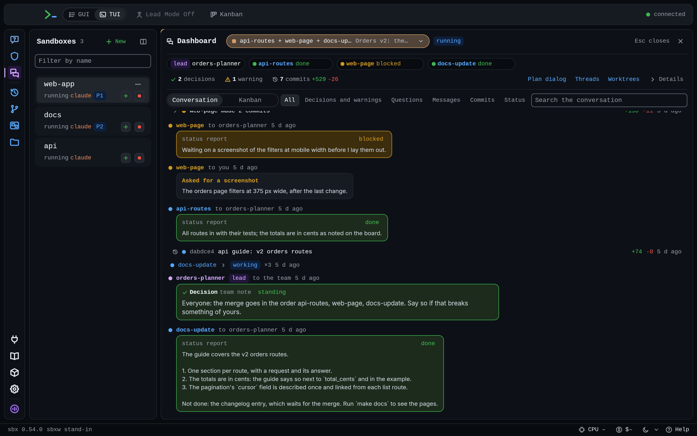

# sbxw

<p align="center">
  <a href="docs/media/sbxw-teaser.mp4">
    
  </a>
  <br>
  <sub>▶ <a href="docs/media/sbxw-teaser.mp4">Watch the 1-minute tour with sound</a></sub>
</p>

**A team of Claude Code agents, each in its own sandbox, steered by one person.**

sbxw is a Rust wrapper around Docker's standalone
[`sbx`](https://docs.docker.com/reference/cli/sbx) CLI (Docker Sandboxes). One
command gives an agent a microVM with your project mounted, a restrictive
network allowlist and your dev server's ports on the host. A lead agent can
split the work into threads, each on its own git branch, and you follow and
approve all of it from a native macOS app, a browser tab, or your phone.
sbxw only ever calls `sbx`, never `docker sandbox`.



## What you get

| | |
|---|---|
| **Isolation by default** | Only the project folder is shared. Egress is an allowlist, never `**`. [Security →](docs/security.md) |
| **A desktop app and a web UI** | Every sandbox's terminals, files, ports, network policy and usage in one window, native on macOS or in a browser tab. [Desktop app →](docs/getting-started.md#the-desktop-app) · [Web UI →](docs/web-ui.md) |
| **Several agents in one sandbox** | Each thread gets its own git worktree and branch, side by side on screen. [Threads →](docs/threads-and-lead.md) |
| **A lead that plans the work** | The main agent splits a task into threads. You approve the plan, follow the team on its Dashboard and Kanban, then merge in one click. [Lead →](docs/threads-and-lead.md#the-lead) |
| **Canvas reviews** | Agents post screenshots and diagrams of what they built; you pin numbered remarks on them and send the round back. [Canvas →](docs/relay.md#canvas-reviews) |
| **Sandboxes that ask each other** | An agent can ask another sandbox, or you, for an answer or a screenshot. Nothing moves until you approve it. [Relay →](docs/relay.md) |
| **Your phone, over your own tailnet** | Read and talk to your leads while away, approve with Face ID. Off by default. [Remote access →](docs/security.md#remote-access) |
| **Jarvis** | Talk to your agents, hear their answers, and let sbxw's own assistant propose config changes you approve. [Jarvis →](docs/jarvis.md) |
| **Batteries included** | Bundled kits: code maps, diagrams, launch videos, Markdown to PDF, a virtual Mac, k8s tools. [Kits →](docs/kits-and-skills.md) |

More: throwaway [chats](docs/chat.md), the macOS [Dynamic Island](docs/island.md),
[SSH and VS Code](docs/ssh.md), [environment files](docs/environment-files.md).

## Install

You need the [`sbx`](https://docs.docker.com/reference/cli/sbx) CLI **0.51.0 or
newer** on your `PATH` (sbxw works with 0.51 to 0.54), and `sbx login` done once.

```bash
curl -fsSL https://raw.githubusercontent.com/gallettom/sbxw/main/install.sh | sh
```

This installs the binary into `/usr/local/bin`, with the web UI and the bundled
kits embedded in it. On macOS it also offers the desktop app (`sbxw.app` in
`~/Applications`). To build from source or change the install options, see
[Getting started](docs/getting-started.md#install).

## Quick start

```bash
cd ~/dev/my-project
sbxw up my-project          # create, provision, serve
open ~/Applications/sbxw.app   # the desktop app (macOS)
sbxw web my-project         # or: print the browser sign-in address
```

Or run `sbxw up` with no name, then create sandboxes from the app with
**New**. To publish your dev server's ports or change the kits, add an
[`sbxw.toml`](sbxw.toml.example) to the project ([Configuration](docs/configuration.md)).

Inside the sandbox, bind dev servers to `0.0.0.0` (`ng serve --host 0.0.0.0`),
or the published ports won't reach them.

## Documentation

All guides are listed in [docs/README.md](docs/README.md). The main ones:

| Guide | What's in it |
|---|---|
| [Getting started](docs/getting-started.md) | Requirements, install, first sandbox, the desktop app, authentication, updating |
| [CLI reference](docs/cli.md) | Every command, and what `sbxw up` does step by step |
| [Web UI](docs/web-ui.md) | Sidebar, panes, Kanban, Project panel, ports and network policy, shortcuts |
| [Threads and the lead](docs/threads-and-lead.md) | Several agents per sandbox, worktree graph, plans, tickets, one-click merge |
| [Relay](docs/relay.md) | Questions between sandboxes, screenshots, Canvas reviews, the virtual Mac |
| [Jarvis](docs/jarvis.md) | The voice of sbxw, and its assistant: proposals you approve |
| [Kits and skills](docs/kits-and-skills.md) | Bundled kits, the kit cache, the shared skill store |
| [Configuration](docs/configuration.md) | Every `sbxw.toml` key, models, environment variables |
| [Security](docs/security.md) | Trust boundaries, listeners, tokens, remote access, what a sandbox cannot do |
| [Architecture](docs/architecture.md) | Crates, tests, `sbx` version floor, open questions |

## Contributing

```bash
cargo build
cargo test --workspace
scripts/e2e.sh        # the built binary end to end, against a fake sbx
scripts/ui-smoke.sh   # the real web UI in headless Chromium
cd desktop && CARGO_PROFILE_DEV_DEBUG=0 cargo test -j1   # the desktop app, headless
```

See [Architecture](docs/architecture.md) for how the code is laid out.
