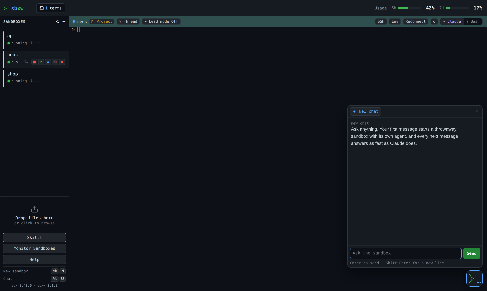

# Chat

[← Back to README](../README.md)

Sometimes you want to talk to an agent, not point it at a codebase. sbxw has
three ways to do that.

- [Chat sandboxes](#chat-sandboxes): an agent on an empty folder
- [The chat dock](#the-chat-dock): chat from the web UI without a terminal
- [The browser side panel](#the-browser-side-panel): chat beside the app you're testing

## Chat sandboxes

A chat sandbox is a normal sandbox whose workspace is a **fresh empty folder**
(`/tmp/sbxw-chat/<name>`). The agent has none of your code to read or change.

```bash
sbxw chat                 # generated name: chat-xxxxxx
sbxw chat brainstorm      # or name it
sbxw rm brainstorm        # removes the sandbox and its empty folder
```

In the web UI: **＋** → **Chat sandbox**. The name is optional. Chat sandboxes
are grouped under **💬 Chats** in the sidebar.

Otherwise it's an ordinary sandbox: it reads your `sbxw.toml`, applies the same
kits and publishes the same `[[ports]]`. If a project sandbox already holds one
of those host ports, that port fails with a warning for the chat sandbox; the
sandbox itself is still created.

## The chat dock



The `>_` button in the bottom-right corner opens a chat panel over the panes.
**⌃⌥M** (Alt+M off a Mac) toggles it from anywhere, terminals included.

- It talks to the `ephemeral-chat`, `ephemeral-chat-2`, … sandboxes, one tab
  each. **＋ New chat** starts the next one. From four sandboxes up it warns
  that each holds disk and memory.
- The button shows what the agents are doing: the cursor blinks at rest, the
  grid fills while one works, it turns amber when one asks you something, and a
  reply that arrives while the panel is closed shows a badge and a two-line
  peek.
- A pending `AskUserQuestion` is answered in the panel. A permission prompt
  offers **Answer in a pane** instead; **Open in a pane** is always there.

It uses the same calls as the [island](island.md)'s composer
(`POST /api/chat/push`, the session events on `/api/stream`). The daemon keeps
only one reply per session, so the transcript lives in the tab's
`sessionStorage`: it survives a reload, not a closed tab.

### How a message is typed in

`POST /api/chat/push` does everything server-side: create the sandbox if
missing, attach the agent, wait for its UI, type, submit. Details that matter:

- It **waits for the terminal to go quiet** before typing, and again before
  pressing Return. Silence is measured on the session's output stream.
- **Return is sent as its own keystroke.** Claude Code reads a fast burst of
  bytes as a paste, and a newline inside a paste is inserted, not sent.
- **A warm session is fast.** If the agent is already attached and drawn, sbxw
  skips the existence check and waits ~180 ms of silence instead of 900 ms.

## The browser side panel

A Chrome/Edge extension that opens a chat **beside the app you're testing**.
The app stays in its own tab, so HTTPS, its real hostname, cookies and SSO all
keep working.

**Install** (once):

```bash
sbxw extension
```

Then in Chrome or Edge:

1. open `chrome://extensions` (or `edge://extensions`)
2. turn on **Developer mode**
3. **Load unpacked** → the folder `sbxw extension` printed (`~/.sbxw/browser-extension/`)

Click the sbxw icon in the toolbar (**Alt+Shift+S**) on your app's tab.

**What it does:**

- Works out which sandbox serves the tab from the published ports and aliases.
  If that's ambiguous, you pick one and it's remembered as a **pairing**
  (`~/.sbxw/state/embed-pairings.json`).
- Sends messages to that sandbox's main agent, or one of its threads, prefixed
  with the page's URL.
- When the agent calls `ask_user_for_screenshot`, the panel can answer with a
  capture of the tab, so the agent sees its own change.

The extension is a thin shell around the daemon's `/sidepanel` page, so most
changes ship inside sbxw. The install script and `sbxw update` keep the folder
current, and the panel reloads the extension when needed.
