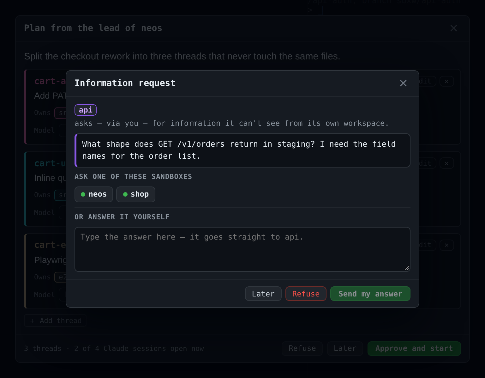
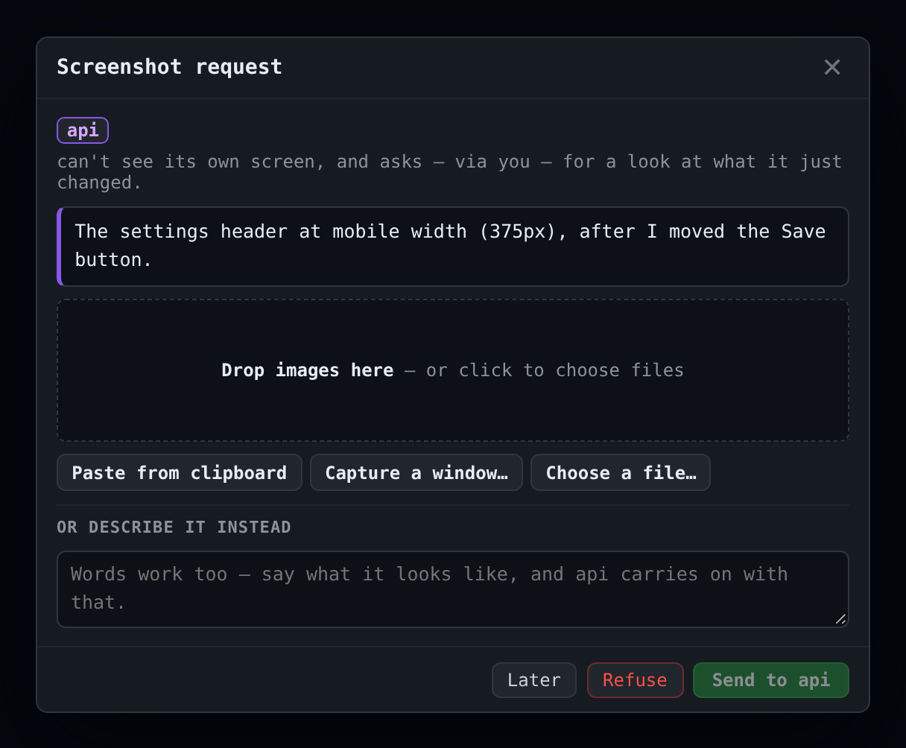

# Relay: asking another sandbox

[← Back to README](../README.md)

- [Why](#why)
- [Questions between sandboxes](#questions-between-sandboxes)
- [Screenshot requests](#screenshot-requests)
- [What a sandbox cannot do](#what-a-sandbox-cannot-do)

## Why

Sandboxes are isolated on purpose, which is also their limit: the agent on the
frontend can't see the API repo next door. So it guesses, or stops and asks you
to go look. The relay is a third option: it asks the other sandbox, and **you
decide every hop**.

```
sandbox A ──ask──▶ sbxw ──▶ 🧑 popup ──route──▶ sandbox B
                                 ▲                  │
sandbox A ◀──approve── 🧑 review ◀──────answer──────┘
```

Nothing happens on its own. No timeout picks a recipient, and no answer reaches
the asker without someone clicking.

## Questions between sandboxes

### The agent's side

Every sandbox gets an MCP server, `sbxw-relay`, with three tools:
`ask_other_sandbox`, `ask_user_for_screenshot` and `check_sandbox_question`.
The same is available as a CLI:

```bash
node ~/.sbxw/relay.js ask  "what shape does GET /v1/orders return in staging?"
node ~/.sbxw/relay.js shot "the settings header at mobile width, after I moved the save button"
```

Agents ask **on their own**, without being told to. It's a tool and not only a
CLI because a tool is weighed every turn, while a note in memory competes with
the whole conversation. In practice, an agent with only the note reached for a
codebase search instead of asking.

The call waits about 90 seconds, then returns the answer, a refusal, or "still
open, check later with `check_sandbox_question`". An agent's tool call never
hangs on a human who stepped away. If the answer is approved after the call
returned, sbxw types it into the asking session (the thread, if a thread
asked).

### Your side

A popup shows the question and one button per running sandbox:



1. **Route it:** click a sandbox. The question is typed into that agent,
   framed as untrusted data, with the id it must answer with.
2. **Carry on:** the popup shrinks to a corner card while the other agent
   works. It comes back by itself when the answer lands.
3. **Review the answer:** it arrives **editable**. Trim it, cut a secret out,
   or rewrite it. Only then does the asker receive it.

Other choices:

- **Answer it yourself:** type in the box and send, no second sandbox needed.
- **Refuse:** a full stop. Nothing is released, and the agent is told not to
  ask again.
- **Later** (or Esc): parks it behind a header badge. The badge counts only what
  waits on *you*.

Routing to a sandbox whose agent can't start bounces the request back with the
reason.

## Screenshot requests

An agent can't see what it just built. The code compiles and the diff is right,
but "the code is correct" and "it looks correct" are different claims. So it can
ask to be shown:

```
sandbox A ──shot──▶ sbxw ──▶ 🧑 popup ──paste / drop / capture ×N──▶ sandbox A
```

There's no routing step: nobody else is looking at your screen.



- **Add images four ways:** paste from the clipboard (⌘V works too), drop
  files, choose files, or **capture a window** through the browser's own picker.
  Clipboard and capture need the page on `localhost`, not a LAN address.
- **Several at once:** up to six images and 16 MB, numbered in the order the
  agent receives them. One interruption for a before/after or two breakpoints.
- **Preview first:** you see exactly what is sent. Images are scaled to 1600px.
- **Words work too:** describe it instead, and the agent works from the
  description.
- **Refuse** is an ordinary answer: the agent carries on, says what it changed
  and what it expects, and won't ask again for the same view.

Through MCP, the images come back **in the tool result**, so the agent actually
looks at them. They're also saved in the asking sandbox as
`~/.sbxw/shots/<request-id>-1.png`, `-2.png`… for later turns. The daemon never
writes into a sandbox: the image data travels in the approved reply and the
sandbox's own CLI writes the files.

The [browser side panel](chat.md#the-browser-side-panel) can answer a
screenshot request with a capture of the app's tab.

## What a sandbox cannot do

- name its own recipient;
- list or read anyone else's requests;
- see an answer you haven't released;
- reply to a question it wasn't handed;
- claim to be another sandbox. Each sandbox presents the token sbxw installed
  (`~/.sbxw/token`), and the daemon derives the sender from it. A `from` field
  in the request is ignored.

Routing, approving and refusing exist only on the UI listener, which sandboxes
can't reach. Requests live in memory (`crates/core/src/relay.rs`): a settled
one is kept 30 minutes for a late pickup, an unanswered one 6 hours.

The daemon never decodes images. It checks each one is a `data:` URL of PNG,
JPEG or WebP under the size cap, and the set is at most six and 16 MB.
