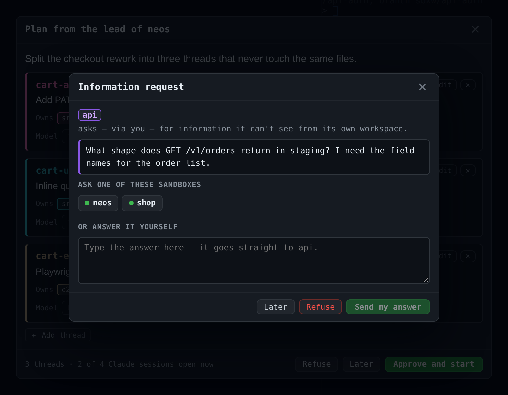

# Relay: asking another sandbox

[← Back to README](../README.md)

- [Why](#why)
- [Questions between sandboxes](#questions-between-sandboxes)
- [Screenshot requests](#screenshot-requests)
- [Canvas reviews](#canvas-reviews)
- [Virtual Mac requests](#virtual-mac-requests)
- [What a sandbox cannot do](#what-a-sandbox-cannot-do)

## Why

Sandboxes are isolated on purpose, which is also their limit: the agent on the
frontend can't see the API repo next door. So it guesses, or stops and asks you
to go look. The relay is a third option: it asks the other sandbox, and **you
decide every hop**.

```
sandbox A ──ask──▶ sbxw ──▶ 🧑 popup ──route──▶ sandbox B
                                 ▲                  │
sandbox A ◀──approve── 🧑 review ◀──────answer──────┘
```

Nothing happens on its own. No timeout picks a recipient, and no answer reaches
the asker without someone clicking.

## Questions between sandboxes

### The agent's side

Every sandbox gets an MCP server, `sbxw-relay`, with these tools:
`ask_other_sandbox`, `ask_user_for_screenshot`, `ask_user_questions` and `check_sandbox_question`.
The same is available as a CLI:

```bash
node ~/.sbxw/relay.js ask  "what shape does GET /v1/orders return in staging?"
node ~/.sbxw/relay.js shot "the settings header at mobile width, after I moved the save button"
```

Agents ask **on their own**, without being told to. It's a tool and not only a
CLI because a tool is weighed every turn, while a note in memory competes with
the whole conversation. In practice, an agent with only the note reached for a
codebase search instead of asking.

The call waits about 90 seconds, then returns the answer, a refusal, or "still
open, check later with `check_sandbox_question`". An agent's tool call never
hangs on a human who stepped away. If the answer is approved after the call
returned, sbxw types it into the asking session (the thread, if a thread
asked). The same holds when the call was cut short (the agent's client gave up,
the connection dropped): the answer is delivered once, either returned by a
call still waiting or typed in, never both and never neither.

### Your side

A popup shows the question and one button per running sandbox:



1. **Route it:** click a sandbox. A one-line notice is typed into that agent,
   and it fetches the question with `node ~/.sbxw/relay.js show <id>`, framed
   as untrusted data, with the id it must answer with. A sandbox brought up
   before this version has no `show` until you run `sbxw up` for it.
2. **Carry on:** the popup shrinks to a corner card while the other agent
   works. It comes back by itself when the answer lands.
3. **Review the answer:** it arrives **editable**. Trim it, cut a secret out,
   or rewrite it. Only then does the asker receive it.

Other choices:

- **Answer it yourself:** type in the box and send, no second sandbox needed.
- **Refuse:** a full stop. Nothing is released, and the agent is told not to
  ask again.
- **Later** (or Esc): parks it behind a header badge. The badge counts only what
  waits on *you*.

Routing to a sandbox whose agent can't start bounces the request back with the
reason.

## Screenshot requests

An agent can't see what it just built. The code compiles and the diff is right,
but "the code is correct" and "it looks correct" are different claims. So it can
ask to be shown:

```
sandbox A ──shot──▶ sbxw ──▶ 🧑 popup ──paste / drop / capture ×N──▶ sandbox A
```

There's no routing step: nobody else is looking at your screen.


- **Add images four ways:** paste from the clipboard (⌘V works too), drop
  files, choose files, or **capture a window** through the browser's own picker.
  Clipboard and capture need the page on `localhost`, not a LAN address.
- **Several at once:** up to six images and 16 MB, numbered in the order the
  agent receives them. One interruption for a before/after or two breakpoints.
- **Preview first:** you see exactly what is sent. Images are scaled to 1600px.
- **Words work too:** describe it instead, and the agent works from the
  description.
- **Refuse** is an ordinary answer: the agent carries on, says what it changed
  and what it expects, and won't ask again for the same view.

Through MCP, the images come back **in the tool result**, so the agent actually
looks at them. They're also saved in the asking sandbox as
`~/.sbxw/shots/<request-id>-1.png`, `-2.png`… for later turns. The daemon never
writes into a sandbox: the image data travels in the approved reply and the
sandbox's own CLI writes the files.

The [browser side panel](chat.md#the-browser-side-panel) can answer a
screenshot request with a capture of the app's tab.

## Canvas reviews

A canvas is one review session of one sandbox. The agent adds screenshots
of the app it works on; you zoom and pan over them in the desktop app's
**Canvas** view, pin numbered remarks on points of a shot, place notes and
example pictures, then press **Send remarks**. The agent reads the round
with a tool and works on it. Everything stays on this computer's disk until
you delete it.

| Tool | What it does |
|---|---|
| `canvas_add_shots {canvas?, title?, shots: [{file, title, note?, width?, screen?}]}` | Reads each file inside the sandbox and posts it; returns the canvas id, how many were kept, and why any was refused. One call is one round. |
| `canvas_add_diagram {canvas?, title?, file, kind?, replace?}` | Reads a JSON file inside the sandbox (sbxw's diagram schema, or an Archify file) and posts it; the daemon imports, checks and lays it out on the canvas. Returns the diagram id (`d-…`) and the canvas id. `replace: "d-…"` sends a new version of a diagram the agent added. |
| `canvas_read {canvas?}` | The remarks of the review rounds not read yet: pins with their number, the shot's title, the position (percentages and a hint such as `top-left`) and the text; notes; each example picture's path inside the sandbox; for each diagram the person changed, the changes in plain sentences and the path of the whole diagram saved in the sandbox. Each round is handed over once. |
| `canvas_list` | The sandbox's canvases: id, title, shots, rounds, unread review rounds. |

**Asking for shots from a canvas.** **Ask the agent for screenshots** (on an
empty canvas, or when the sandbox has none) types the prompt into the chosen
session after one confirmation, with a line under it naming the canvas
(`pass canvas: "c-…" to canvas_add_shots`). The canvas then waits: it shows
**Asked web-app for screenshots 1 min ago**, its entry in the picker says
*waiting for shots*, and **Stop waiting** ends it. While it waits (6 hours at
most), any `canvas_add_shots` call that names no canvas lands there, even with
a `title`. The first shot ends the wait, and the rest of the same call follows
it. With no canvas open, a new one named "Screenshots" is made for the
request. If the prompt cannot be typed (no live session), nothing waits and
that new canvas is removed again.

An agent reaches only its own sandbox's canvases (its token says which
sandbox it is; a body field never does). It cannot delete a canvas, edit a
remark or read another sandbox's canvas.

**Layout.** Each round is a grid below the earlier ones (12 desktop shots
make 4 columns of 3 rows, 9 make 3 x 3, phones share a cell three by
three), its title under each shot. Give the same `screen` key to the same
screen in every round: it takes the same cell as before, so before and after
line up in one column; a new screen goes after the earlier ones. A shot the
person moved keeps its place. Canvases made before grids are laid out again
once, when the daemon reads them, unless the person had arranged them.
In `canvas_read`, a picture the person added is "Example N".

**Limits.** PNG, JPEG or WebP, checked by content, never by name (animated
pictures refused); 20 MB and 8192 px a side per picture; 24 shots a round;
500 MB of pictures a canvas; titles 120 characters, notes and remarks 2000.

**Diagrams.** An agent puts a workflow, a sequence, a data flow or a
lifecycle on the canvas with `canvas_add_diagram`; the person moves, renames,
connects, adds and deletes its boxes in the desktop app. The file is either
sbxw's schema (`{version: 1, kind, title, direction?, lanes?, groups?,
nodes: [{id, label, sub?, shape?, lane?}], edges: [{from, to, label?, style?,
order?}]}`, written out in `crates/core/src/diagram.rs`) or an Archify JSON
file (it has `diagram_type`), imported. Nodes without `x` and `y` are laid
out by the daemon. Each tool call is one round: the diagram sits below the
earlier rounds. When the person sends a round, every diagram they changed
since the agent last knew it goes with it; `canvas_read` gives its changes
as sentences (`Renamed node review from "In review" to "Lead review".`) and
writes the whole diagram, as sent, to
`/tmp/sbxw-canvas/<canvas id>/<diagram id>.json` inside the sandbox (the
relay server writes it, files 0600, folders 0700, names made only from ids
it checked). The agent edits that file and calls `canvas_add_diagram` with
`replace`; that is refused while the person has changes the agent has not
read, so nothing they did is lost silently. Two editors of one diagram do not
overwrite each other: a save names the revision it started from and is
refused (409) when the diagram moved past it.

The tool reads a file only when its real path (links followed) is a `.json`
file inside the workspace, the home or `/tmp`, and not inside `~/.sbxw`,
`~/.claude`, `~/.ssh`, `~/.config`, `~/.aws`, `~/.gnupg`, `~/.docker` or
`~/.kube`.

| Diagram limit | At most |
|---|---|
| a diagram's file, and one diagram as stored (laid out) | 256 KB |
| nodes, edges, lanes, groups | 200, 400, 16, 32 |
| title; node, lane, group and edge label; node `sub` | 120; 80; 160 characters |
| diagrams a canvas | 50 |
| diagrams of one canvas together (their current versions, compact JSON) | 2 MB |

Ids (`a-z 0-9 _ -`, 40 characters) are refused, never cleaned into shape;
every text goes through `canvas::clean`. A diagram's id (`d-` and 12 hex
digits) is generated by the daemon, never taken from the file.

**On disk.** `~/.sbxw/state/canvas/<id>/`: `canvas.json` and the pictures,
each under a name sbxw generates (`s-<12 hex>.png`). Nothing an agent or a
person types is used as a path. Folders 0700, files 0600, atomic writes.
The daemon's log has ids, counts and sizes, never a title, a remark, a
diagram label or a picture. Canvases are never deleted on their own, not even with their
sandbox: the Canvas view shows each one's size and the total, and deletes
one canvas or every canvas older than a date, each after one confirmation.

**Sending.** One confirmation lists the target session, every remark in
full and each example picture (local path, size, a box to tick for a file
that looks secret). On Send, sbxw copies the pictures into the sandbox
(`/tmp/sbxw-uploads/...`, as dropped files), records the round and types
one fixed line: `[sbxw canvas · c-…] review round 1 is ready: run
canvas_read to read the person's remarks`. A session started before this
version has no `canvas_read` until `sbxw up <sandbox>`.

**Where a shot comes from.** `canvas_add_shots` reads a file inside the
sandbox, so every source must leave a PNG, JPEG or WebP on the sandbox's
disk first. Each of these does:

| Source | How the agent gets a file | `width` to give |
|---|---|---|
| The sandbox's shared browser (the one the person watches in the Browser panel) | `node ~/.sbxw/browser/browser.mjs viewport mobile` (or `tablet`, `desktop`, `<w>x<h>`), `open <url>`, then `shot /tmp/shots/home.png`: Chromium's `Page.captureScreenshot`, written as a PNG at that path. With Playwright over `http://127.0.0.1:9222`, `page.screenshot({ path })` does the same. | the viewport's width (390, 820, 1280 or the `<w>` given) |
| A headless Chromium of the agent's own | The same Chromium binary (`agent-skills` kit). The kit's hook refuses a one-off launch once and points to the shared browser, which the person can watch: use the shared one. `SBXW_OWN_BROWSER=1` lets a project's own runner (a Playwright test with `screenshot: 'on'`) write its files, which can then be posted. | the test's viewport width |
| The virtual Mac | `mac_screenshot` (or `screenshot: true` on another `mac_*` call): the relay server saves the PNG it shows the agent as `.sbxw-artifacts/mac-shots/mac-<time>.png` in the workspace (else `~/.sbxw/shots/`), and says the path in its answer. The newest 40 are kept, so post them before taking many more. | none: it is the whole Mac screen, not a page, and the canvas sizes it by its pixels |

So an agent never needs a picture it can only see: the shared browser and
the Mac both leave a file, and a test runner's output is a file already.
Without the `agent-skills` kit there is no Chromium in the sandbox, and
without `sbxw:terminal-mac` no `mac_*` tool: then only files the project
makes itself can be posted.

**On the phone.** A paired phone (see [security](security.md#remote-access))
sees the canvases of every sandbox it reaches, one shot per page, adds pins
and notes on shots and sends the round: sbxw types the same fixed line. It
gets a notification when an agent posts a new round. The phone does not add
example pictures; a round with pictures added on the Mac is sent from the Mac.

## Virtual Mac requests

With the [`sbxw:terminal-mac`](../assets/terminal-mac/README.md) kit, a
sandbox may ask to **boot the virtual Mac** or to **publish a port** to it.
Each is a relay request of its own kind: never routed, a yes or a no. The
card says what will happen in sbxw's words, then quotes the agent's reason.
**Approve** runs it, and the request is settled with what came of it (the URL
to open, or the error), so the agent reads the outcome rather than "approved".

## Questions for you

`ask_user_questions` puts a set of questions to **you** (a `/grill-me`
round, or any batch of decisions that are yours) and blocks until you have
answered (10 minutes, then a request id for `check_sandbox_question`). Each
question carries a title, the question and the agent's recommendation.
`/grill-me` asks its rounds this way in sbxw.

The round opens this popup like any other request, on **one form**: who
asks (sandbox and thread), the agent's intro if it wrote one, then every
question in order with its id, its title, the question, the agent's
recommendation on its own line, and an answer field. **Use the
recommendation** fills a field with it. A question you leave empty is
skipped. **Send answers** (or Ctrl+Enter, ⌘+Enter on a Mac) releases them
all at once, one line per answered question (`Q1 : …`), which is what the
tool returns. Personal data is masked first, as the
[Jarvis](web-ui.md#jarvis) masks what it sends; if the
masking is not available or fails, nothing is sent. Tab moves from one
answer field to the next. The popup does not take the keyboard from a
terminal until you click into it.

You can also **route the round** to another sandbox, with the same buttons
as a question: its agent gets the round as untrusted text from another
agent and is asked to draft the answers in the `Q1 : …` format. Its draft
comes back to the popup, shown as it was written and filled into the form,
for you to edit, discard with **Clear the draft** and answer yourself, or send. Nothing reaches the
asker until you click **Send answers**. **Refuse** sets the round aside and
tells the agent so.

**Read aloud** (shown when Jarvis's voice is set up) reads the round
with Jarvis's voice: the intro, then each question with its
recommendation. Click again to stop. Nothing is read in full on its own;
with the voice on, a short spoken cue says a round has arrived.

## Team notes and the relay server's hello

A lead and its threads leave each other team notes (`team_note`,
`read_team_notes`, see [threads-and-lead.md](threads-and-lead.md)). sbxw
types one fixed line into the addressee's session saying a note waits, never
the note's words. A session reads a note only if its relay MCP server has
`read_team_notes`; one started before the relay had it does not, and the
line would leave the note unread.

So each relay server says hello: at start and every 2 minutes it posts
`/api/relay/hello` on the agent listener with `{thread, agent_proc, tools}`,
where `agent_proc` is `<pid>:<start>` of the Claude process it serves (found
as the status hook finds it) and `tools` the tool *names* it offers. The
sandbox is the token's, never the body's; the body is capped at 16 KB and 200
names. The daemon keeps, in memory only, whether each process offers
`read_team_notes`, and, from the status hook's events, which process each
session (`lead` or a thread) runs in. An addressee is a sure reader only when
its current process said hello with the tool within 6 minutes. Any other
(an old session never says hello, and after a daemon restart nobody has
until the next hello and hook event) gets the cautious line, which tells it
to ask the sender to resend by `SendMessage`, and the sender's answer says
to send it that way too. A hello is logged as counts, never its content; a
failed hello is silent.

Why this signal: the hook version says what is on disk, not what a running
session loaded; the daemon does not record when it wrote the relay into a
sandbox; a session's own relay server is the one thing that knows its tools.

## What a sandbox cannot do

- name its own recipient;
- list or read anyone else's requests;
- see an answer you haven't released;
- reply to a question it wasn't handed;
- claim to be another sandbox. Each sandbox presents the token sbxw installed
  (`~/.sbxw/token`), and the daemon derives the sender from it. A `from` field
  in the request is ignored.

Routing, approving and refusing exist only on the UI listener, which sandboxes
can't reach. Requests live in memory (`crates/core/src/relay.rs`): a settled
one is kept 30 minutes for a late pickup, an unanswered one 6 hours. A
request opened by a thread or lead of a plan is also noted on that team's
timeline (`docs/threads-and-lead.md`): who asked whom, the outcome, the
times, the image count and the texts (2000 characters at most), kept with the
plan; never an image.

The daemon never decodes images. It checks each one is a `data:` URL of PNG,
JPEG or WebP under the size cap, and the set is at most six and 16 MB.
