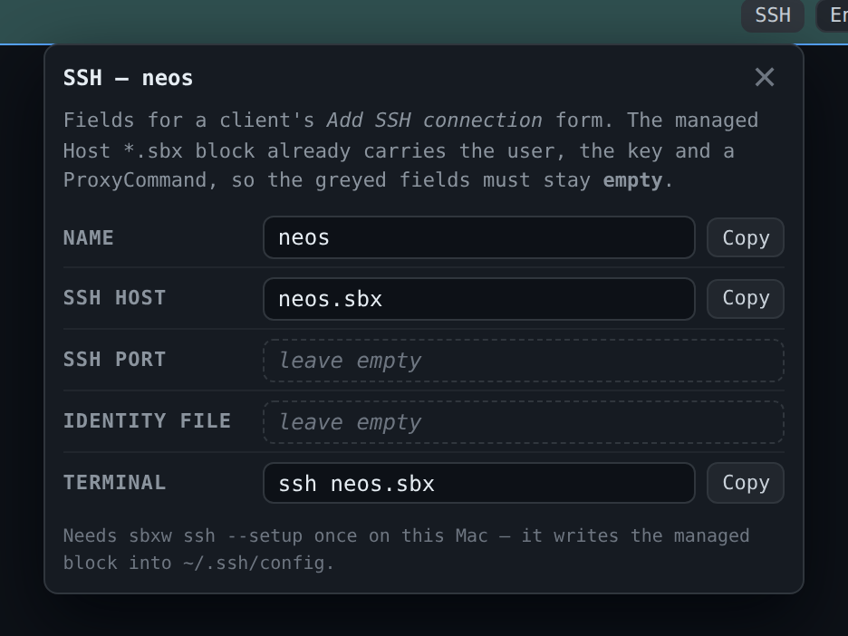

# SSH (experimental)

[← Back to README](../README.md)

Sandboxes can be SSH targets. Register the host block once, and every sandbox
answers at `<name>.sbx`:

```bash
sbxw ssh --setup              # once (wraps `sbx setup ssh`)
sbxw ssh neos                 # interactive shell
sbxw ssh neos -- git status   # one command
```

`--setup` writes a managed, sbx-owned `Host *.sbx` block into your SSH config.
It matches no host you already have, and it's safe to re-run.

**The installer does this for you.** Run interactively, it asks (default yes).
Piped (`curl … | sh`), it applies the same default, since otherwise the web UI's
SSH button and `sbxw ssh` would fail on most installs. `SBXW_SETUP_SSH=0` leaves
your SSH config alone; `SBXW_SETUP_SSH=1` configures it without asking.

## What SSH adds over `sbxw bash`

- **It starts things for you.** The connection brings up the sbx daemon and the
  sandbox on demand, so it works on a stopped sandbox. The web UI's **Bash** on a
  stopped sandbox uses it for that reason.
- **Remote development.** Any OpenSSH-compatible tool can attach: VS Code,
  Cursor, Claude Desktop.

```bash
code --remote ssh-remote+neos.sbx /workspace
```



**Claude Desktop:** *Add SSH connection* → put `neos.sbx` in **SSH Host** and
leave **SSH Port** and **Identity File** empty. The managed block supplies the
user, key and a ProxyCommand; sandboxes don't listen on TCP 22, so filling
those fields breaks the connection. The web UI's **SSH** button gives each field
with a copy button.

Sessions started over SSH show up in the [island](island.md#several-agents-in-one-sandbox)
as their own rows.

## Troubleshooting

If the connection fails and `~/.ssh/config` has no `*.sbx` entry, sbxw says so
and points at `--setup`. SSH access is experimental in sbx and may need enabling
in your sbx installation first.
