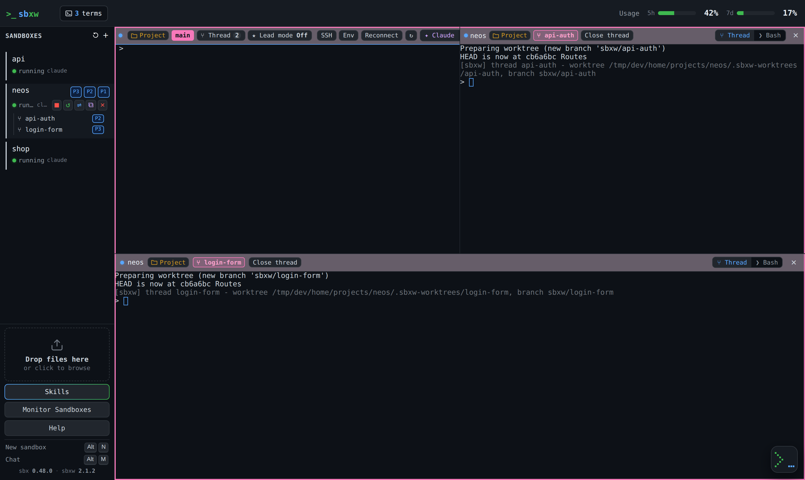
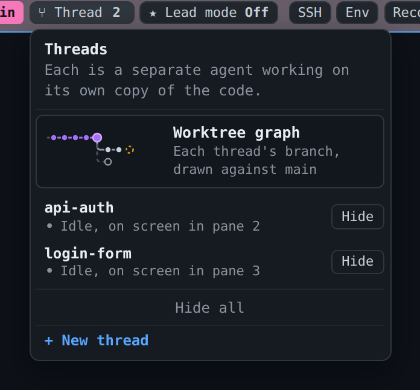
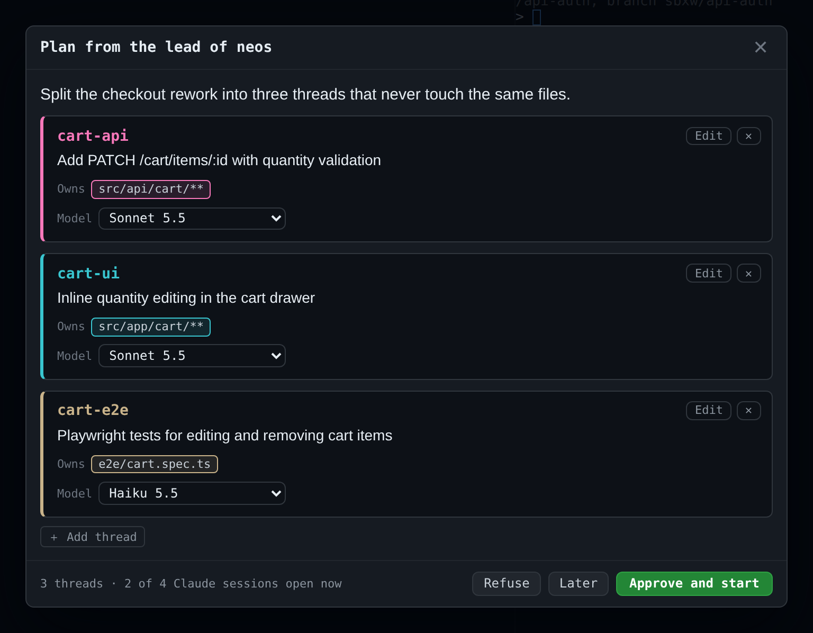

# Threads and the lead

[← Back to README](../README.md)

- [Threads: several agents in one sandbox](#threads)
- [The worktree graph](#the-worktree-graph)
- [The lead: plan, approve, follow, merge](#the-lead)
- [Reference](#reference)

## Threads

Claude already splits work inside a session, with subagents, but you can't
watch or steer them. A **thread** is the visible version: another Claude
session in the same sandbox, in its own pane, working on one thing.



Two agents editing one checkout overwrite each other's files. So each thread
gets its own **git worktree** and **branch**:

```
<repo>/.sbxw-worktrees/<thread>   on branch   sbxw/<thread>
```

### Opening a thread

**⑂ Thread** on the main pane's bar opens a dialog:


- **Name:** lower-case letters, digits and hyphens.
- **Repository:** when the workspace holds several repos one level down
  (`~/dev/shop/{backend,frontend}`), pick the one the thread works in.
- **Model:** from `models` in `sbxw.toml` (Sonnet, Opus, Haiku by default).

The thread opens in the first empty pane, or a new one while the window has
room. The first open creates the worktree from the repo's current `HEAD`;
later opens land back in it, uncommitted work included.

### Working with threads



Once a sandbox has threads, **⑂ Thread** shows their count (amber when one is
blocked) and opens a menu: each thread with its state, a click to go to it,
**Show** / **Hide** for its pane, and **+ New thread**. The sidebar lists the
same threads under the sandbox.

- **A thread's pane** has **⑂ Thread** (its agent) and **❯ Bash** (a shell in
  its worktree). The bar says `⑂ <name>`, outlined; the main pane says `main`,
  filled. A sandbox's panes share one colour and sit together.
- **Hiding** closes the pane, never the session. The pane's ✕ leaves the thread
  running too.
- **Reopened, it picks up where it was.** After a daemon or sandbox restart, a
  thread resumes its conversation: by its session id, read from Claude Code's
  session registry by the thread's name and worktree (`claude --resume`), or
  `claude --continue` for an older one. A plan's thread with nothing to resume
  starts again with its goal, scope and rules, told it is a restart; it never
  comes back blank.
- **One live session per thread.** A second open (another pane, the desktop
  and the web together) attaches to the same terminal. A daemon restart ends
  sbxw's terminals but not always the session behind one: `sbx exec`'s
  process can outlive its client and go on working unseen. Reopening the
  thread then finds that session (same name, same worktree, a live process
  whose environment says `SBXW_THREAD=<thread>` and whose command line says
  `--name <thread>`), stops it (`SIGTERM`, then `SIGKILL` after 10 s; if it
  still does not stop, the open is refused rather than start a second one),
  and resumes its conversation in the new pane with a first message saying
  it was interrupted and that its uncommitted edits are still on disk, to
  read `git status` and `git diff` before going on. This happens only when
  sbxw holds no terminal for the thread: while it does, every open attaches
  to that terminal and runs nothing in the sandbox.
- **A stopped sandbox comes back** when you open one of its threads: sbxw
  starts it directly (`sbx exec` starts a stopped sandbox, sbx 0.50) after
  releasing any busy host port, then opens the thread. The main session is
  not opened for it.
- **Ceiling:** `max_agent_sessions` (default 4) counts the agent plus open
  threads. They share CPU, memory and your usage. The agent is never refused;
  a new thread over the limit is, with the reason in its pane.

### Closing a thread

**Close thread** in its pane bar first shows what would be lost: the worktree
path, its uncommitted files (you must tick them off), and whether its branch
has commits the main branch lacks. A branch with nothing new is deleted by
default; one with unmerged commits is kept unless you tick it. Closing stops
every process in the worktree, then runs `git worktree remove` and, if asked,
`git branch -D`.

**Nothing is removed for you.** Closing is always a click, and merging is yours
to do (or the lead's [one-click merge](#3-one-click-merge)).

## The worktree graph

The Thread menu opens on a miniature of it. Click it for the full view:


- The top lane is the lead's branch (the one the repo's main checkout is on,
  and where merges land).
- Each thread forks off it: commits as dots, uncommitted work as a dashed amber
  ring, a merged thread in green.
- Beside each lane, in words: `2 to merge`, `4 behind main`, `1 uncommitted`,
  `✓ merged into main`, `no commits yet`.

It refreshes every 4 s while open. Below 640px it keeps the words and drops the
drawing. It's read with git on the host, so it works on a stopped sandbox, and
with `--no-optional-locks`, so it never holds the lock a thread needs to commit.

## The lead

Opening threads by hand means you do the splitting. **★ Lead mode** on the main
pane's bar makes the main session do it: sbxw types `/lead` into it. It asks
what you want done, reads the repo, and proposes a **plan**: a few threads,
each with a name, a goal and the files it owns.

As lead it **does not code**. It plans, follows the threads, reviews their
branches, and proposes the merge.

### Team mode: split or shared

Each plan has a **variant**, which the lead picks with a one-line
justification shown in the plan dialog. You can change it before approving;
not after.

| | split | shared |
|---|---|---|
| Worktrees | one per thread, `.sbxw-worktrees/<thread>` | one for all, `.sbxw-worktrees/team-<plan>` |
| Branches | `sbxw/<thread>` each | one, `sbxw/team-<plan>` |
| Threads see each other's work | at merge | as it is written |
| Dev server | one per worktree, if any | one, in the main pane's Bash, from the shared worktree |
| Merge | each branch, in order | the one branch, once every thread is done |
| Pick it when | the work streams are independent, long, or risky (one may be thrown away) | threads touch overlapping files, must integrate live, or share a dev server |

A shared plan trades merge conflicts for live ones: two threads in one
worktree can step on each other's files. Its threads are told to edit and
commit only their scope (`git commit -- <paths>`, never `git add -A`,
`git commit -a` or `git stash`), and the lead arbitrates. All of a shared
plan's threads work in one repo; a proposal naming two is refused.
`max_agent_sessions` counts sessions the same way in both variants.

```
★ lead ──propose_plan──▶ sbxw ──▶ 🧑 plan dialog (edit, approve)
  ▲                                     │
  │                  ┌──────────────────┼──────────────────┐
  │                  ▼                  ▼                  ▼
  │            ⑂ cart-api          ⑂ cart-ui            (…)
  │                  │ report_thread_status ──▶ sbxw ──▶ the thread's chip
  └── SendMessage ───┘ (blocked, done, answers: Claude Code, not sbxw)
```

### 1. You approve the plan



When the main checkout has uncommitted changes, the dialog says so first:
"N uncommitted changes in the main checkout will not be in the threads'
worktrees: commit them first if the plan depends on them". The threads'
branches are cut from `HEAD`. The count is read on the host when the plan is
proposed (`main_uncommitted` on the plan), so files a sandbox merely does not
mount are not counted.

Nothing starts without you. Edit any thread's name, goal, scope, repo or model;
remove or add threads; check the variant against the lead's justification; then **Approve and start**, **Refuse** (final), or
**Later** (**Review plan** on the main pane brings it back). Approval is
refused if the threads wouldn't fit under `max_agent_sessions`.

### 2. The threads work

On approval, sbxw opens each thread with a **briefing** as its first message:
its goal, its scope, and the rules (commit on your branch, never merge or push,
report your state). The briefing also carries the standing rules that hold in
every repository (`STANDING_RULES` in `crates/core/src/messages.rs`, about 440
characters): commit at each stable point, check `git merge-tree --write-tree`
against main before reporting done, do nothing if another session of the same
name already works in the worktree, send what the lead must read by
`SendMessage`, and stop at a refused hook, a blocked host or a pending
approval. A repository's own rules (build commands, what not to touch) go in
its root `CLAUDE.md`, which every session reads by itself; sbxw's own is the
example. The lead's goal then says only what is specific to the thread.

- **A thread knows its state at every session start.** Sessions restart (a
  daemon restart, a compaction). sbxw installs a `SessionStart` hook,
  `~/.sbxw/thread-start.js`, that acts only in a thread (`SBXW_THREAD` set) and
  gives the session, as context: its name, branch and tip, `git status
  --short` (30 lines at most), scratch worktrees registered under its
  worktree, leftover `target*` dirs, whether main has commits the branch
  lacks, and "commit before long builds". Read-only git, about 2 seconds at
  most, silent on any error. It is written with the relay at each bring-up:
  an existing sandbox gets it with `sbxw up <sandbox>`.
- **Threads report to sbxw** with `report_thread_status`. The chip shows the
  state: `…` starting, `●` working, `?` blocked, `✓` done, `✕` failed. Hover for
  the report.
- **A thread that cannot start is failed, with the reason.** sbxw makes the
  worktree first, on its own (`THREAD_PREPARE_SCRIPT`), then starts the
  session. Whatever stops it (no repo, a workspace root the agent cannot
  write, `git worktree add` refusing, the session ceiling, a session that
  ends before the thread ever reported) sets the thread to `✕` failed with
  the reason, which `plan_status` gives the lead and the chip's hover gives
  you (`sbxw could not start it: …`). Opening the thread again, once the
  cause is fixed, retries it and clears the failure; the briefing waits for
  that retry. A thread already done is never set back to failed.
- **The worktree folder is never forced.** When `<repo>/.sbxw-worktrees`
  cannot be created, sbxw says so in plain words, and when `.git` is a
  separate mount from the workspace root it adds that the sandbox most
  likely mounts only some of the workspace's folders. It does not use `sudo`
  or a folder elsewhere: a worktree outside the mounted repository would
  live in the container only, unseen by the host's git and lost with the
  sandbox.
- **A workspace split by a strict carve cannot hold threads.** A strict
  [carve](configuration.md#carving-a-folder-out) of a folder inside the
  workspace mounts the workspace folder by folder: the files beside those
  folders are missing, and nothing can be created at its root, so
  `.sbxw-worktrees` cannot be made and git in the sandbox sees the missing
  tracked files as deleted. When sbxw created the sandbox that way, a thread
  that cannot start and a merge refused for missing files say so, and point
  to `enforce = "soft"`, which keeps the repository whole.
- **Threads talk to the lead directly**, with Claude Code's own `SendMessage`
  between sessions of the sandbox. A thread runs as `claude --name <thread>`,
  so the lead knows its address in advance; each briefing gives the lead's
  name. If that messaging isn't available, sbxw types a note into the main
  session instead.
- **In a shared plan**, every thread opens in the plan's worktree, made by the
  first one to start, with `SBXW_TEAM=shared` and `SBXW_TEAM_PLAN=<plan id>` in
  its environment. A thread reopened after a restart resumes its own
  conversation by session id, never with `--continue`: the threads share one
  folder, so "the last conversation in it" could be another thread's. With no
  conversation of its own to resume, it starts again with its briefing.
- All sessions run with `--dangerously-skip-permissions`. If you change the
  lead's permission mode, Claude Code holds messages between them for approval.

- **When a thread will not report done** (its session is gone, or it told
  only the lead), the lead can mark it done with `mark_thread_done`, after
  reviewing its work and with a note saying what it checked. This only lets
  the lead propose the merge, which you still approve; the plan records it
  (`set_by: "lead"`) and the merge view shows the thread as
  `marked done by the lead`, the note on hover. A thread that reports again
  replaces the mark; a thread that reported done itself keeps its own report.

### 3. One-click merge

Before proposing a merge, the lead runs `scripts/lead-review.sh <thread>
[--scope <path>...]` in this repository (read-only, no build, a fraction of a
second). For branch `sbxw/<thread>` it prints, in a stable order: the commits
on top of main, `git diff --stat main...`, CLEAN or the conflicting files
against main and against every other live `sbxw/*` branch with commits of its
own (`git merge-tree --write-tree`), the files changed outside the scope
paths, whether the thread's worktree is dirty, leftovers in it
(`.sbxw-artifacts/` content, `target*` dirs, registered scratch worktrees),
and the added lines that log (`log::`, `tracing::`, `console.log`), so the
lead can check nothing sensitive is logged. It decides nothing; its exit code
is 0 except for a missing branch (2). `--main <ref>` picks another base.
`scripts/lead-review.sh --after-merge` lists the live thread branches with
how far ahead and behind main they are and their merge state against it. The
test is `tests/js/lead-review.test.mjs`, on a temporary repository.

When every thread is done, the lead calls `propose_merge` with an order and a
note. The plan dialog offers **Merge all**. For each thread, in order, sbxw:

1. checks the main checkout against the paths the merge changes (from the
   merge base to the branch), and refuses only when the merge could be harmed
   or harm your work: a merge, rebase, cherry-pick or revert under way;
   unresolved conflicts; staged changes (git itself will not merge into an
   index that differs from `HEAD`); uncommitted edits to a path the merge
   changes (named: commit or stash those); a path the merge changes that is
   missing from the working tree (see below),
2. runs `git merge --no-ff --no-edit sbxw/<thread>` inside the sandbox,
3. on conflict, runs `git merge --abort` and stops there.

Unstaged edits elsewhere stay in the working tree, out of the merge commit.
**Tracked files absent from the checkout** (`git status` shows ` D`, most
often because the sandbox mounts only part of the workspace) are left alone
when the merge does not touch them: they stay in the commit, since a merge
commit records the index plus the merge, and the result says how many were
absent. When the merge *does* touch one, it is refused with the files named:
the merge has to be done where the whole repository is present. sbxw never
advises committing those "deletions", which would delete real files.

With **close threads** ticked, merged threads are then closed and their branches
deleted. The lead is told the result in one line, e.g.
`[sbxw] Merged: a, b. Failed: c (conflict in X).` A failed merge can be retried
after fixing the cause.

**Main moved.** Once a merge has merged at least one thread, every other
thread of the sandbox with an open session (of this plan or another) is told
in one fixed line written by sbxw, e.g. ``[sbxw] main moved: a, b merged.
Check `git merge-tree --write-tree main HEAD` before you go on.`` (the branch
is the one merged into). It follows a team note's delivery rule: typed when
the thread is idle or working, held while it waits on a question or a
permission prompt, dropped when its session ended. The merged threads are not
told, and nothing is typed into a session of another sandbox. The lead's
merge line then ends with `Told that main moved: <threads>.` sbxw does not
say which of those branches now conflict: its merge checks look at the main
checkout against the paths a merge changes, not at one branch against
another, so the lead runs `scripts/lead-review.sh --after-merge` for that.

A **shared** plan has one branch: once every thread is done, **Merge** runs
`git merge --no-ff sbxw/team-<plan>` once, with the same checks. The lead's
proposal also carries a **distillate**: the decisions and warnings from the
work that still hold. You approve (or trim) them with the merge: each shows
as one line you can open to read or edit in full. sbxw then
writes them to the repo's Claude Code auto memory, as `team-<plan>.md` with a
line in its `MEMORY.md`, so the next session starts knowing them. With
**close threads** ticked, the threads' sessions are closed, then the shared
worktree and its branch.

### Leaving lead mode

The toggle reads **On**, in violet, while a session leads. Ending it (from the
web UI) refuses a pending plan and closes approved ones: their threads keep
running, but their reports no longer reach the main session. Restarting the
lead's session also removes the mark.

### The team's timeline

Each plan is a **team** (its sandbox, lead and threads), and sbxw keeps its
history as one timeline: the proposal, your approval or refusal and its
reason, every status report (not only the latest), a thread that could not
start, the lead marking a thread done, the merge proposal, your Merge click
and each result, the board's notes and claims, the relay requests the team
opened, and the commits of the team's branches. The desktop app's **Board**
shows it as a conversation.

It shows only what went through sbxw: what you type in a terminal never
reaches it. The messages the lead and its threads send each other with Claude
Code's own `SendMessage` are shown as **direct messages**: sbxw's status hook
already reports each tool call to the daemon, and for a delivered
`SendMessage` between two sessions of one team the daemon keeps only the
addressee and the words (2000 characters at most), pruned with the plan.
Nothing else of any tool call is kept, no transcript is read, and messages
sent before the daemon had this version are not recovered.

- `GET /api/teams`: every team, the latest active first, with its state
  (`proposed`, `running`, `done`, `merged`, `refused`, `closed`).
- `GET /api/teams/<plan>/timeline?limit=&before=&group=&thread=&q=` (groups
  also `messages`, the direct messages): a page
  of events, newest first (`before` is the last event id of the previous
  page; `limit` 1 to 500, 100 by default). Each event has `id`, `at` (ms, or
  null when not known), `kind`, `group` (`notes`, `questions`, `commits`,
  `status`, `claims`; `group=conversation` is all but claims), `from` (`user`, `lead`, `sbxw` or a thread), `to`,
  `text` (2000 characters at most) and a small `data`. The first page adds
  the team's commits per thread with their totals, and the board's
  decisions and warnings that still stand.
- The history is kept from this version on, in
  `~/.sbxw/state/plans/team/<sandbox>.json` (the plans' 0700 folder), and is
  pruned with its plan. A plan from before shows what its state holds, with
  "time unknown" where sbxw never recorded one.
- Relay requests appear as who asked whom, the outcome and the times, with
  their question and answer texts (2000 characters at most), kept with the
  plan and pruned with it. An image never is.
- **Team notes.** The lead and its threads have two relay tools for what
  you should be able to follow: `team_note {to, kind, text}` (`to`: `lead`,
  a thread, or `team`; `kind`: `info`, `warning` or `decision`) records the
  note on the team's timeline and types one line of sbxw's own into each
  addressee's open session saying a note waits (never the note's words);
  `read_team_notes` hands the caller its notes once, framed as another
  agent's data. Their decisions and warnings stand pinned beside the board's.
- Commits: each thread's branch against the main checkout, or once merged,
  the recorded merge commit's other side, so a thread's commits stay its own
  after the merge deletes its branch. No author email. A shared plan's
  commits are attributed to threads by the board's commit entries.
- New board entries carry their plan id; an older one is attributed by its
  time and author and marked as a guess.

### Trust

- **A person decides the plan and the merge.** Approve, refuse and merge exist
  only on the daemon's UI listener, which sandboxes can't reach. No agent can
  approve its own plan.
- **After approval, the lead and its threads write to each other without a
  click.** That's Claude Code's own messaging, and the sandbox is the boundary:
  any session in it can already write to any other. Nothing reaches another
  sandbox.
- A plan id is 128 random bits, seen only by the proposing session and the
  browser. A thread report carries no id and could be forged by another session
  in the same sandbox, but it only changes a label, never what runs.

## Reference

<details>
<summary>Thread details for the curious</summary>

- **Repos.** `GET /api/sandboxes/<name>/repos` lists the repos sbxw finds: the
  workspace itself when it's a repo, otherwise subfolders to depth 3 (skipping
  hidden folders, `node_modules`, `target`, `vendor`), each with branch,
  uncommitted count and ahead/behind. The choice is remembered in
  `~/.sbxw/state/threads/<sandbox>.json`. With no choice and several repos, the
  open is refused with the list.
- **No trust dialog.** Before starting `claude`, the thread marks its worktree
  trusted in `~/.claude.json`, the same way provisioning does for the workspace.
- **Model.** Passed as `claude --model <id>` on a fresh start and on a
  resume; checked against `^[a-z0-9][a-z0-9.\-]{0,63}$`.
  `GET /api/models` lists the choices, `GET /api/sandboxes/<name>/threads` gives
  each thread's model.
- **Worktree graph API.** `GET /api/sandboxes/<name>/worktrees` returns
  `{ok, workspace, repos: [{path, base, head, dirty, log, threads: [{name, branch, worktree, tip, fork, ahead, behind, dirty, commits, tip_subject, tip_at}], error}]}`.
  `tip_subject` and `tip_at` are the branch tip's subject and commit date
  (null without a branch); a branch with a tip and `ahead` 0 is merged.
- **Commit history API (read-only).** Git runs on the host with fixed
  arguments (the worktree graph's runner: `--no-optional-locks`, no program
  the repo's config names, a 5 s timeout), never a shell string; nothing is
  cached. Authors' names only: no email is asked of git or returned.
  - `GET /api/sandboxes/<name>/commits?limit=&before=&ref=`: a page of the
    commits of every repo under the workspace, all local branches (the
    threads' `sbxw/<thread>` included) and the main checkout's HEAD, newest
    first by commit date. `limit` 1 to 200 (default 50); `before` a hash (7
    to 64 lowercase hex: the page after it); `ref` one branch (`sbxw/<thread>`
    or a plain branch name; passed as `refs/heads/<ref>` after
    `--end-of-options`). Answer `{ok, available: true, workspace, repos,
    commits: [{hash, short, author, at, subject, body, branch, thread,
    merged, files, repo}], more, limits}`: `body` is its first 12 lines
    (2000 bytes), `branch` the ref it was reached from, `thread` the thread
    of a `sbxw/<thread>` branch, `merged` whether the main checkout's HEAD
    holds it, `files` the files it changed against its first parent. The
    walk goes 2000 commits deep per repo.
  - `GET /api/sandboxes/<name>/commits/<hash>`: `{ok, available: true,
    commit: {hash, short, author, at, subject, body, repo, files: [{path,
    added, removed, binary, patch, truncated}], files_more, truncated},
    truncated, limits}`. Caps: a file's patch 64 KiB, the whole 512 KiB
    (cut on a line), 300 files listed, a file over 4000 changed lines listed
    without its patch; binary files named, never dumped; `truncated` when
    anything was cut. The patch is asked only for the paths git itself
    listed, as literal pathspecs. 404 for a hash in no repo.
  - Not available (`{ok, available: false, reason, commits: []}`, status
    200): no workspace recorded, a remote host that cannot be reached, a
    workspace that is not a repository or that git on the host cannot read.
    A bad `limit`, hash or `ref` is a 400 before git runs. sbxw makes no
    `--clone` sandbox: the workspace is the host's folder, mounted at the
    same path, so what the host reads is the sandbox's whole history; the
    daemon never execs into a sandbox for it.
- **Exclude.** `.sbxw-worktrees/` is added to `.git/info/exclude`, not
  `.gitignore`.
- **Env changes.** `[env]` edits reach the agent on its next attach (`sbx run`
  applies them). A thread starts with `sbx exec` and is not guaranteed to see
  them.
- **The island** answers prompts for the main agent only. A thread's questions
  are answered in its pane.

</details>

<details>
<summary>Lead details for the curious</summary>

- **Tools.** The `sbxw-relay` MCP server gives the main session `propose_plan`,
  `check_plan`, `plan_status`, `propose_merge` and `mark_thread_done`; a thread gets
  `report_thread_status` instead. A session knows which it is from
  `SBXW_THREAD`. **★ Lead mode** installs `/lead` and refreshes the server first.
  A main session started before that keeps its old server: if `/lead` says it
  has no `propose_plan`, restart the session (`/exit`, reopen the pane).
- **The lead's name** is read by the relay server from Claude Code's session
  registry (`~/.claude/sessions/`) and sent with `propose_plan`.
- **Persistence.** Plans are written to `~/.sbxw/state/plans/<sandbox>.json`
  (directory `0700`) and survive a daemon restart. A plan whose threads are all
  done or failed is dropped a day after its last change. `GET /api/leads` lists
  which session leads.
- **Variant.** The plan carries `variant` (`split`, the default and what older
  plan files read as, or `shared`), `justification`, and for a shared plan
  `worktree`, the shared worktree's path, set on approval. `propose_plan` takes
  `variant` and `justification`; `POST /api/plans/<id>/approve` takes
  `{threads, variant?}`.
- **Who set a thread's state.** A thread carries `set_by` when it was not the
  thread itself: `"sbxw"` for a start that failed (`summary` is the reason),
  `"lead"` for a thread the lead marked done (`summary` is its note).
  `POST /api/plans/mark_done` (agent listener) takes `{id, thread, note}`.
- **Merge state.** The plan carries
  `merge: {order, note, state, base, results, distillate}`; `state` goes
  `proposed` → `merging` → `merged` or `failed`. A shared plan's `order` is every
  thread and its `results` hold one entry, named `team-<plan>`. `distillate` is
  `[{kind: "decision" | "warning", text}]`. `POST /api/plans/<id>/merge` with
  `{close_threads, distillate?}` runs it; `distillate`, when given, replaces the
  proposed one.
- **End.** `POST /api/sandboxes/<name>/lead/end`.

</details>
