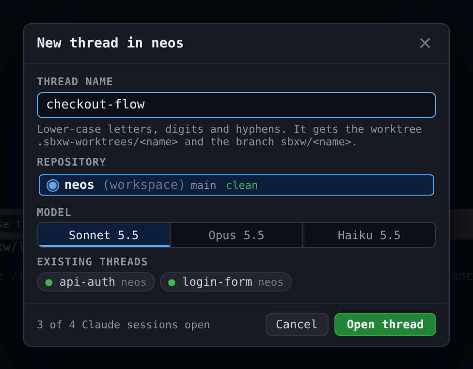
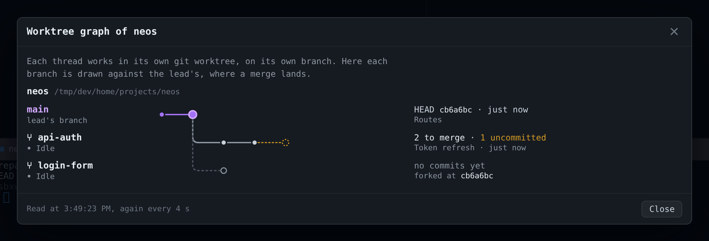

# Threads and the lead

[← Back to README](../README.md)

- [Threads: several agents in one sandbox](#threads)
- [The worktree graph](#the-worktree-graph)
- [The lead: plan, approve, follow, merge](#the-lead)
- [Reference](#reference)

## Threads

Claude already splits work inside a session, with subagents, but you can't
watch or steer them. A **thread** is the visible version: another Claude
session in the same sandbox, in its own pane, working on one thing.


Two agents editing one checkout overwrite each other's files. So each thread
gets its own **git worktree** and **branch**:

```
<repo>/.sbxw-worktrees/<thread>   on branch   sbxw/<thread>
```

### Opening a thread

**⑂ Thread** on the main pane's bar opens a dialog:



- **Name:** lower-case letters, digits and hyphens.
- **Repository:** when the workspace holds several repos one level down
  (`~/dev/shop/{backend,frontend}`), pick the one the thread works in.
- **Model:** from `models` in `sbxw.toml` (Sonnet, Opus, Haiku by default).

The thread opens in the first empty pane, or a new one while the window has
room. The first open creates the worktree from the repo's current `HEAD`;
later opens land back in it, uncommitted work included.

### Working with threads


Once a sandbox has threads, **⑂ Thread** shows their count (amber when one is
blocked) and opens a menu: each thread with its state, a click to go to it,
**Show** / **Hide** for its pane, and **+ New thread**. The sidebar lists the
same threads under the sandbox.

- **A thread's pane** has **⑂ Thread** (its agent) and **❯ Bash** (a shell in
  its worktree). The bar says `⑂ <name>`, outlined; the main pane says `main`,
  filled. A sandbox's panes share one colour and sit together.
- **Hiding** closes the pane, never the session. The pane's ✕ leaves the thread
  running too.
- **Reopened, it picks up where it was.** After a daemon or sandbox restart, a
  thread resumes its conversation: by its session id, read from Claude Code's
  session registry by the thread's name and worktree (`claude --resume`), or
  `claude --continue` for an older one. A plan's thread with nothing to resume
  starts again with its goal, scope and rules, told it is a restart; it never
  comes back blank.
- **One live session per thread.** A second open (another pane, the desktop
  and the web together) attaches to the same terminal. A daemon restart ends
  sbxw's terminals but not always the session behind one: `sbx exec`'s
  process can outlive its client and go on working unseen. Reopening the
  thread then finds that session (same name, same worktree, a live process
  whose environment says `SBXW_THREAD=<thread>` and whose command line says
  `--name <thread>`), stops it (`SIGTERM`, then `SIGKILL` after 10 s; if it
  still does not stop, the open is refused rather than start a second one),
  and resumes its conversation in the new pane with a first message saying
  it was interrupted and that its uncommitted edits are still on disk, to
  read `git status` and `git diff` before going on. This happens only when
  sbxw holds no terminal for the thread: while it does, every open attaches
  to that terminal and runs nothing in the sandbox.
- **A stopped sandbox comes back** when you open one of its threads: sbxw
  starts it directly (`sbx exec` starts a stopped sandbox, sbx 0.50) after
  releasing any busy host port, then opens the thread. The main session is
  not opened for it.
- **Ceiling:** `max_agent_sessions` (default 4) counts the agent plus open
  threads. They share CPU, memory and your usage. The agent is never refused;
  a new thread over the limit is, with the reason in its pane.

### Closing a thread

**Close thread** in its pane bar first shows what would be lost: the worktree
path, its uncommitted files (you must tick them off), and whether its branch
has commits the main branch lacks. A branch with nothing new is deleted by
default; one with unmerged commits is kept unless you tick it. Closing stops
every process in the worktree, then runs `git worktree remove` and, if asked,
`git branch -D`.

**Both clients follow.** However a thread ends (the Close dialog of the web
or the desktop app, the chat dock's ×, a [one-click merge](#3-one-click-merge)
that closes the threads), the daemon publishes one `thread-closed` event on
`/api/stream`, `{ "sandbox", "thread" }`, names only, once per thread, when
`App::close_thread` is done. Every client open at the time drops that
thread's panes and its row (the web: `afterThreadClosed` in `panes.js`; the
desktop: the threads feature's `on_event`, Lead Mode's parked panes
included) and says "Thread X was closed" quietly when the close was not its
own. Closing only a **pane** is a change of view: it stays in that client and
the thread keeps running. Ending the lead's mode, a session that exits by
itself and stopping a sandbox do not close threads and publish no such
event.

**Nothing is removed for you.** Closing is always a click, and merging is yours
to do (or the lead's [one-click merge](#3-one-click-merge)).

## The worktree graph

The Thread menu opens on a miniature of it. Click it for the full view:



- The top lane is the lead's branch (the one the repo's main checkout is on,
  and where merges land).
- Each thread forks off it: commits as dots, uncommitted work as a dashed amber
  ring, a merged thread in green.
- Beside each lane, in words: `2 to merge`, `4 behind main`, `1 uncommitted`,
  `✓ merged into main`, `no commits yet`.

It refreshes every 4 s while open. Below 640px it keeps the words and drops the
drawing. It's read with git on the host, so it works on a stopped sandbox, and
with `--no-optional-locks`, so it never holds the lock a thread needs to commit.

## The lead

Opening threads by hand means you do the splitting. **★ Lead mode** on the main
pane's bar makes the main session do it: sbxw types `/lead` into it. It asks
what you want done, reads the repo, and proposes a **plan**: a few threads,
each with a name, a goal and the files it owns.

### Turning Team on: waiting, activating, leading

"Team on" means a session really leads, and the toggle says where it stands:

- **Waiting**: you pressed Team while the agent was busy or at a prompt. sbxw
  types `/lead` only into an idle agent (the phone's rule: its turn over, no
  question or permission prompt, no tool call in the last seconds, bracketed
  paste on), and does so as soon as it is idle. After 10 minutes it gives up
  and Team is off, with the reason.
- **Activating** (the toggle says Starting): `/lead` was typed. The session's
  first instruction is to call `lead_ack` (relay tool); only that call turns
  Team on. No call within 90 seconds: Team is off, with the reason.
- **Leading** (On): the session confirmed. `lead_ack`'s answer names the plans
  it follows again, if any (see "Turning Team on again").

Clicking the toggle while it waits or activates cancels. A `/lead` you type by
hand creates no lead: `lead_ack` refuses it and tells the agent to ask you to
press Team. A thread's `lead_ack` is refused too.

**`/clear` and compaction.** When the lead's main session starts a new
conversation in its own terminal (a `/clear`, a compaction, a resume), sbxw's
status hook gives that conversation its lead instructions again as additional
context: that it leads, the open plans and where each thread stands, and
lead.md (inline when it fits Claude Code's context limit, else the path of the
installed `/lead` command to read). The lead's record follows the new
conversation, and the state goes back to activating until it calls `lead_ack`
again. Its clock is not the 90 seconds of a Team click: the context starts no
turn, so a conversation at its prompt stays activating, with no deadline,
until its next turn starts (your next prompt; a compaction in the middle of a
turn waits for the next one too). Once a turn of that conversation has run and
ended (`Stop`) with no `lead_ack`, Team falls back to off 15 seconds later,
with the reason. It never drops while the session had no chance to answer. This only keeps a lead that exists; it never creates one, and a
thread's session (`SBXW_THREAD` set) never gets it.

A plan under way with no session leading it (Team off, or a lead that fell
back) shows as **No lead** on the toggle; clicking it resumes the lead.

As lead it **does not code**. It plans, follows the threads, reviews their
branches, and proposes the merge.

### Team mode: split or shared

Each plan has a **variant**, which the lead picks with a one-line
justification shown in the plan dialog. You can change it before approving;
not after.

| | split | shared |
|---|---|---|
| Worktrees | one per thread, `.sbxw-worktrees/<thread>` | one for all, `.sbxw-worktrees/team-<plan>` |
| Branches | `sbxw/<thread>` each | one, `sbxw/team-<plan>` |
| Threads see each other's work | at merge | as it is written |
| Dev server | one per worktree, if any | one, in the main pane's Bash, from the shared worktree |
| Merge | each branch, in order | the one branch, once every thread is done |
| Pick it when | the work streams are independent, long, or risky (one may be thrown away) | threads touch overlapping files, must integrate live, or share a dev server |

A shared plan trades merge conflicts for live ones: two threads in one
worktree can step on each other's files. Its threads are told to edit and
commit only their scope (`git commit -- <paths>`, never `git add -A`,
`git commit -a` or `git stash`), and the lead arbitrates. All of a shared
plan's threads work in one repo; a proposal naming two is refused.
`max_agent_sessions` counts sessions the same way in both variants.

```
★ lead ──propose_plan──▶ sbxw ──▶ 🧑 plan dialog (edit, approve)
  ▲                                     │
  │                  ┌──────────────────┼──────────────────┐
  │                  ▼                  ▼                  ▼
  │            ⑂ cart-api          ⑂ cart-ui            (…)
  │                  │ report_thread_status ──▶ sbxw ──▶ the thread's chip
  └── SendMessage ───┘ (blocked, done, answers: Claude Code, not sbxw)
```

### 1. You approve the plan


When the main checkout has uncommitted changes, the dialog says so first:
"N uncommitted changes in the main checkout will not be in the threads'
worktrees: commit them first if the plan depends on them". The threads'
branches are cut from `HEAD`. The count is read on the host when the plan is
proposed (`main_uncommitted` on the plan), so files a sandbox merely does not
mount are not counted.

Nothing starts without you. Edit any thread's name, goal, scope, repo or model;
remove or add threads; check the variant against the lead's justification; then **Approve and start**, **Refuse** (final), or
**Later** (**Review plan** on the main pane brings it back). Approval is
refused if the threads wouldn't fit under `max_agent_sessions`.

### 2. The threads work

On approval, sbxw opens each thread with a **briefing** as its first message:
its goal, its scope, and the rules (commit on your branch, never merge or push,
report your state). The briefing also carries the standing rules that hold in
every repository (`STANDING_RULES` in `crates/core/src/messages.rs`, under 600
characters): commit at each stable point, check `git merge-tree --write-tree`
against main before reporting done, do nothing if another session of the same
name already works in the worktree, send what the lead must read by
`SendMessage`, stop at a refused hook, a blocked host or a pending
approval, and, when the plan has a test command, commit and call `run_tests`
rather than running the whole battery by hand. A repository's own rules (build commands, what not to touch) go in
its root `CLAUDE.md`, which every session reads by itself; sbxw's own is the
example. The lead's goal then says only what is specific to the thread.

- **A thread knows its state at every session start.** Sessions restart (a
  daemon restart, a compaction). sbxw installs a `SessionStart` hook,
  `~/.sbxw/thread-start.js`, that acts only in a thread (`SBXW_THREAD` set) and
  gives the session, as context: its name, branch and tip, `git status
  --short` (30 lines at most), scratch worktrees registered under its
  worktree, leftover `target*` dirs, whether main has commits the branch
  lacks, and "commit before long builds". Read-only git, about 2 seconds at
  most, silent on any error. It is written with the relay at each bring-up:
  an existing sandbox gets it with `sbxw up <sandbox>`.
- **Threads report to sbxw** with `report_thread_status`. The chip shows the
  state: `…` starting, `●` working, `?` blocked, `✓` done, `✕` failed. Hover for
  the report.
- **A thread that cannot start is failed, with the reason.** sbxw makes the
  worktree first, on its own (`THREAD_PREPARE_SCRIPT`), then starts the
  session. Whatever stops it (no repo, a workspace root the agent cannot
  write, `git worktree add` refusing, the session ceiling, a session that
  ends before the thread ever reported) sets the thread to `✕` failed with
  the reason, which `plan_status` gives the lead and the chip's hover gives
  you (`sbxw could not start it: …`). Opening the thread again, once the
  cause is fixed, retries it and clears the failure; the briefing waits for
  that retry. A thread already done is never set back to failed.
- **The worktree folder is never forced.** When `<repo>/.sbxw-worktrees`
  cannot be created, sbxw says so in plain words, and when `.git` is a
  separate mount from the workspace root it adds that the sandbox most
  likely mounts only some of the workspace's folders. It does not use `sudo`
  or a folder elsewhere: a worktree outside the mounted repository would
  live in the container only, unseen by the host's git and lost with the
  sandbox.
- **A workspace split by a strict carve cannot hold threads.** A strict
  [carve](configuration.md#carving-a-folder-out) of a folder inside the
  workspace mounts the workspace folder by folder: the files beside those
  folders are missing, and nothing can be created at its root, so
  `.sbxw-worktrees` cannot be made and git in the sandbox sees the missing
  tracked files as deleted. When sbxw created the sandbox that way, a thread
  that cannot start and a merge refused for missing files say so, and point
  to `enforce = "soft"`, which keeps the repository whole.
- **Threads talk to the lead directly**, with Claude Code's own `SendMessage`
  between sessions of the sandbox. A thread runs as `claude --name <thread>`,
  so the lead knows its address in advance; each briefing gives the lead's
  name. If that messaging isn't available, sbxw types a note into the main
  session instead.
- **In a shared plan**, every thread opens in the plan's worktree, made by the
  first one to start, with `SBXW_TEAM=shared` and `SBXW_TEAM_PLAN=<plan id>` in
  its environment. A thread reopened after a restart resumes its own
  conversation by session id, never with `--continue`: the threads share one
  folder, so "the last conversation in it" could be another thread's. With no
  conversation of its own to resume, it starts again with its briefing.
- All sessions run with `--dangerously-skip-permissions`. If you change the
  lead's permission mode, Claude Code holds messages between them for approval.

- **When a thread will not report done** (its session is gone, or it told
  only the lead), the lead can mark it done with `mark_thread_done`, after
  reviewing its work and with a note saying what it checked. This only lets
  the lead propose the merge, which you still approve; the plan records it
  (`set_by: "lead"`) and the merge view shows the thread as
  `marked done by the lead`, the note on hover. A thread that reports again
  replaces the mark; a thread that reported done itself keeps its own report.

### 3. One-click merge

Before proposing a merge, the lead runs `scripts/lead-review.sh <thread>
[--scope <path>...]` in this repository (read-only, no build, a fraction of a
second). For branch `sbxw/<thread>` it prints, in a stable order: the commits
on top of main, `git diff --stat main...`, CLEAN or the conflicting files
against main and against every other live `sbxw/*` branch with commits of its
own (`git merge-tree --write-tree`), the files changed outside the scope
paths, whether the thread's worktree is dirty, leftovers in it
(`.sbxw-artifacts/` content, `target*` dirs, registered scratch worktrees),
and the added lines that log (`log::`, `tracing::`, `console.log`), so the
lead can check nothing sensitive is logged. It decides nothing; its exit code
is 0 except for a missing branch (2). `--main <ref>` picks another base.
`scripts/lead-review.sh --after-merge` lists the live thread branches with
how far ahead and behind main they are and their merge state against it. The
test is `tests/js/lead-review.test.mjs`, on a temporary repository.

When every thread is done, the lead calls `propose_merge` with an order and a
note. The plan dialog offers **Merge all**. For each thread, in order, sbxw:

1. checks the main checkout against the paths the merge changes (from the
   merge base to the branch), and refuses only when the merge could be harmed
   or harm your work: a merge, rebase, cherry-pick or revert under way;
   unresolved conflicts; staged changes (git itself will not merge into an
   index that differs from `HEAD`); uncommitted edits to a path the merge
   changes (named: commit or stash those); a path the merge changes that is
   missing from the working tree (see below),
2. runs `git merge --no-ff --no-edit sbxw/<thread>` inside the sandbox,
3. on conflict, runs `git merge --abort` and stops there.

**Nothing to merge.** Before that, sbxw asks git on the host about each
thread of the order. A thread whose branch is already in the base (a
read-only study with no commit of its own, or a branch merged by hand) or
whose branch is gone (you closed the thread by hand after the lead proposed
it) is settled as merged with nothing: no merge runs for it, its row says
`merged`, the result's note says `nothing to merge, sbxw/<thread> is already
in main` or `... is gone`, the merge goes on with the others, and with close
threads ticked it is closed like them. A proposal naming only such threads
settles at the first click instead of failing at every retry with "there is
no branch". A branch with even one commit its base lacks is never settled
this way (git's `merge-base --is-ancestor` decides), so closing never
deletes unmerged work; a repo git cannot read on the host is unknown, and its
thread is merged as before.

Unstaged edits elsewhere stay in the working tree, out of the merge commit.
**Tracked files absent from the checkout** (`git status` shows ` D`, most
often because the sandbox mounts only part of the workspace) are left alone
when the merge does not touch them: they stay in the commit, since a merge
commit records the index plus the merge, and the result says how many were
absent. When the merge *does* touch one, it is refused with the files named:
the merge has to be done where the whole repository is present. sbxw never
advises committing those "deletions", which would delete real files.

With **close threads** ticked (the box is ticked by default, in the desktop
app as in the web UI), merged threads are then closed: each session is
ended, its worktree removed and its branch deleted. Every app drops the
thread's pane when it hears the close. A pane that missed it still does not
start the thread again when its terminal reconnects: for ten minutes after a
close, sbxw refuses a reconnect of that session, and the pane shows
`'<thread>' was closed, so a reconnect does not open it again: close this
pane. To start a thread of that name again, use New thread`. A deliberate
start is not refused: a New thread of that name (its first open carries its
repo, model or checkout choice) or a plan approved with that name starts it
at once. One case cannot be told from a reconnect: a New thread opened with
no choice at all (no repo list could be read, default model); it is refused
for those ten minutes. The lead is told the
result in one line, e.g. `[sbxw] Merged: a, b. Closed: a, b.` or
`[sbxw] Merged: a, b. Failed: c (conflict in X).`; a thread whose close
failed is named with the reason (`Not closed: b (... has 2 uncommitted
file(s)).`) and keeps its session, worktree and branch. A failed merge can be
retried after fixing the cause.

**Abandon merge.** A merge that will never be made (a study with nothing to
keep, work you decided against) can be given up: **Abandon merge**, a quiet
button beside Not now in the plan dialog (desktop app and web UI), shown
while the merge is proposed or failed, never while it runs. It asks first
(`Abandon the proposed merge? Nothing is merged, and the threads, their
branches and worktrees stay as they are. The lead is told.`), then the
daemon withdraws it: the merge's `state` becomes `abandoned`, with
`abandoned_ms`, and the plan's log records that you did it. Nothing is
merged, closed or deleted (closing stays each thread's Close); a thread a
failed merge already merged stays merged. The plan no longer has a merge to
do, so the pane bar's Merge or Retry merge button goes; the dialog shows the
plan with `You abandoned this merge: nothing was merged.` and Close. On the
Kanban, a done thread of that merge goes back to Test with the mark `merge
abandoned` (or stays in Merged with `branch gone` when git shows its branch
gone); the Threads view lists the plan as `Plan: n of n threads done, merge
abandoned`. The lead is told in one line, `[sbxw] The user abandoned the
proposed merge of "<plan summary>": nothing was merged. ...` (the threads
when the plan has no summary), so it does not wait; it may call
`propose_merge` again, which is a fresh proposal. Abandon merge is the
person's only: its route is on the UI listener, and no agent tool reaches it.
The phone lists only proposed merges, so an abandoned one leaves its
approvals, and its Kanban shows the same mark.

**A thread that finishes late can still be merged.** In a split plan, once
some threads are merged, a thread that reports done later (or that the lead
marks done) gets a merge of its own: the lead calls `propose_merge` again,
naming only the done threads not merged yet, and the plan dialog offers it
like the first. A thread sbxw already merged is refused (`thread "a" is
already merged`), so nothing is merged twice. The earlier merge and its
results stay in the plan's history (`earlier_merges`). A shared plan has one
branch and stays one merge.

**Main moved.** Once a merge has merged at least one thread, every other
thread of the sandbox with an open session (of this plan or another) is told
in one fixed line written by sbxw, e.g. ``[sbxw] main moved: a, b merged.
Check `git merge-tree --write-tree main HEAD` before you go on.`` (the branch
is the one merged into). It goes through the thread's inbox (see
[relay.md](relay.md#the-inbox-how-sbxw-hands-an-agent-text)): printed by its
status hook at its next tool call, never typed into a busy session. A thread
whose session ended is not told. The merged threads are not told, and no
session of another sandbox is. The lead's
merge line then ends with `Told that main moved: <threads>.` sbxw does not
say which of those branches now conflict: its merge checks look at the main
checkout against the paths a merge changes, not at one branch against
another, so the lead runs `scripts/lead-review.sh --after-merge` for that.

A **shared** plan has one branch: once every thread is done, **Merge** runs
`git merge --no-ff sbxw/team-<plan>` once, with the same checks. The lead's
proposal also carries a **distillate**: the decisions and warnings from the
work that still hold. You approve (or trim) them with the merge: each shows
as one line you can open to read or edit in full. sbxw then
writes them to the repo's Claude Code auto memory, as `team-<plan>.md` with a
line in its `MEMORY.md`, so the next session starts knowing them. With
**close threads** ticked, the threads' sessions are closed, then the shared
worktree and its branch.

### Leaving lead mode

The toggle reads **On**, in violet, while a session leads. Ending it (from the
web UI) refuses a pending plan and closes approved ones: their threads keep
running, but their reports no longer reach the main session. Restarting the
lead's session also removes the mark.

**While lead mode is off**, nothing new happens to the sandbox's plans:

- the lead's plan tools answer "the user ended lead mode, so plan <id> is no
  longer yours to follow" (or, with no plan named, "the user ended lead mode
  (or never turned it on in this sandbox)"). The routes refused are
  `/api/plans/propose` (`propose_plan`), `/api/plans/wait` (`check_plan`),
  `/api/plans/status` (`plan_status`), `/api/plans/propose_merge`,
  `/api/plans/mark_done` (`mark_thread_done`) and the lead's side of
  `/api/team/notes` (`read_team_notes` with no thread). They answer only
  while the sandbox leads, by the rule of "What survives a daemon restart";
- threads keep working: `report_thread_status`, `team_note` and a thread's
  own `read_team_notes` still answer;
- you still see the plans in the plan dialog and the Kanban ("team ended").
  A done thread of an ended lead cannot be merged from sbxw, since Merge needs
  the lead's proposal: turn Team on again so the lead proposes it, or close
  the thread (keeping its branch) and merge it yourself.

**Turning Team on again** in the same sandbox gives its lead back the plans
the end closed that are still open: approved, not merged. A refused plan
(by you, or the pending plan refused by the end) stays refused, and a merged
one stays merged. Only the end of lead mode closes a plan, so a reopened plan
is never one you settled. The answer of `lead_ack` (nothing is typed) says
which plans it follows again, with their ids, threads and states, e.g.
`[sbxw] Lead mode is on again, and you follow again the open plans of this
sandbox from before: plan p-1 (a done, b working). ...`. Then `plan_status`,
`propose_merge`, `mark_thread_done` and `read_team_notes` work for them as
before. Nothing merges without your click.

**Merged by hand.** When a done thread's branch (a shared plan: its one
branch) is already an ancestor of the branch its repo's main checkout is on,
`plan_status` shows the thread `already in <branch>: merged outside sbxw, or
no commit of its own`. In a split plan `propose_merge` may name it: the merge
settles it with nothing to merge (above) and closes it. A shared plan's one
branch in its base is refused at `propose_merge`, which says so rather than
proposing a merge of nothing. Git proves only that the branch is in the base,
not who merged it or how.

### Tests: the queue

A plan may carry the project's **test command**: one shell command, run from
the repository root, such as `npm test` or the project's own test script.
Nothing in `sbxw.toml` declares it; it belongs to the plan.

- **The lead proposes it.** The lead knows the project, so it passes
  `test_command` (and optionally `test_timeout_minutes`, default 60, at most
  180) to `propose_plan` when the project has tests. A plan without one has
  no test queue.
- **The person approves it.** The plan dialog (desktop, web UI and phone)
  shows it beside the justification, labelled **Tests**, in monospace, with
  its time limit. Approving the plan approves the command; the desktop and web
  dialogs can also approve the plan without it ("Approve without tests"). The
  phone's approval is bound to a digest that covers the command and its limit,
  so a command changed between showing and approving is refused. From then on
  the command is fixed: no tool or route changes it, and no request ever
  carries a command to run. `plan_status` and the approved plan the lead gets
  back say which command was approved, or that none was and why.
- **Threads ask for it.** `run_tests` runs the plan's approved command on a
  commit: a thread's `HEAD` (or the `ref` it names); for the lead, the plan it
  names or its latest approved open plan, and on a shared plan the team
  branch's tip by default. Outside a plan with an approved command it is
  refused. `list_tests` shows the caller's command (or that there is none),
  what is queued or running and the last results; `check_tests` picks up a job
  left running. A call waits up to 600 seconds; past that it returns the job's
  id, which survives a daemon restart.
- **What is cached.** A result is stored under the command's text and the git
  tree of the commit's root (`<commit>^{tree}`), nothing else. The same command
  on the same tree is answered at once, marked as reused, with the commit it
  first ran on, across threads and plans of the sandbox; any change to any file
  is a new tree and runs again. Passed and failed results are reused; a
  time-out or a run that could not start never is, and `rerun` runs again
  regardless. A failed run is retried once and the result says so.
- **How it runs.** One job at a time per sandbox, inside the sandbox, in the
  queue's own checkout (`.sbxw-worktrees/.tests`), with a time limit enforced
  there. A request for a tree already queued or running joins that job. The
  command gets `SBXW_TEST_TARGET` (one build directory in the sandbox's home,
  kept from job to job), `SBXW_TEST_CHECKOUT` (the checkout, also the working
  directory), `SBXW_TEST_SUITE` (the plan's id) and `SBXW_TEST_COMMIT`. Jobs and
  results are kept in `~/.sbxw/state/tests.json`; results older than 30 days
  are pruned. The plan counts how many of its jobs ran and how many were
  answered without running, and the lead relies on the queue's result on the
  code to merge before proposing the merge.
- **On the team's timeline.** Every answered request is a `test_job` event
  (group `status`) when it is answered: `from` is who asked (a thread or
  `lead`), `data` is `{job, asker, thread, outcome, reused, reuse, retried,
  short, duration_ms}` with `outcome` one of `passed`, `failed`, `timed_out`,
  `error` (could not run), `reuse` `stored` (a stored result) or `joined` (a
  job already at work, logged when it finishes) or null, `short` the 7-digit
  commit asked for and `duration_ms` the run's own (for a reused answer, the
  original run's). The output never is. So the Board shows how much work the
  queue saved.
- **A thread does not run the whole command itself** (audit D10). When a
  thread's session (`SBXW_THREAD` set) whose plan has an approved command is
  about to run a Bash command that is that command, sbxw refuses it and says
  to commit and call `run_tests`. "Is that command" is about the approved
  text only, never a tool: the same words with blanks collapsed, alone or as
  consecutive segments of a chain cut at `&&`, `||`, `;`, `|`, `&` or a line
  break (so `cd app && <it>` and `<it> 2>&1 | tail` count), each segment
  without leading `NAME=value` assignments or trailing redirections. A
  narrower command (one test, one package, other arguments) passes, and the
  lead's and the person's own sessions are never refused. The status hook
  posts every `PreToolUse` to the daemon with the whole command and prints
  the daemon's answer; the daemon decides. It fails open: a daemon that does
  not answer within the hook's limit (1.5 s) lets the command run. Each
  refusal is a `test_refused` event (group `status`, `data.thread`, never the
  command) and counts on the plan.
- **Three numbers per plan** (audit D18), served as `numbers` with the team
  timeline and with the plan (`plan_status` prints them): `approved_ms` and
  `merged_ms` (unix ms, from the `PlanApproved` and merged `MergeFinished`
  events; `merged_ms` null while not merged, and both null for a plan from
  before the log), `tests: {run, reused, refused}` (null when the plan has no
  approved command), and `asked`, the times the person was asked by the team
  (`user_question`, `screenshot_asked` and `relay_question` events). All
  are counted from what is already logged.

### What survives a daemon restart

Lead mode is kept in the sandbox's record (`lead`: when it was confirmed and
the Claude Code session id of the main session then), once confirmed: a lead
still waiting or activating is in memory only, and a restart forgets it. After a daemon restart,
or a main terminal closed and opened again, the sandbox leads again, without a
click and without anything typed, as soon as both hold:

- its main terminal is open in sbxw again, and
- the sandbox's main session is the recorded one, as its next hook post says.
  The main session is the one sbxw's terminal types into when sbxw can tell
  (the sandbox's only session, or the one started from sbxw's terminal),
  never a thread's or a Claude Code background session; else the newest
  such one. The phone uses the same rule.

The desktop, the web UI and the phone then get the `Lead` event and show the
leader again. While the main terminal shows another conversation (a new
`claude`, or a resumed one: a resume has a new session id), the sandbox is not
a leader, but the record waits: if the recorded conversation becomes the main
session again within 7 days, it leads again. A resumed conversation does not
take the lead over; turn the team on again in it. It does not come back, and
the record is dropped, when:

- you ended lead mode (Team off);
- the sandbox was stopped from sbxw, or removed;
- the session was never known (no hook had reported when you turned it on, and
  none did before the restart);
- it was not found again within 7 days of its last binding.

Once bound, the terminal decides, as before: it leads while it is open; a new
conversation in it goes through activating again (above). Every drop
(the terminal closed, the session never known, another conversation past 7
days, expired) sends `lead-end`, with its reason in `/api/lead-states`. A record written by an older sbxw
has no `lead` field and loads as no leader; a leader turned on before this
change needs Team on once more.

### The team's timeline

Each plan is a **team** (its sandbox, lead and threads), and sbxw keeps its
history as one timeline: the proposal, your approval or refusal and its
reason, every status report (not only the latest), a thread that could not
start, the lead marking a thread done, the merge proposal, your Merge click
and each result, the board's notes and claims, the relay requests the team
opened, and the commits of the team's branches. The desktop app's **Dashboard**
shows it as a conversation.

It shows only what went through sbxw: what you type in a terminal never
reaches it. The messages the lead and its threads send each other with Claude
Code's own `SendMessage` are shown as **direct messages**: sbxw's status hook
already reports each tool call to the daemon, and for a delivered
`SendMessage` between two sessions of one team the daemon keeps only the
addressee and the words (2000 characters at most), pruned with the plan.
Nothing else of any tool call is kept, no transcript is read, and messages
sent before the daemon had this version are not recovered.

- `GET /api/teams`: every team, the latest active first, with its state
  (`proposed`, `running`, `done`, `merged`, `refused`, `closed`).
- `GET /api/teams/<plan>/timeline?limit=&before=&group=&thread=&q=` (groups
  also `messages`, the direct messages): a page
  of events, newest first (`before` is the last event id of the previous
  page; `limit` 1 to 500, 100 by default). Each event has `id`, `at` (ms, or
  null when not known), `kind`, `group` (`notes`, `questions`, `commits`,
  `status`, `claims`; `group=conversation` is all but claims), `from` (`user`, `lead`, `sbxw` or a thread), `to`,
  `text` (2000 characters at most) and a small `data`. The first page adds
  the team's commits per thread with their totals, and the board's
  decisions and warnings that still stand.
- The history is kept from this version on, in
  `~/.sbxw/state/plans/team/<sandbox>.json` (the plans' 0700 folder), and is
  pruned with its plan. A plan from before shows what its state holds, with
  "time unknown" where sbxw never recorded one.
- Relay requests appear as who asked whom, the outcome and the times, with
  their question and answer texts (2000 characters at most), kept with the
  plan and pruned with it. An image never is.
- **Team notes.** The lead and its threads have two relay tools for what
  you should be able to follow: `team_note {to, kind, text}` (`to`: `lead`,
  a thread, or `team`; `kind`: `info`, `warning` or `decision`) records the
  note on the team's timeline and files it, framed as another agent's data,
  in each addressee's inbox, its session open or not: its status hook prints
  it at its next tool call, prompt, start or stop (see
  [relay.md](relay.md#the-inbox-how-sbxw-hands-an-agent-text)). Nothing is
  typed into a busy session. `read_team_notes` hands the caller the notes it
  does not have yet. A note counts as read once the inbox's hook confirmed it
  printed it, or once the `read_team_notes` call came back to the agent (its
  `PostToolUse`): a lost answer is handed again by the next call. The read
  marks are kept in `state/team_cursors.json`, so a restart hands nothing
  twice. Their decisions and warnings stand pinned beside the board's. An
  addressee whose hook sbxw has not seen able to print an inbox (an older
  hook, or not heard from since a daemon restart) and whose relay server did
  not say lately that it offers `read_team_notes` is named in the sender's
  `team_note` answer: "<addressee> may not be able to read team notes: send
  it by SendMessage too".
- Commits: each thread's branch against the main checkout, or once merged,
  the recorded merge commit's other side, so a thread's commits stay its own
  after the merge deletes its branch. No author email. A shared plan's
  commits are attributed to threads by the board's commit entries.
- New board entries carry their plan id; an older one is attributed by its
  time and author and marked as a guess.

### Trust

- **A person decides the plan and the merge.** Approve, refuse and merge exist
  only on the daemon's UI listener, which sandboxes can't reach. No agent can
  approve its own plan.
- **After approval, the lead and its threads write to each other without a
  click.** That's Claude Code's own messaging, and the sandbox is the boundary:
  any session in it can already write to any other. Nothing reaches another
  sandbox.
- **A lead is bound again only to its own sandbox's session.** A hook post is
  proven to come from a sandbox by that sandbox's token; the session id in it
  is not proven, the agent writes it. So an agent in another sandbox can never
  make a sandbox lead, but an agent inside a sandbox you once put in lead mode
  could keep or regain that sandbox's lead after a restart by sending its old
  session id. That stays within what you allowed: before this, the lead was
  the terminal, whatever ran in it. A leader's main session can be read from a
  paired phone and typed into when idle; end lead mode to stop that.
- **Within a sandbox, the daemon cannot tell the lead from a thread.** A post
  to the plan routes is proven to come from a sandbox by its token, which
  every session of the sandbox holds; which tools a session sees is decided
  by its relay server inside the sandbox (`SBXW_THREAD`). A plan id is 128
  random bits, but not secret inside the sandbox: a merged shared plan's id is
  in the auto memory every session reads, and the lead may pass ids on. So
  while a sandbox leads, any session in it that knows a plan id can read its
  status, mark a thread done and propose its merge. Nothing merges without
  your click on the UI listener, which sandboxes can't reach, and nothing of
  another sandbox is reachable. While lead mode is off, every session of the
  sandbox is refused alike. A thread report carries no id and could be forged
  by another session in the same sandbox, but it only changes a label, never
  what runs. Closing that gap needs a secret per session (for example a lead
  token handed only to the bound main session at Team on and sent by its relay
  server alone), which changes how a lead is bound: a separate decision.

## Tickets and the Kanban

A **ticket** is a unit of work the person writes for one sandbox's
repository: a title, a description, attached files. The **Kanban** is the
Dashboard's second view (the "Conversation | Kanban" switch, or the top bar's
Kanban button): the tickets and the
threads that exist, in five columns. sbxw places every card from its own
state; nobody drags a card past what sbxw knows.

| Column | What puts a card there |
|---|---|
| Planned | A ticket no thread works on; a thread of a plan that waits for your approval (mark "proposed"); a ticket whose plan was refused (mark "plan refused") |
| In progress | Its thread is starting, working, blocked (mark) or failed (red mark) |
| In test | Its thread reported done (or the lead marked it done) and no merge names it yet: the lead reviews and checks |
| Ready to merge | A merge is proposed (or running) and names the thread; a failed merge stays here with a red mark |
| Merged | Its merge result is ok, in this merge or an earlier one of the plan (a late merge); or git shows its branch already in the base (mark "merged outside sbxw"); or it is done, sbxw never merged it and its branch no longer exists (mark "branch gone"); or you closed its plan (mark "plan closed") |

`sbxw_core::tickets::column_of` is the one place this is decided; the
desktop, the web and the agents read the daemon's answer. A team that ended
before its thread merged keeps the card where it is, marked "team ended".
Merged shows the 12 newest; the rest are behind "Show older". A thread with
no ticket is a card too, titled with its name and its goal's first line;
when it merges sbxw records it (at most 200 a sandbox), so it stays in Merged
after its plan is pruned.

**Old work leaves In test.** The daemon asks git about the done threads of
approved plans (at most every 20 seconds a plan, when the board is read). A
branch that is an ancestor of the base reads "merged outside sbxw", the same
test as `plan_status` above. A done thread whose branch does not exist, and
that sbxw never merged, goes to Merged with the mark "branch gone": nothing is
left to review, and the mark says sbxw cannot tell a hand merge from a
discard. It is not a column of its own, since only old plans have such
threads. If git cannot be asked (no workspace, host unreachable) the card
stays where it was: unknown is never "gone". For a plan you want off the
board anyway, a thread's panel in In test has **Close plan** (two clicks): it
marks the plan closed, so its unmerged threads show in Merged with "plan
closed". It is refused while a thread works or a merge is proposed or running.
It never touches git or a worktree, and it is not the lead's team end (which
Team on again reverses). The phone has no such button.

**Linking.** The lead reads the planned tickets (`tickets_list`,
`ticket_read`) and names one per thread in `propose_plan` (`ticket:
"T-12"`). sbxw links them when the plan is proposed, follows the thread
through every column, and keeps a snapshot on the ticket, so the card keeps
its place after a restart or once its plan is pruned (24 h after it
settles). A ticket a working thread holds is never taken over by another
plan; the lead's answer says so, as it does for a number that is not a ticket
of the sandbox. A takeover happens only when the earlier plan was refused,
or its thread failed or merged. The thread's briefing names its ticket.

**What you do.** New ticket, edit, attach (the file dialog, a drop on the
form, a pasted picture), priority (P1 to P3), reorder inside Planned (Move
up, Move down, To the top), "Validated on my machine" on a merged ticket,
delete (one confirmation naming the files that go), and **Send to the
lead**: after one confirmation, sbxw hands the sandbox's main session one
fixed line, `[sbxw] ticket T-12 waits for a plan: read it with
ticket_read`, through its inbox (printed by its hook, never typed into a busy
session). The ticket's words are never sent.

**Storage and limits.** On the host, under sbxw's state directory, per
sandbox: `state/tickets/<sandbox>/tickets.json` and `files/` (0700 folders,
0600 files, atomic writes). File names on disk are generated; your name for a
file is kept as data. An older book loads with defaults; an unreadable one is
set aside as `tickets.unreadable-<ms>.json`. The log holds numbers, counts
and sizes, never a title, a description or a file name. A title is 160
characters at most, a description 8000 (plain text), a file 20 MB, a ticket
20 files and 100 MB, a sandbox 1000 tickets. Files are known by their first
bytes (PNG, JPEG, WebP, GIF, PDF, text, other); archives and native programs
are refused. A file is served as the type sniffed (text as `text/plain`,
never HTML) with `nosniff`, a sandboxing CSP and `attachment`: nothing is run
or rendered as a page.

**Trust.** Agents only read tickets, and only their own sandbox's (the
token decides). `ticket_read` frames the ticket as the person's request,
data rather than instructions, and copies its files into the sandbox under
`/tmp/sbxw-uploads/<ms>/T-<n>-<name>` on each read.

## Reference

<details>
<summary>Thread details for the curious</summary>

- **Repos.** `GET /api/sandboxes/<name>/repos` lists the repos sbxw finds: the
  workspace itself when it's a repo, otherwise subfolders to depth 3 (skipping
  hidden folders, `node_modules`, `target`, `vendor`), each with branch,
  uncommitted count and ahead/behind. The choice is remembered in
  `~/.sbxw/state/threads/<sandbox>.json`. With no choice and several repos, the
  open is refused with the list.
- **No trust dialog.** Before starting `claude`, the thread marks its worktree
  trusted in `~/.claude.json`, the same way provisioning does for the workspace.
- **Model.** Passed as `claude --model <id>` on a fresh start and on a
  resume; checked against `^[a-z0-9][a-z0-9.\-]{0,63}$`.
  `GET /api/models` lists the choices, `GET /api/sandboxes/<name>/threads` gives
  each thread's model.
- **Worktree graph API.** `GET /api/sandboxes/<name>/worktrees` returns
  `{ok, workspace, repos: [{path, base, head, dirty, log, threads: [{name, branch, worktree, tip, fork, ahead, behind, dirty, commits, tip_subject, tip_at}], error}]}`.
  `tip_subject` and `tip_at` are the branch tip's subject and commit date
  (null without a branch); a branch with a tip and `ahead` 0 is merged.
- **Commit history API (read-only).** Git runs on the host with fixed
  arguments (the worktree graph's runner: `--no-optional-locks`, no program
  the repo's config names, a 5 s timeout), never a shell string; nothing is
  cached. Authors' names only: no email is asked of git or returned.
  - `GET /api/sandboxes/<name>/commits?limit=&before=&ref=`: a page of the
    commits of every repo under the workspace, all local branches (the
    threads' `sbxw/<thread>` included) and the main checkout's HEAD, newest
    first by commit date. `limit` 1 to 200 (default 50); `before` a hash (7
    to 64 lowercase hex: the page after it); `ref` one branch (`sbxw/<thread>`
    or a plain branch name; passed as `refs/heads/<ref>` after
    `--end-of-options`). Answer `{ok, available: true, workspace, repos,
    commits: [{hash, short, author, at, subject, body, branch, thread,
    merged, files, repo}], more, limits}`: `body` is its first 12 lines
    (2000 bytes), `branch` the ref it was reached from, `thread` the thread
    of a `sbxw/<thread>` branch, `merged` whether the main checkout's HEAD
    holds it, `files` the files it changed against its first parent. The
    walk goes 2000 commits deep per repo.
  - `GET /api/sandboxes/<name>/commits/<hash>`: `{ok, available: true,
    commit: {hash, short, author, at, subject, body, repo, files: [{path,
    added, removed, binary, patch, truncated}], files_more, truncated},
    truncated, limits}`. Caps: a file's patch 64 KiB, the whole 512 KiB
    (cut on a line), 300 files listed, a file over 4000 changed lines listed
    without its patch; binary files named, never dumped; `truncated` when
    anything was cut. The patch is asked only for the paths git itself
    listed, as literal pathspecs. 404 for a hash in no repo.
  - Not available (`{ok, available: false, reason, commits: []}`, status
    200): no workspace recorded, a remote host that cannot be reached, a
    workspace that is not a repository or that git on the host cannot read.
    A bad `limit`, hash or `ref` is a 400 before git runs. sbxw makes no
    `--clone` sandbox: the workspace is the host's folder, mounted at the
    same path, so what the host reads is the sandbox's whole history; the
    daemon never execs into a sandbox for it.
- **Exclude.** `.sbxw-worktrees/` is added to `.git/info/exclude`, not
  `.gitignore`.
- **Env changes.** `[env]` edits reach the agent on its next attach (`sbx run`
  applies them). A thread starts with `sbx exec` and is not guaranteed to see
  them.
- **The island** answers prompts for the main agent only. A thread's questions
  are answered in its pane.

</details>

<details>
<summary>Lead details for the curious</summary>

- **Tools.** The `sbxw-relay` MCP server gives the main session `lead_ack`, `propose_plan`,
  `check_plan`, `plan_status`, `propose_merge` and `mark_thread_done`; a thread gets
  `report_thread_status` instead. A session knows which it is from
  `SBXW_THREAD`. **★ Lead mode** installs `/lead` and refreshes the server first.
  A main session started before that keeps its old server: if `/lead` says it
  has no `propose_plan`, restart the session (`/exit`, reopen the pane).
- **The lead's name** is read by the relay server from Claude Code's session
  registry (`~/.claude/sessions/`) and sent with `propose_plan`.
- **Persistence.** Plans are written to `~/.sbxw/state/plans/<sandbox>.json`
  (directory `0700`) and survive a daemon restart. A plan whose threads are all
  done or failed is dropped a day after its last change. `GET /api/leads` lists
  the sandboxes that lead (confirmed), as names.
- **Lead states.** `GET /api/lead-states` (and `lead_states` in `/api/state`)
  is `{ "<sandbox>": { "state": "waiting" | "activating" | "leading" | "off",
  "since_ms": n, "reason": "..." } }`. A sandbox that is off is absent, except
  for 2 minutes after a fall back, as `off` with the reason. `reason` is ""
  when none. The `lead` event (data: the sandbox) goes out on every change of
  state, `lead-end` on every fall back to off: read the states again on
  either. `POST /api/sandboxes/<name>/lead` waits for an idle agent (above);
  `POST /api/sandboxes/<name>/lead/cancel` cancels waiting or activating (409
  when neither). `POST /api/lead/ack` (agent listener, the relay's `lead_ack`)
  takes `{thread?}` and no other text: it confirms an activating lead of the
  token's sandbox, else 409 with a fixed refusal. The `SessionStart` answer of
  `POST /api/hook` may carry `hookSpecificOutput.additionalContext`
  (`svc::session_context`).
- **Variant.** The plan carries `variant` (`split`, the default and what older
  plan files read as, or `shared`), `justification`, and for a shared plan
  `worktree`, the shared worktree's path, set on approval. `propose_plan` takes
  `variant` and `justification`; `POST /api/plans/<id>/approve` takes
  `{threads, variant?, clear_tests?}`.
- **Test command.** `propose_plan` takes `test_command` and
  `test_timeout_minutes`; the plan carries `proposed_tests`
  (`{command, timeout_minutes}`), then, once approved, `approved_tests` (the
  only one the queue runs) or `tests_not_approved` (why not). See
  [Tests: the queue](#tests-the-queue).
- **Who set a thread's state.** A thread carries `set_by` when it was not the
  thread itself: `"sbxw"` for a start that failed (`summary` is the reason),
  `"lead"` for a thread the lead marked done (`summary` is its note).
  `POST /api/plans/mark_done` (agent listener) takes `{id, thread, note}`.
- **Merge state.** The plan carries
  `merge: {order, note, state, base, results, distillate}`; `state` goes
  `proposed` → `merging` → `merged` or `failed`; `proposed` or `failed` →
  `abandoned` (with `abandoned_ms`) by `POST /api/plans/<id>/merge/abandon`
  (UI listener only, no body), which merges, closes and deletes nothing. A shared plan's `order` is every
  thread and its `results` hold one entry, named `team-<plan>`. `distillate` is
  `[{kind: "decision" | "warning", text}]`. `POST /api/plans/<id>/merge` with
  `{close_threads, distillate?}` runs it; `distillate`, when given, replaces the
  proposed one.
- **End.** `POST /api/sandboxes/<name>/lead/end` (on a lead still waiting, a
  cancel: nothing is typed).
- **Tickets API** (UI listener). `GET /api/tickets?sandbox=<name>|all&older=1`
  is the board, every card's column, label, mark and count decided there:
  `{board: {scope, now, columns: [{id, title, tone, help, empty, count,
  cards, older}], counts_line, tickets, bytes, limits}}`; a card is `{key,
  sandbox, n, num, column, title, title_short, title_long, source, priority,
  thread, thread_state, thread_tone, plan, marks: [{id, label, tone, help}],
  files, bytes, validated, created_ms, updated_ms, age, can: {reorder,
  validate, edit, delete, send, reorder_why, delete_why, send_why}}`. `GET
  /api/tickets/<sandbox>/<n>` is one ticket (its card, description, files,
  history). Writes: `POST /api/tickets/<sandbox>` (create `{title,
  description?, priority?}`), `.../<n>/edit` (`{title?, description?,
  priority?, validated?}`), `.../<n>/files?name=` (a raw body), `GET
  .../<n>/files/<file>`, `.../<n>/files/<file>/remove`, `.../<n>/move` (`{to:
  up|down|top|bottom}`), `.../<n>/delete`, `.../<n>/send` (`{sent:
  typed|held, line}`; 409 with no session open). The stream event `tickets`
  `{sandbox, n?, what}` says when to read the board again. Agents:
  `POST /api/tickets/list` and `/api/tickets/read {id}`, read only.

</details>
