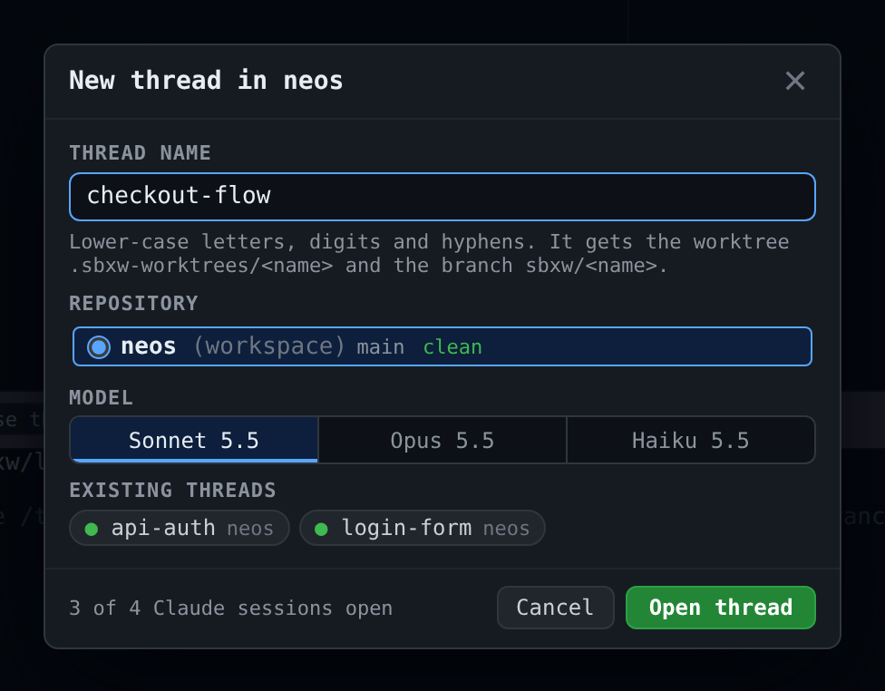
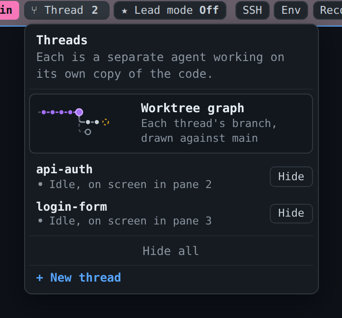
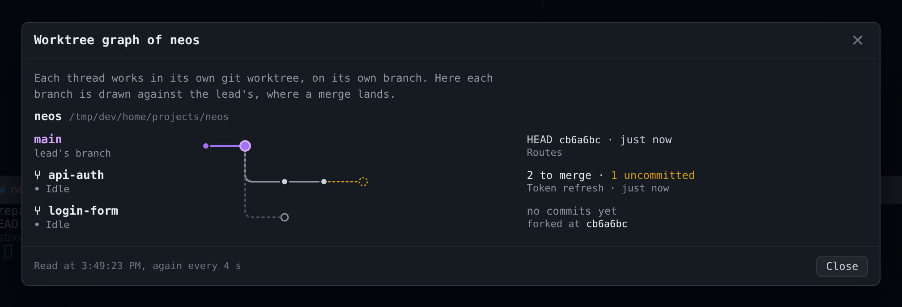
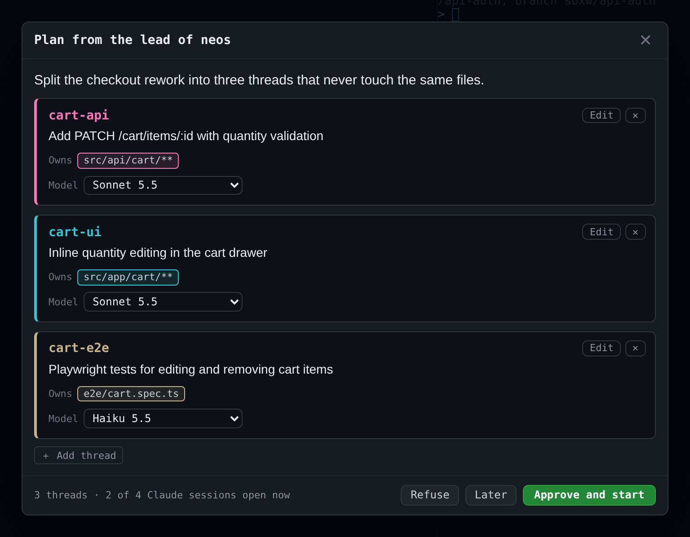

# Threads and the lead

[← Back to README](../README.md)

- [Threads: several agents in one sandbox](#threads)
- [The worktree graph](#the-worktree-graph)
- [The lead: plan, approve, follow, merge](#the-lead)
- [Reference](#reference)

## Threads

Claude already splits work inside a session, with subagents, but you can't
watch or steer them. A **thread** is the visible version: another Claude
session in the same sandbox, in its own pane, working on one thing.


Two agents editing one checkout overwrite each other's files. So each thread
gets its own **git worktree** and **branch**:

```
<repo>/.sbxw-worktrees/<thread>   on branch   sbxw/<thread>
```

### Opening a thread

**⑂ Thread** on the main pane's bar opens a dialog:



- **Name:** lower-case letters, digits and hyphens.
- **Repository:** when the workspace holds several repos one level down
  (`~/dev/shop/{backend,frontend}`), pick the one the thread works in.
- **Model:** from `models` in `sbxw.toml` (Sonnet, Opus, Haiku by default).

The thread opens in the first empty pane, or a new one while the window has
room. The first open creates the worktree from the repo's current `HEAD`;
later opens land back in it, uncommitted work included.

### Working with threads



Once a sandbox has threads, **⑂ Thread** shows their count (amber when one is
blocked) and opens a menu: each thread with its state, a click to go to it,
**Show** / **Hide** for its pane, and **+ New thread**. The sidebar lists the
same threads under the sandbox.

- **A thread's pane** has **⑂ Thread** (its agent) and **❯ Bash** (a shell in
  its worktree). The bar says `⑂ <name>`, outlined; the main pane says `main`,
  filled. A sandbox's panes share one colour and sit together.
- **Hiding** closes the pane, never the session. The pane's ✕ leaves the thread
  running too.
- **Reopened, it picks up where it was.** After a daemon or sandbox restart, a
  thread resumes with `claude --continue`.
- **A stopped sandbox comes back** when you open one of its threads: sbxw
  starts it directly (`sbx exec` starts a stopped sandbox, sbx 0.50) after
  releasing any busy host port, then opens the thread. The main session is
  not opened for it.
- **Ceiling:** `max_agent_sessions` (default 4) counts the agent plus open
  threads. They share CPU, memory and your usage. The agent is never refused;
  a new thread over the limit is, with the reason in its pane.

### Closing a thread

**Close thread** in its pane bar first shows what would be lost: the worktree
path, its uncommitted files (you must tick them off), and whether its branch
has commits the main branch lacks. A branch with nothing new is deleted by
default; one with unmerged commits is kept unless you tick it. Closing stops
every process in the worktree, then runs `git worktree remove` and, if asked,
`git branch -D`.

**Nothing is removed for you.** Closing is always a click, and merging is yours
to do (or the lead's [one-click merge](#3-one-click-merge)).

## The worktree graph

The Thread menu opens on a miniature of it. Click it for the full view:



- The top lane is the lead's branch (the one the repo's main checkout is on,
  and where merges land).
- Each thread forks off it: commits as dots, uncommitted work as a dashed amber
  ring, a merged thread in green.
- Beside each lane, in words: `2 to merge`, `4 behind main`, `1 uncommitted`,
  `✓ merged into main`, `no commits yet`.

It refreshes every 4 s while open. Below 640px it keeps the words and drops the
drawing. It's read with git on the host, so it works on a stopped sandbox, and
with `--no-optional-locks`, so it never holds the lock a thread needs to commit.

## The lead

Opening threads by hand means you do the splitting. **★ Lead mode** on the main
pane's bar makes the main session do it: sbxw types `/lead` into it. It asks
what you want done, reads the repo, and proposes a **plan**: a few threads,
each with a name, a goal and the files it owns.

As lead it **does not code**. It plans, follows the threads, reviews their
branches, and proposes the merge.

```
★ lead ──propose_plan──▶ sbxw ──▶ 🧑 plan dialog (edit, approve)
  ▲                                     │
  │                  ┌──────────────────┼──────────────────┐
  │                  ▼                  ▼                  ▼
  │            ⑂ cart-api          ⑂ cart-ui            (…)
  │                  │ report_thread_status ──▶ sbxw ──▶ the thread's chip
  └── SendMessage ───┘ (blocked, done, answers: Claude Code, not sbxw)
```

### 1. You approve the plan



Nothing starts without you. Edit any thread's name, goal, scope, repo or model;
remove or add threads; then **Approve and start**, **Refuse** (final), or
**Later** (**Review plan** on the main pane brings it back). Approval is
refused if the threads wouldn't fit under `max_agent_sessions`.

### 2. The threads work

On approval, sbxw opens each thread with a **briefing** as its first message:
its goal, its scope, and the rules (commit on your branch, never merge or push,
report your state).

- **Threads report to sbxw** with `report_thread_status`. The chip shows the
  state: `…` starting, `●` working, `?` blocked, `✓` done, `✕` failed. Hover for
  the report.
- **Threads talk to the lead directly**, with Claude Code's own `SendMessage`
  between sessions of the sandbox. A thread runs as `claude --name <thread>`,
  so the lead knows its address in advance; each briefing gives the lead's
  name. If that messaging isn't available, sbxw types a note into the main
  session instead.
- All sessions run with `--dangerously-skip-permissions`. If you change the
  lead's permission mode, Claude Code holds messages between them for approval.

### 3. One-click merge

When every thread is done, the lead calls `propose_merge` with an order and a
note. The plan dialog offers **Merge all**. For each thread, in order, sbxw:

1. refuses if the main checkout has uncommitted changes,
2. runs `git merge --no-ff --no-edit sbxw/<thread>` inside the sandbox,
3. on conflict, runs `git merge --abort` and stops there.

With **close threads** ticked, merged threads are then closed and their branches
deleted. The lead is told the result in one line, e.g.
`[sbxw] Merged: a, b. Failed: c (conflict in X).` A failed merge can be retried
after fixing the cause.

### Leaving lead mode

The toggle reads **On**, in violet, while a session leads. Ending it (from the
web UI) refuses a pending plan and closes approved ones: their threads keep
running, but their reports no longer reach the main session. Restarting the
lead's session also removes the mark.

### Trust

- **A person decides the plan and the merge.** Approve, refuse and merge exist
  only on the daemon's UI listener, which sandboxes can't reach. No agent can
  approve its own plan.
- **After approval, the lead and its threads write to each other without a
  click.** That's Claude Code's own messaging, and the sandbox is the boundary:
  any session in it can already write to any other. Nothing reaches another
  sandbox.
- A plan id is 128 random bits, seen only by the proposing session and the
  browser. A thread report carries no id and could be forged by another session
  in the same sandbox, but it only changes a label, never what runs.

## Reference

<details>
<summary>Thread details for the curious</summary>

- **Repos.** `GET /api/sandboxes/<name>/repos` lists the repos sbxw finds: the
  workspace itself when it's a repo, otherwise subfolders to depth 3 (skipping
  hidden folders, `node_modules`, `target`, `vendor`), each with branch,
  uncommitted count and ahead/behind. The choice is remembered in
  `~/.sbxw/state/threads/<sandbox>.json`. With no choice and several repos, the
  open is refused with the list.
- **No trust dialog.** Before starting `claude`, the thread marks its worktree
  trusted in `~/.claude.json`, the same way provisioning does for the workspace.
- **Model.** Passed as `claude --model <id>` on a fresh start and on
  `--continue`; checked against `^[a-z0-9][a-z0-9.\-]{0,63}$`.
  `GET /api/models` lists the choices, `GET /api/sandboxes/<name>/threads` gives
  each thread's model.
- **Worktree graph API.** `GET /api/sandboxes/<name>/worktrees` returns
  `{ok, workspace, repos: [{path, base, head, dirty, log, threads: [{name, branch, worktree, tip, fork, ahead, behind, dirty, commits}], error}]}`.
- **Exclude.** `.sbxw-worktrees/` is added to `.git/info/exclude`, not
  `.gitignore`.
- **Env changes.** `[env]` edits reach the agent on its next attach (`sbx run`
  applies them). A thread starts with `sbx exec` and is not guaranteed to see
  them.
- **The island** answers prompts for the main agent only. A thread's questions
  are answered in its pane.

</details>

<details>
<summary>Lead details for the curious</summary>

- **Tools.** The `sbxw-relay` MCP server gives the main session `propose_plan`,
  `check_plan`, `plan_status` and `propose_merge`; a thread gets
  `report_thread_status` instead. A session knows which it is from
  `SBXW_THREAD`. **★ Lead mode** installs `/lead` and refreshes the server first.
  A main session started before that keeps its old server: if `/lead` says it
  has no `propose_plan`, restart the session (`/exit`, reopen the pane).
- **The lead's name** is read by the relay server from Claude Code's session
  registry (`~/.claude/sessions/`) and sent with `propose_plan`.
- **Persistence.** Plans are written to `~/.sbxw/state/plans/<sandbox>.json`
  (directory `0700`) and survive a daemon restart. A plan whose threads are all
  done or failed is dropped a day after its last change. `GET /api/leads` lists
  which session leads.
- **Merge state.** The plan carries
  `merge: {order, note, state, base, results}`; `state` goes `proposed` →
  `merging` → `merged` or `failed`. `POST /api/plans/<id>/merge` with
  `{close_threads}` runs it.
- **End.** `POST /api/sandboxes/<name>/lead/end`.

</details>
