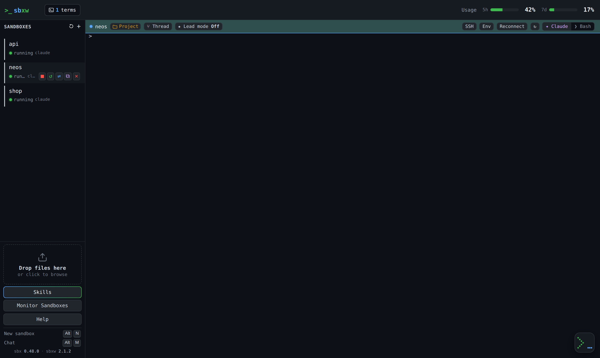
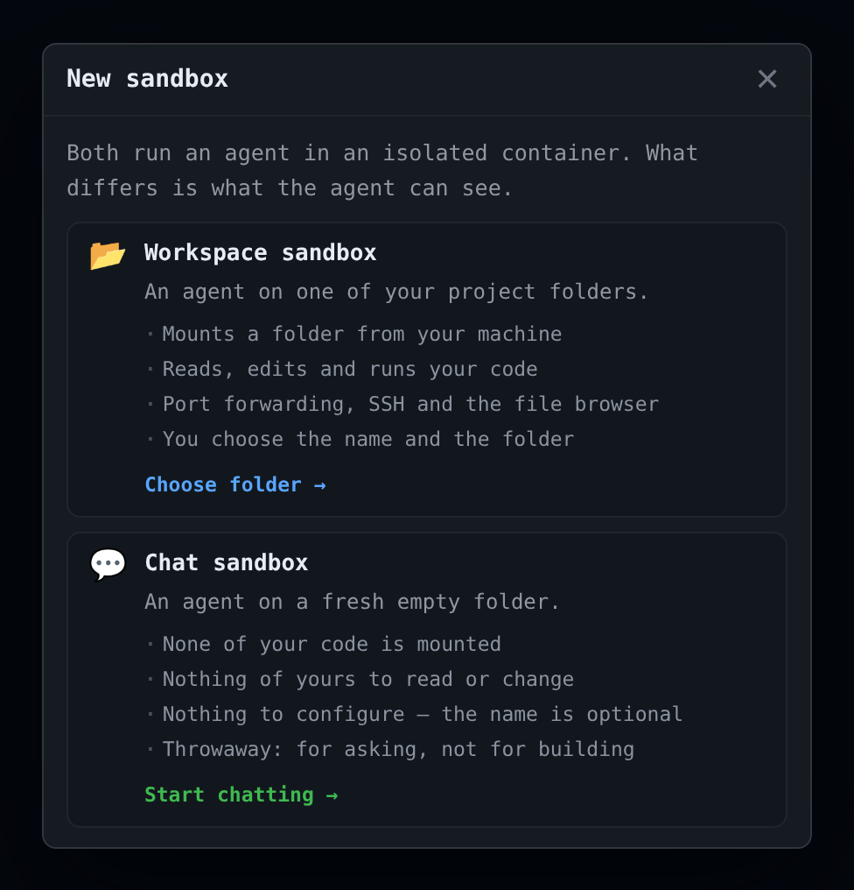
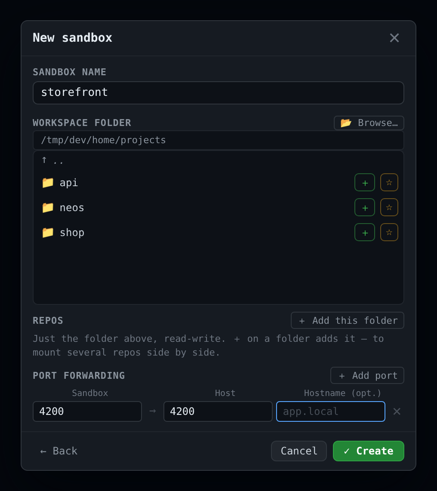
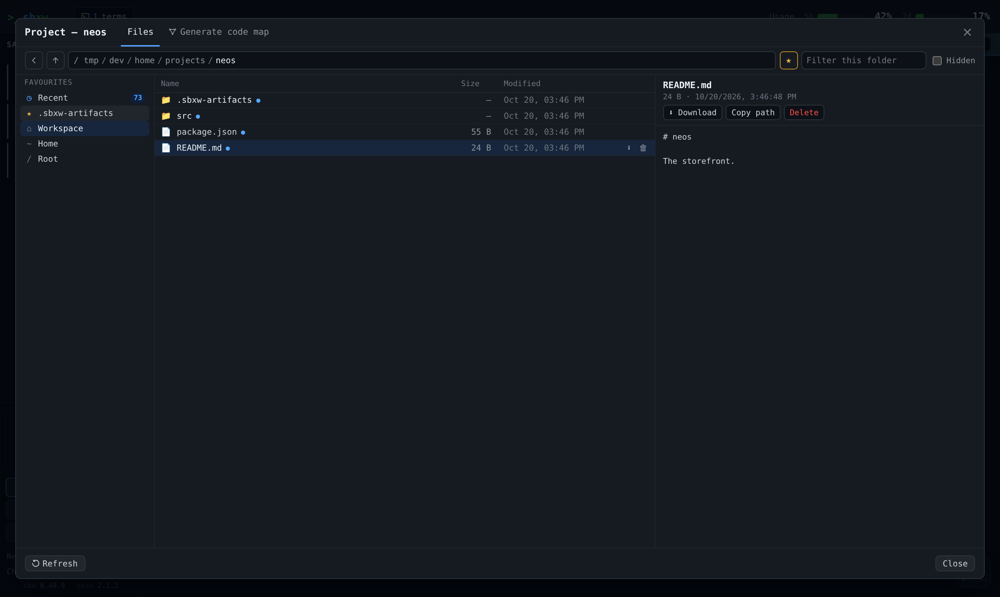
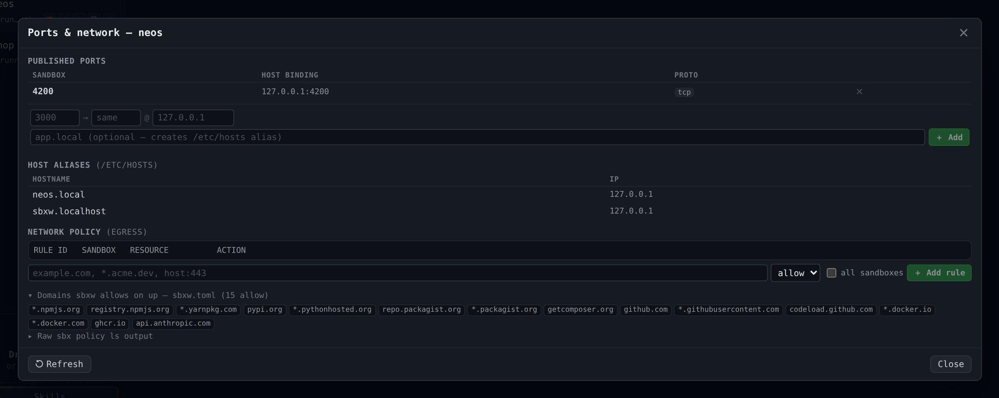
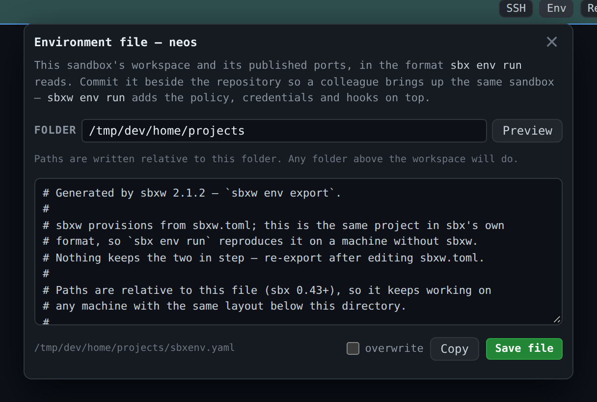
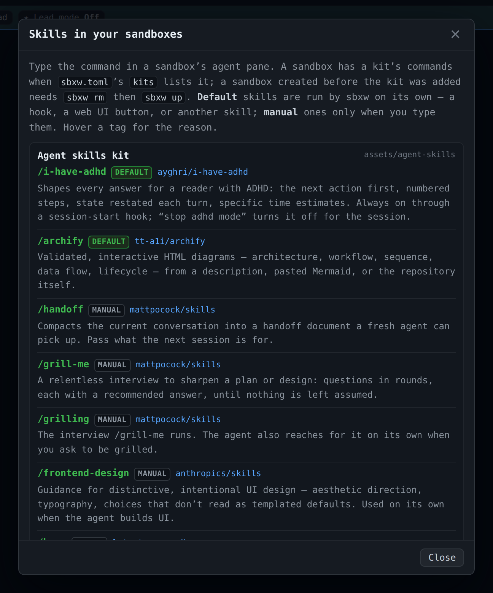
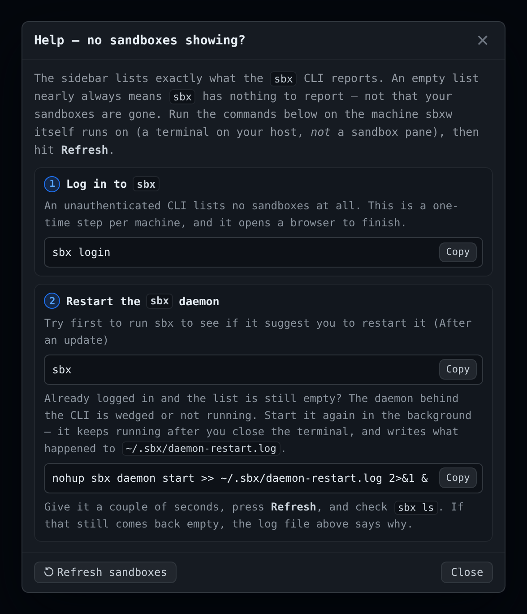

# Web UI

[← Back to README](../README.md)

Served at <http://sbxw.localhost:7681> by default (`web_addr` in
[`sbxw.toml`](configuration.md)). To open it, run `sbxw web` (or
`sbxw web <sandbox>`; `sbxw up` prints the same address) and open the sign-in
address it prints, `http://sbxw.localhost:7681/?t=<token>`. It signs this
browser in with a cookie and drops the token from the address bar. Typing the
bare address shows a page that says to run `sbxw web`. The token is new each
time the daemon starts: after a restart an open tab reloads onto that page,
and the newly printed address signs it in again. See
[Security: two listeners](security.md#two-listeners).



- [Layout at a glance](#layout-at-a-glance)
- [Creating sandboxes](#creating-sandboxes)
- [Remote hosts (experimental)](#remote-hosts-experimental)
- [The pane bar](#the-pane-bar)
- [The Project panel: files and code map](#the-project-panel)
- [Ports and network policy](#ports-and-network-policy)
- [Environment file and SSH cards](#environment-file-and-ssh-cards)
- [The sidebar footer](#the-sidebar-footer)
- [Screenshots from the browser side panel](#screenshots-from-the-browser-side-panel)
- [Keyboard shortcuts](#keyboard-shortcuts)

## Layout at a glance

| Area | What's there |
|---|---|
| **Header** | The terminal-count switch (1 to several panes), the terminal colour picker, for the background, the bar above it and the text (kept in this browser; the defaults come from [`terminal_color`, `terminal_bar_color` and `terminal_text_color`](configuration.md)), the relay badge when an agent's question waits for you, and your **Claude subscription usage** |
| **Sidebar** | Every sandbox `sbx ls` reports, grouped by workspace folder (and first by host, when [remote hosts](#remote-hosts-experimental) are registered). Chat sandboxes go under **💬 Chats**. In each group, and among the sandboxes outside any group, the ones on screen come first, in pane order. A sandbox's [threads](threads-and-lead.md) are listed under its row. Clicking a row opens it in the focused pane; a row that is in no pane has a **+** at its top right, which opens it in the first empty pane, or adds a pane for it |
| **Panes** | One terminal each. A sandbox's panes sit next to each other in a shared colour |
| **Bottom right** | Background-job cards (bring-ups, code maps, relay requests) and the [chat dock](chat.md#the-chat-dock) button |

Each sandbox row has buttons to **stop**, **reload**, open **ports and network**
(⇌), **duplicate**, and **remove** (✕). Beside the name: its age (hover for the
creation time).

A sandbox made by an sbx older than 0.51 carries a small amber ring beside its age (read
once from `sbx inspect`, which records the creating version since 0.51). It
keeps running but takes no kit; **⟲ recreate** removes it and creates it again
from what sbxw recorded — workspace, config, mounts, Remote Control — after
asking, since everything outside the workspace folder is lost. A chat is never
recreated: its workspace goes with it.

**⚑ N** beside a row's age means sbx is waiting for you to decide something
for that sandbox (`sbx policy approval`, 0.51): a host it reached that no
rule allows, or a kit asking to publish a host port (that one lapses after
45 s). Click it to see each request with the options sbx offers — **Allow**,
**Dismiss**… — and answer there; the list refreshes while it is open. sbxw
never answers on its own.

**Usage.** The 5-hour and weekly percentages are account-wide, the same numbers
as Claude Code's `/usage`. They turn amber at 75% and red at 90%. They are
hidden with API-key auth, which has no subscription windows. How they're
collected is in [Dynamic Island](island.md#subscription-usage).

## Creating sandboxes

**＋** (or **⌃⌥N** on a Mac, **Alt+N** elsewhere) asks which kind you want:



The **workspace sandbox** dialog asks for a name and a project folder, then
lists the optional settings below: extra folders, ports, Remote control. It goes through the same pipeline as `sbxw up`.



- **Ports** rows: sandbox port → host port, optional host IP, optional
  `/etc/hosts` alias.
- **Several repos in one sandbox.** **＋** on a folder (or **＋ Add this
  folder**) adds it to **Extra folders**. The first is the workspace, always read-write;
  threads put their worktrees there. Others are mounted beside it at the same
  path, read-only by default or read-write.
- **Favourite folders.** ☆ on a folder pins it as a shortcut chip above the
  picker. Star the folder you keep projects in, not each project. Favourites
  live on the host in `~/.sbxw/state/favourites.json` (hand-editable, up to 12).
  A favourite that is missing right now (an unplugged drive) is shown greyed,
  not dropped.

With remote hosts registered, the dialog starts with a **Host** field (see
[Remote hosts](#remote-hosts-experimental)).

The **chat sandbox** dialog is the browser version of `sbxw chat`. See
[Chat](chat.md).

### The automatic template

With `template = "auto"` in `sbxw.toml`, **Create** first checks the template
for the configured kits. If it was made by another version of sbx, or the kits'
specs changed since (an sbxw release that leaves the kits alone does not
count), or there is none yet, a dialog shows what changed and offers:

- **Rebuild template**: the sandbox is created from sbx's image. Once its kits'
  startup installs have finished, its agent token and credentials are taken
  out, it is saved as the new template, and they are put back. Only then does
  it open, so the snapshot holds no one's work. The first time takes several
  minutes. The old template is removed once the new one is saved.
- **Use the old one**: create from the out-of-date template.
- **Without template**: create from sbx's image and leave the template alone.

Closing the dialog returns to the create dialog. A template that is up to date
is used without asking; to rebuild it anyway, tick **Rebuild the starting
template** at the bottom of the create dialog (shown only
then).

### Watching the bring-up

A first creation can take minutes while the image downloads. A card in the
bottom-right corner lists every step up front and ticks them off, with `sbx`'s
own output streaming under the running one:

```
sbxw  myapp                     Creating… 2/5
      ✓ Preparing the workspace
      ● Creating the sandbox
          pulling docker.io/…/sandbox-claude: 214.7MB / 512.3MB
        Waiting for the sandbox to start
        Installing the agent tooling
        Publishing ports and host aliases
```

- The network policy step appears only when `sbxw.toml` has a policy. *Applying
  kits* appears only for an existing sandbox (a new one gets its kits inside the
  create step).
- It survives a page reload: the steps come over the UI's event stream.
- Every way of creating a sandbox reports here: the create and chat dialogs,
  **Duplicate**, and the island's chat.
- A failed `sbx create` shows sbx's own error, not just "exited with status 1".

## Remote hosts (experimental)

sbxw can run sandboxes on other machines over SSH ([Remote
hosts](remote-hosts.md)). This part of the UI is **experimental**, like the
feature. With no host registered, none of it shows.

**The sidebar, by host.** With at least one host in `~/.sbxw/hosts.toml`, the
sidebar is one section per host: `local` (this machine) first, then each host
by name, each with its own workspace groups. Click a host's header to fold it;
the folded ones are remembered in this browser. Rows under a remote host show
the bare sandbox name; its full ref is `host~name` (hover the name).

Each host's header shows:

| Part | Meaning |
|---|---|
| Dot and text | Green with a latency (`12 ms`, the last round trip over the SSH link, timed again every 30 s or so): the link is up. Red, **down HH:MM**: it was up and dropped at that time; sbxw keeps retrying. Grey, **never**: sbxw has not reached it yet. Hover the dot for the full sentence |
| Count | Sandboxes sbxw holds a record of there |
| **⋯** | **Test** runs `sbx version` over the link and times a round trip. **Provision** shows the command that installs `sbx` on the host, `sbxw host provision <host>`, to copy and run in a terminal on this machine: it asks for your sudo password on the host and for a Docker token, which the page never sees. **Edit** opens **Setup → Hosts** on that host |

**Unreachable sandboxes.** While a host's link is down, its sandboxes stay
listed, greyed, with **unreachable since HH:MM** (your browser's time) in place
of their status. Their buttons are disabled, and hovering one says why. They
come back on their own when the link does.

**Creating on a host.** In the workspace dialog, **Host** picks where the
sandbox runs (default: the one you picked last, in this browser). On a remote
host, the folder browser lists that host's folders, and **Or clone a git URL**
clones a repo there instead, into `~/sbxw-repos/<repo>` on the host (a folder
already there is used as it is). Favourites, the native **Browse…** picker and
kit folders are this machine's, so they are hidden. The automatic-template
question is not asked for a remote host.

**Setup → Hosts** lists the hosts with their link and sandbox count, and edits
`hosts.toml` (the same file `sbxw host` edits):

- **Add a host**: a name, then an SSH alias from `~/.ssh/config` or an address
  (with optional user, port and identity file path), the agent port (default
  7682) and the `sbx` path on the host (default: detected). If the host key is
  not in `~/.ssh/known_hosts`, its fingerprint is shown first: check it on the
  host (`ssh-keygen -lf /etc/ssh/ssh_host_ed25519_key.pub`), then **Trust and
  save**. If the key changes between the two steps, nothing is saved.
- **Trust this host with secrets** (`trust_secrets`): sbxw then sends that
  host your Anthropic API key and your kept skills. Anyone with root on the host can
  read them. Only for a machine you control.
- **Edit** changes any of these; a new address asks about its key again.
  **Remove** unregisters a host; one with sandboxes is refused unless you
  confirm a second time (their records stay on disk). Nothing on the host is
  touched.
- **Reload file** re-reads `hosts.toml` after you edit it by hand or with
  `sbxw host`. A host whose settings changed gets a new SSH link.

## The pane bar

Each pane has a bar. On the left, things about the **workspace**; on the right,
things about the **session** in the pane.

| Button | What it does |
|---|---|
| **Project** | Opens the [Project panel](#the-project-panel): files and code map |
| **⑂ Thread** | Opens another Claude session in its own git worktree. See [Threads](threads-and-lead.md) |
| **★ Lead mode** | Turns the main session into a planner. See [The lead](threads-and-lead.md#the-lead) |
| **⋯** | A menu: **SSH** (connection details for SSH clients), **Environment file** (export the sandbox as `sbxenv.yaml`), both [below](#environment-file-and-ssh-cards), and **Reconnect** (reopen the WebSocket) |
| **↻** | Rebuild the terminal widget, then reconnect. Reconnect and ↻ both replay the last 256 KB of the session |
| **Claude ↔ Bash** | Switch between the agent and a shell. Both keep running server-side, with their scrollback |

Notes:

- **Bash on a stopped sandbox** starts it: `sbx exec` starts a stopped
  sandbox before running the shell (sbx 0.50). Busy host ports are released
  first, as for the agent.
- **Replays are repainted, never re-answered.** Terminal queries in the replay
  (`CSI 6n`, `CSI c`) are stripped, so a reconnect doesn't type
  `37;3R37;3R…` onto your command line.

## The Project panel

**Project** in a pane's bar opens a near-full-window panel with two tabs.

### Files



A file browser over the sandbox's **own** filesystem, opening on
`.sbxw-artifacts/`, where agents put deliverables.

- **Navigate:** breadcrumb (click its empty space to type a path, `~` works),
  back and up, a filter, and a **Hidden** toggle for dotfiles.
- **Preview:** text, images, and HTML (in a sandboxed iframe), with
  **Download** and **Copy path**. A folder with a README opens on it.
- **Keyboard:** ↑/↓ move and preview, Return opens a folder or downloads a
  file, Backspace goes up (in **Recent**, back to the previous view).
- **Favourites:** `.sbxw-artifacts`, the workspace, the agent's home and `/` are
  built in. ★ pins any other folder (per sandbox, in this browser). Extra repos
  mounted at creation show up here too.
- **Kit logs** opens `/var/log` on `sbx-kit-startup.log`, the output of every
  kit's startup commands on every boot; `sbx-kits/<kit>/install-<n>.log` beside
  it holds each install hook's. When a kit seems to have done nothing, the
  reason is there.
- **◷ Recent** lists the files written in the last 7 days across the
  workspace, read-write mounts, home and `/tmp` (minus `.git`, dependency and
  cache folders), newest first, up to the 300 most recent. Each has a **Show in folder** button: an agent's
  file is not always where you asked for it. The badge counts the last hour's
  files, and a blue dot marks them in any listing.
- **Delete:** 🗑 on a row, **Delete** in the preview, or the Delete key, after a
  confirmation. Allowed only under the workspace, a read-write mount, home or
  `/tmp`, never on those folders themselves, `.sbxw-artifacts` or `.git`. The
  daemon re-checks the resolved path, so a symlink is no way out.

A running sandbox is read through `sbx exec`, so you see what the agent sees. A
stopped one shows its workspace from the host and says so, rather than being
started to list a folder. Every file is served with
`Content-Security-Policy: sandbox`, so an HTML file an agent wrote never runs
with the daemon's origin.

### Code map

The second tab reads the project's code map, the linked Markdown in
`.sbxw-artifacts/codemap/` written by the [codemap kit](kits-and-skills.md#bundled-kits):

- `[[wiki links]]` are clickable, each section lists its **backlinks**, an
  outline jumps within a file, and search spans the whole map.
- A **Diagram** tab shows the map's [Archify](https://github.com/tt-a1i/archify)
  architecture diagram, live, in a sandboxed iframe. A map without one shows the
  graph of its links.
- A **dead link** is drawn struck through in red, so a map that drifted from the
  code shows it.

**Generate code map** appears on a project without one. It runs `/codemap` in a
**background session** of that sandbox, so your agent pane stays yours. While it
runs, the sandbox row shows an amber `map…` badge and a corner card names the
run. The agent reports completion by POSTing to `$SBXW_CODEMAP_DONE`; the
session's exit is the fallback.

**Write a lens…** retells the map for one reader, such as *"a product owner:
what each part delivers, for whom, and what it costs to change"*. The agent runs
`/codemap-lens` in the background, names the lens itself, and writes it to
`.sbxw-artifacts/codemap-lenses/<slug>/`. The lens then appears in the map
picker.

The button refuses up front, rather than failing minutes later, when: the
sandbox is stopped; the codemap kit isn't applied; or a map or lens is already
being written (one at a time, since a lens reads the map).

## Ports and network policy

**⇌** on a sandbox row opens **Ports & network**:



**Published ports and aliases.** View, add and remove mappings, including host
IP and `/etc/hosts` alias.

**Network policy.** No single `sbx` call answers "what can this sandbox reach?",
so the panel combines three:

| Section | From | Answers |
|---|---|---|
| **Blocked recently** | `sbx policy log <name> --format json` | Each host this sandbox was refused, newest first, with a count and an **Allow** button |
| **Rules** | `sbx policy ls <name> --wide` | Which domains are allowed or denied (with a filter, since a global policy can have hundreds) |
| **Recent egress** | `sbx policy log <name>` | What was actually allowed or blocked, and why. Click the **ACTION** header to put denies (or allows) first |
| **Policies governing this sandbox** | `sbx policy ls <name>` | Each policy with its source (`local`, `kit`, `org`) and rule counts |

Plus the **domains sbxw allows on up**, from `sbxw.toml`.

If one call fails, only its section goes. Output sbxw can't parse is shown
verbatim rather than as a misleading empty list.

**Adding and removing rules:**

- The form takes sbx's syntax (`example.com`, `*.acme.dev`, `host:443`,
  comma-separated) with allow or deny. It's scoped to this sandbox unless you
  tick **all sandboxes**, which asks for confirmation.
- **Only some HTTP requests** narrows the rule: methods (`GET, HEAD`), a path
  glob (`/v1/**`) and query parameters every request must carry
  (`org=acme, label=release*`), sent as `--method`, `--path` and `--query`
  (sbx 0.50). Allow `api.example.com` only for `org=acme`, for instance.
- **✕ on a rule** runs `sbx policy rm network --id <rule-id> --force`, after a
  confirmation. It appears only when sbx reports a rule id. Rules from an `org`
  source show 🔒: sbx won't let you remove them.
- **Allow on a blocked host** adds an allow rule for that host (without its
  port), for this sandbox only, after a confirmation. A host blocked by
  organisation policy shows 🔒 instead.
- **↻ Re-read policy now** runs `sbx policy refresh`: the policy is
  re-read at once, after an AI Governance change say, instead of at the next
  poll. Open connections stay open.

Rules changed here are **not** written to `sbxw.toml`; the next `sbxw up`
re-applies the configured allowlist. For a permanent change, edit
`network_allow` / `network_deny`.

## Environment file and SSH cards

**⋯ → Environment file** opens a card that exports the sandbox as an `sbxenv.yaml`: live
preview, an editable target folder, **Copy** and **Save file**. It reads the
ports the sandbox *actually* has, including ones you added in the UI. See
[Environment files](environment-files.md#sbxw-env-export-write-the-file).



**⋯ → SSH** opens a card with one copy button per field of an *Add SSH connection*
form: **Name**, **SSH Host** (`<name>.sbx`), and **SSH Port** / **Identity
File** shown as *leave empty* (the managed `Host *.sbx` block supplies them).
The last row is the whole command, `ssh <name>.sbx`. See [SSH](ssh.md).

Both cards close with Escape or a click outside.

## The sidebar footer

| Item | What it does |
|---|---|
| **Drop files here** | Drop or pick a file, choose a sandbox, and it is copied in. Its path is typed into that sandbox's Claude prompt, not submitted, so you can say what it's for. Up to 128 MB |
| **Setup → Skills** | Lists the commands the bundled kits put in every sandbox, which run on their own (*default*) and which only when typed (*manual*); above them, **Your skills** keeps a skill made in a sandbox for every new one ([details](kits-and-skills.md#keeping-a-skill-you-made)) |
| **Setup → Templates** | Lists the saved templates (`sbx template ls`), marking the one `template` in `sbxw.toml` names (*in use*) and the ones `template = "auto"` keeps (*automatic*). **Remove** deletes one. Pick a sandbox and a tag, then **Save**, to snapshot it as a new template: its agent token and Claude credentials are taken out first and put back after, as with `sbxw template save`. sbx may stop the sandbox for the snapshot; sbxw starts it again |
| **Setup → Kits** | Edits the `kits` line of an `sbxw.toml` sbxw uses — the daemon's own, or the one a sandbox was created from; no other file. Bundled kits are checkboxes (`sbxw:<name>`); any other reference (a path, a `.zip`, an OCI ref, a git URL) a list with **Add** and **Remove**. Only that line is rewritten: comments, `[[ports]]` and the rest stay as written. A file without the line shows the defaults; **Save** writes them out, **Use defaults** removes it. New sandboxes from this page get the change at once; an existing one at its next `sbxw up` |
| **Setup → MCP** | The MCP servers registered on this host (`sbx mcp ls`). **Add** registers one: a remote URL with optional headers (a `${key}` in a header is a secret, typed in the dialog and stored as `mcp:<name>:<key>` through `sbx secret set`, never on a command line), or a host command (stdio) with arguments and a working directory. Remote servers are added with `--skip-auth`: authorize an OAuth one with **Sign in**, which runs `sbx mcp auth <name>` on the host: its browser opens, and the token serves every sandbox. **Edit** is a remove then an add, since sbx has no edit — it drops the server's OAuth token, and an empty secret field keeps the stored secret. **Inspect** shows `sbx mcp inspect`; **Remove** unregisters it (sandboxes that loaded it keep it until unloaded). **Load** / **Unload** attach it to or detach it from the running sandbox picked at the top, without restarting its agent; sbx does not say which servers a sandbox has loaded, so both are always offered |
| **Setup → Hosts** | Remote hosts (experimental): see [Remote hosts](#remote-hosts-experimental) |
| **Setup → Mac** | The [virtual Mac](../assets/terminal-mac/README.md): install terminal-mac, start, pause, shut down or open the VM, follow the guest's one-time setup checklist, see who holds the lease and the ports opened for it, and take the lease back |
| **Setup → Secrets** | The token sbx's proxy presents to GitHub for every sandbox (`git push` over HTTPS, `gh`): sbx's global `github` secret. Write-only — the page says whether one is set, never what it is; the value goes to `sbx secret set github` on stdin and is cleared from the field. **Use my gh login** (shown when `gh` is in Homebrew's or the system's `bin`, never looked up on `PATH`) stores `sbx secret set github --command '<path>/gh auth token'` instead: sbx runs it on this machine and refreshes the token itself. **Other services** stores a key for a service sbx does not know (`sbx secret set-custom --host … --env … --value-stdin`, 0.51): the sandbox sees a placeholder in the variable, the proxy puts the value in requests to the listed hosts only — hosts are required, since 0.51 substitutes nothing without them. The list shows names and scopes, never values. A token scoped to a single sandbox (`--sandbox`) is not counted as set. **Remove** runs `sbx secret rm github` |
| **Monitor** | Runs `monitor_cmd` (default: `sbx`, its all-sandboxes dashboard) on the host, in a window nearly the size of the screen, over the panes. ✕, a click outside it or the button again closes it; Escape goes to the TUI. `monitor_cmd = []` hides it |
| **?** (Help) | Fixes for an empty sandbox list (below) |
| Shortcuts | The [keyboard shortcuts](#keyboard-shortcuts) for this platform |
| Versions | `sbx` and `sbxw`, for bug reports and for "is my sbx too old?" |



**Monitor** is deliberately one fixed configured command, not a "run anything on
the host" box. It is filed under a pseudo-sandbox (`__host__`) that no real
sandbox name can collide with.

### Help: an empty sandbox list

The sidebar shows exactly what `sbx ls` reports, so an empty list means either
you have no sandboxes or the CLI can't see them. **Help** offers the two
host-side fixes, each with a copy button:



1. `sbx login`. An unauthenticated CLI lists nothing.
2. Still empty? Restart the sbx daemon:
   `nohup sbx daemon start >> ~/.sbx/daemon-restart.log 2>&1 &`, then
   **Refresh**.

Run them in a terminal on the host, not in a sandbox pane.

## The voice concierge

The concierge sits in the middle of the top bar, the voice side of sbxw,
apart from the chat dock. From left to right:

| Part | What it does |
|---|---|
| Microphone, green when voice is set up | Click to talk, click again to send; **F8**, held, does the same from the keyboard. Red while it listens |
| Sandbox name, in blue | Where your words go. Click it to pick another running sandbox |
| Speaker | Turns the voice on and off. Blue while a message is read; crossed out when the voice is off. Click to stop the reading and mute; click again to hear the next messages (what was missed is not replayed) |
| **Open** | Opens the panel under the bar (**Close** closes it): what was sent, agents' messages, errors |

Rings leave the border while someone talks: blue when the voice reads, red
when the microphone listens. The panel never opens by itself: a message
read aloud, a question or an error leaves a blue dot on **Open** (an error is
also a toast), and you open the panel when you want to see it.

In the panel, hold the talk button, or hold
**F8** anywhere on the page (terminals included; `[voice] push_to_talk_key`
changes it), speak, and release: the speech is turned into text on this
machine. The audio is never kept, and neither is the text.

Two local models do the work, and no language model sits between you and
the agent: Parakeet turns speech into text, and Voxtral TTS reads an agent's
message aloud as it was written. Nothing is reworded in either direction.

Until the models are downloaded the panel shows the command that downloads
them, `sbxw voice install`, and an **Install voice** button that asks first,
then shows the download's progress, with Cancel. A cancelled download picks up
where it stopped. A build without `--features voice` says so.

The browser lends the microphone only to a page on `127.0.0.1` (or HTTPS):
with `web_addr` on a LAN address, the panel says why it cannot listen.

Reading aloud runs in a local server the daemon starts on the first
sentence and stops after five idle minutes (`mlx-audio`, fetched by `uvx`
during the install). It needs a Mac with Apple Silicon and
[uv](https://docs.astral.sh/uv/); elsewhere the panel listens and types but
stays silent. A message is read a few sentences at a time, and the sound
plays as it is made rather than once a batch is finished. Symbols are said
in words (`>=`, `@`, `/`, a file name's dot…), in French for a French voice
and in English for the others. The speaker in the bar, or the same one in the
panel's header, switches the voice off: nothing is read, the Concierge's own
prompts included, until you switch it back on, and the choice is remembered
in this browser. Talking stops the current reading without muting. The voice is `[voice]
tts_voice`.

What you dictate is masked before it goes anywhere: an e-mail address, a
phone number, an IBAN or a key becomes `[email]`, `[phone]`, `[iban]` or
`[secret]`, and the names you list in `~/.sbxw/anonymise.toml` become the
aliases you chose. A card edited by hand is masked again as it is sent, and
then shows what left.

```toml
patterns = ["email", "phone", "iban", "secret"]   # optional: the default

[replace]
"Jeanne Martin" = "Personne A"
"Projet Atlas" = "Projet X"
```

Case, accents and hyphens are ignored, and a name only matches as a whole
word. The file is read each time, so a name added is hidden from the next
sentence on; a file that does not parse sends nothing until it is fixed.
A name you did not list goes through, and a recogniser may spell a name
another way; a message is sent as soon as it is said, so the list is the
only guard. What you type straight into a
terminal is not filtered. `sbxw voice status` shows what is in force.

Pick a sandbox at the top of the panel. What you say with nothing to answer
becomes a message for its agent: it is masked and typed into the agent at
once, with nothing to confirm; the panel shows what left when the masking
changed it. The same goes for your answer to an agent's question. With no
sandbox picked, or if sending fails, the words wait in an editable card
(**Send** or *oui*, **Discard** or *non*). You can also type.

A `/grill-me` in the picked sandbox — in its main agent, or in a thread or
session sbxw opened there — engages the concierge on its own: the panel
gets each round, and reads it aloud. **Follow** does
the same for every turn any of its agents ends (off by default: that is a
lot of talking for ordinary work). When the agent asks with the relay's `ask_user_questions` tool (what
`/grill-me` does in sbxw), the round comes to the Concierge from any
sandbox, and the answers go back as that tool's result; nothing is typed
into a terminal. Such a round opens the panel on its question card, with the
voice on or off, since the agent waits until you answer. It does not take the
keyboard from a terminal you are typing in. A round already waiting when the
page loads opens it too. Other agent messages leave the panel closed. A round the agent only wrote out in its terminal is
answered by typing into its session instead. Either way, a grill round is
taken **one question at a time**: the panel shows and
reads Q1 with the agent's recommendation, waits for your answer, then
moves to Q2 (*répète* reads it again, *passe* skips it, *précédente* goes
back). Once every question is answered, the answers are listed as one
message ("Q1 : …", as you said them), shown, and sent at once on your
*oui*. Any other message that arrives is read aloud as written (code blocks
left out), and what you say next answers it: your words are shown,
editable, and the panel asks "J'envoie ?". Say *oui* (or click Send) and
they are typed into that session; *non* drops them. A multiple-choice
question is read with its options, and what you say picks one — its number
("la deux"), its rank ("la dernière") or its words — confirmed the same
way. **Not an answer** on a message makes your next words a message of your
own instead.

**Dictation into a terminal.** Click the microphone in a pane's bar, speak,
and click it again — or hold **F9** in the pane that has focus and release:
the words are typed into that
terminal as if from the keyboard — Claude's prompt, or a shell. No Enter is
pressed, so you can read and fix them first; end with *entrée* (or
*envoie*) and Enter is pressed for you. The button shows once the voice
models are installed.

Nothing said is kept: not the audio, not the text. **Clear** empties the
panel.

## Screenshots from the browser side panel

When the agent beside your app's tab calls `ask_user_for_screenshot`, the
[side panel](chat.md#the-browser-side-panel) shows the request above the
message box: which agent asks, its question, and a **Send a screenshot of
this tab** button. One click captures the tab beside the panel and sends it to
that agent; the transcript shows a thumbnail of what it got. Until you click,
nothing leaves, and the request also waits in sbxw's relay popup.

**Send the screenshots Claude asks for without asking me**, in the panel's
⋯ menu, is off until you turn it on, and is remembered in this browser only.
When it is on, the panel answers on its own, at most one request per sandbox
every 10 seconds; the requests after that wait for your click. Either way it
only answers screenshot requests from the sandbox the panel talks to, and only
with the tab beside it.

## Keyboard shortcuts

| Action | macOS | Windows / Linux |
|---|---|---|
| New sandbox | ⌃⌥N | Alt+N |
| Toggle the chat dock | ⌃⌥M | Alt+M |
| Talk to the Concierge (hold) | F8 | F8 |
| Dictate into the focused terminal (hold) | F9 | F9 |
| Write the lens (in its dialog) | ⌘↩ | Ctrl+Enter |

On a Mac, Option alone types characters (⌥N is the `~` dead key), so the app
uses ⌃⌥. Elsewhere Alt alone stays, because Ctrl+Alt is AltGr on many Windows
layouts.
