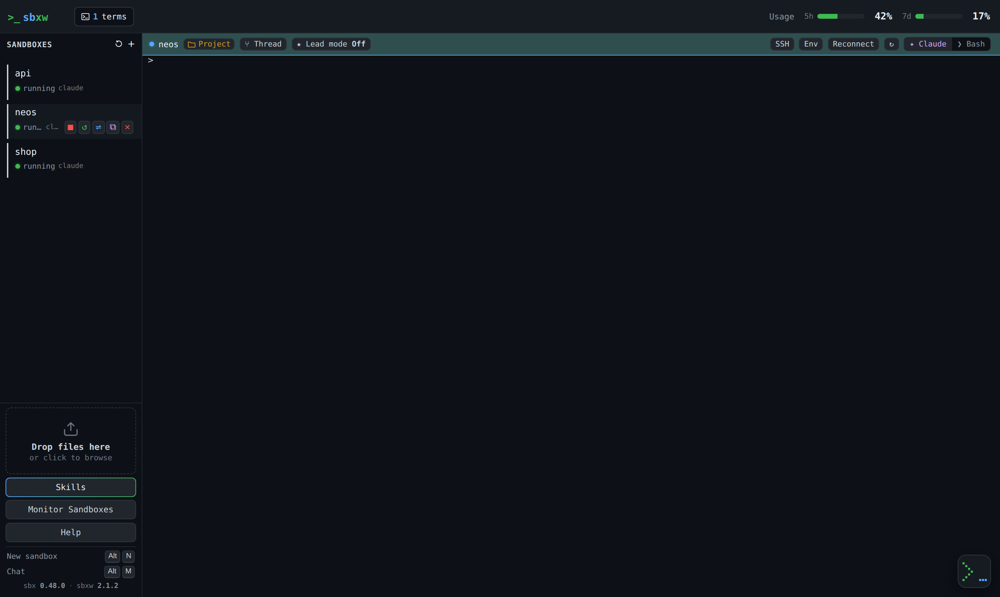
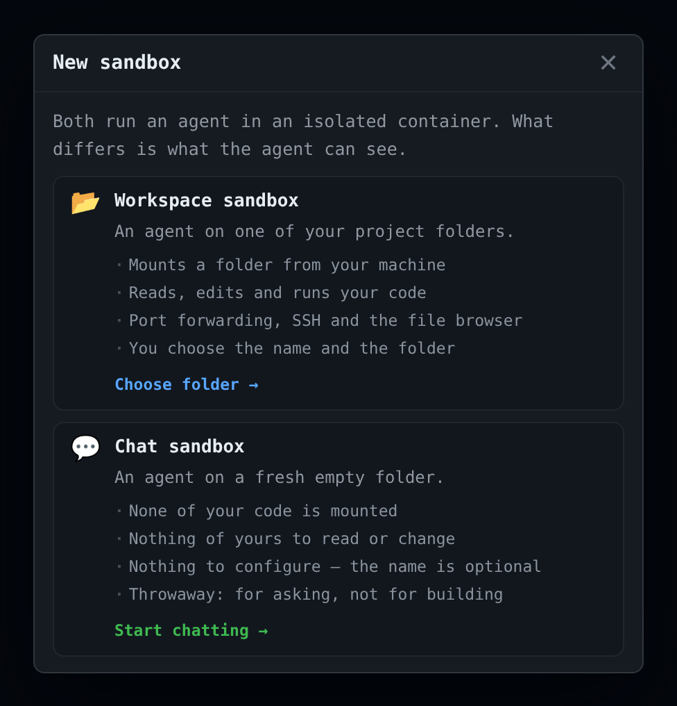
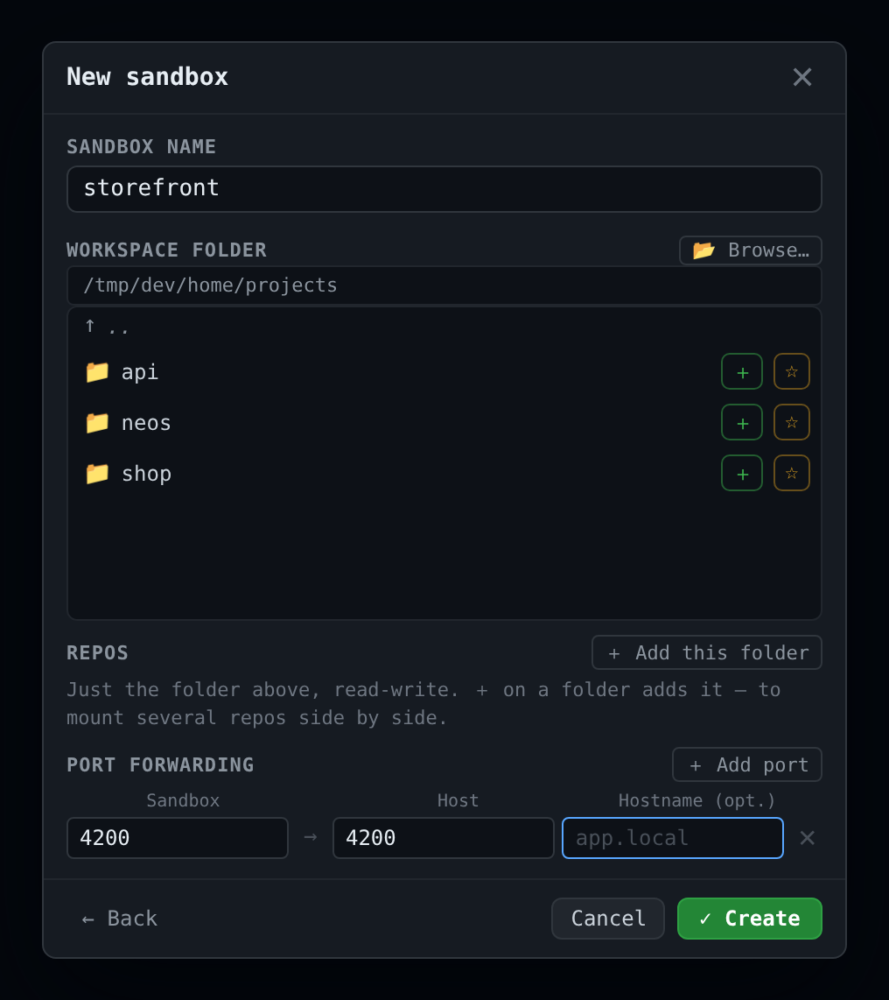
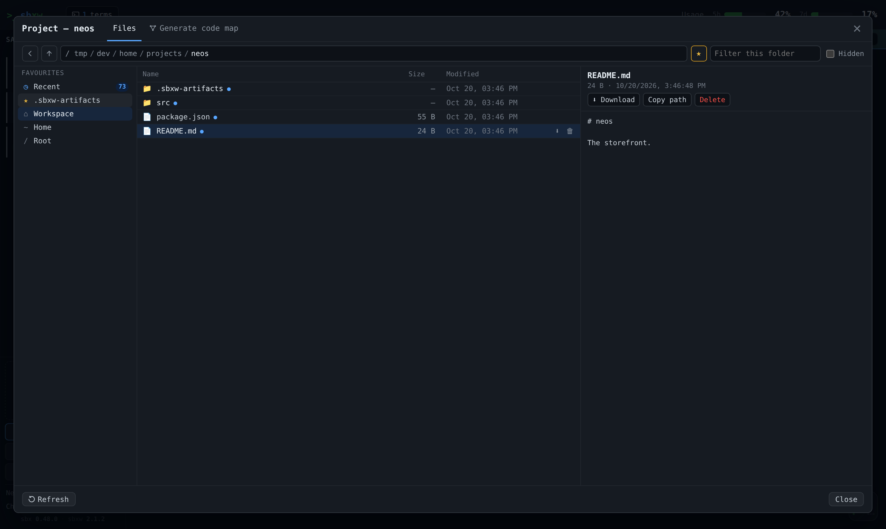
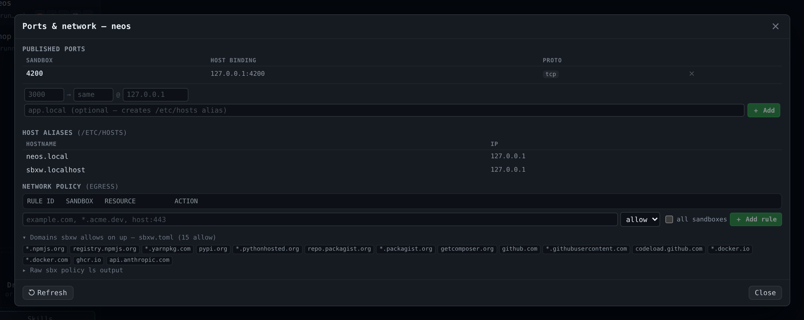
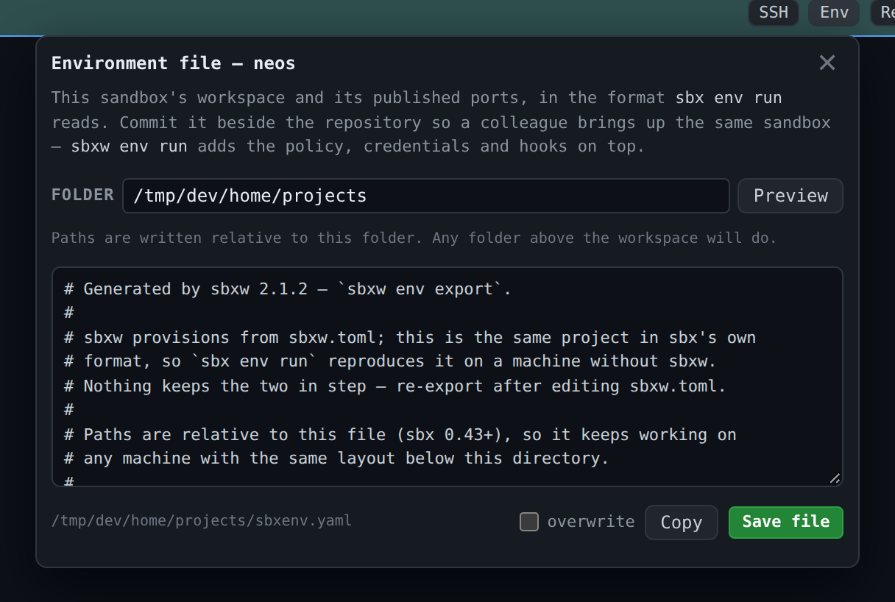
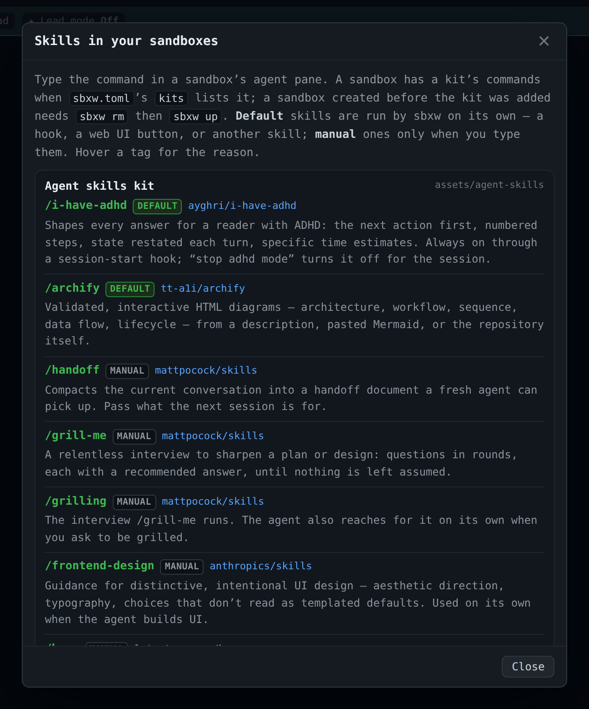
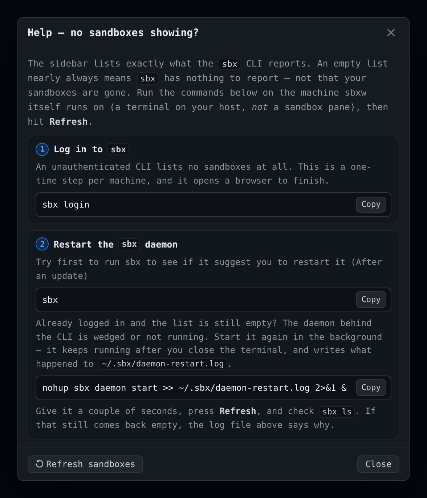

# Web UI

[← Back to README](../README.md)

Served at <http://sbxw.localhost:7681> by default (`web_addr` in
[`sbxw.toml`](configuration.md)).



- [Layout at a glance](#layout-at-a-glance)
- [Creating sandboxes](#creating-sandboxes)
- [The pane bar](#the-pane-bar)
- [The Project panel: files and code map](#the-project-panel)
- [Ports and network policy](#ports-and-network-policy)
- [Environment file and SSH cards](#environment-file-and-ssh-cards)
- [The sidebar footer](#the-sidebar-footer)
- [Keyboard shortcuts](#keyboard-shortcuts)

## Layout at a glance

| Area | What's there |
|---|---|
| **Header** | The terminal-count switch (1 to several panes), the terminal colour picker, for the background and the bar above it (kept in this browser; the defaults come from [`terminal_color` and `terminal_bar_color`](configuration.md)), the relay badge when an agent's question waits for you, and your **Claude subscription usage** |
| **Sidebar** | Every sandbox `sbx ls` reports, grouped by workspace folder. Chat sandboxes go under **💬 Chats**. In each group, and among the sandboxes outside any group, the ones on screen come first, in pane order. A sandbox's [threads](threads-and-lead.md) are listed under its row |
| **Panes** | One terminal each. A sandbox's panes sit next to each other in a shared colour |
| **Bottom right** | Background-job cards (bring-ups, code maps, relay requests) and the [chat dock](chat.md#the-chat-dock) button |

Each sandbox row has buttons to **stop**, **reload**, open **ports and network**
(⇌), **duplicate**, and **remove** (✕). Beside the name: its age (hover for the
creation time).

**Usage.** The 5-hour and weekly percentages are account-wide, the same numbers
as Claude Code's `/usage`. They turn amber at 75% and red at 90%. They are
hidden with API-key auth, which has no subscription windows. How they're
collected is in [Dynamic Island](island.md#subscription-usage).

## Creating sandboxes

**＋** (or **⌃⌥N** on a Mac, **Alt+N** elsewhere) asks which kind you want:



The **workspace sandbox** dialog asks for a name and a project folder, then
lists the optional settings below: extra folders, ports, Remote control. It goes through the same pipeline as `sbxw up`.



- **Ports** rows: sandbox port → host port, optional host IP, optional
  `/etc/hosts` alias.
- **Several repos in one sandbox.** **＋** on a folder (or **＋ Add this
  folder**) adds it to **Extra folders**. The first is the workspace, always read-write;
  threads put their worktrees there. Others are mounted beside it at the same
  path, read-only by default or read-write.
- **Favourite folders.** ☆ on a folder pins it as a shortcut chip above the
  picker. Star the folder you keep projects in, not each project. Favourites
  live on the host in `~/.sbxw/state/favourites.json` (hand-editable, up to 12).
  A favourite that is missing right now (an unplugged drive) is shown greyed,
  not dropped.

The **chat sandbox** dialog is the browser version of `sbxw chat`. See
[Chat](chat.md).

### The automatic template

With `template = "auto"` in `sbxw.toml`, **Create** first checks the template
for the configured kits. If it was made by another version of sbx, or the kits'
specs changed since (an sbxw release that leaves the kits alone does not
count), or there is none yet, a dialog shows what changed and offers:

- **Rebuild template**: the sandbox is created from sbx's image. Once its kits'
  startup installs have finished, its agent token and credentials are taken
  out, it is saved as the new template, and they are put back. Only then does
  it open, so the snapshot holds no one's work. The first time takes several
  minutes. The old template is removed once the new one is saved.
- **Use the old one**: create from the out-of-date template.
- **Without template**: create from sbx's image and leave the template alone.

Closing the dialog returns to the create dialog. A template that is up to date
is used without asking; to rebuild it anyway, tick **Rebuild the starting
template** at the bottom of the create dialog (shown only
then).

### Watching the bring-up

A first creation can take minutes while the image downloads. A card in the
bottom-right corner lists every step up front and ticks them off, with `sbx`'s
own output streaming under the running one:

```
sbxw  neos                     Creating… 2/5
      ✓ Preparing the workspace
      ● Creating the sandbox
          pulling docker.io/…/sandbox-claude: 214.7MB / 512.3MB
        Waiting for the sandbox to start
        Installing the agent tooling
        Publishing ports and host aliases
```

- The network policy step appears only when `sbxw.toml` has a policy. *Applying
  kits* appears only for an existing sandbox (a new one gets its kits inside the
  create step).
- It survives a page reload: the steps come over the UI's event stream.
- Every way of creating a sandbox reports here: the create and chat dialogs,
  **Duplicate**, and the island's chat.
- A failed `sbx create` shows sbx's own error, not just "exited with status 1".

## The pane bar

Each pane has a bar. On the left, things about the **workspace**; on the right,
things about the **session** in the pane.

| Button | What it does |
|---|---|
| **Project** | Opens the [Project panel](#the-project-panel): files and code map |
| **⑂ Thread** | Opens another Claude session in its own git worktree. See [Threads](threads-and-lead.md) |
| **★ Lead mode** | Turns the main session into a planner. See [The lead](threads-and-lead.md#the-lead) |
| **⋯** | A menu: **SSH** (connection details for SSH clients), **Environment file** (export the sandbox as `sbxenv.yaml`), both [below](#environment-file-and-ssh-cards), and **Reconnect** (reopen the WebSocket) |
| **↻** | Rebuild the terminal widget, then reconnect. Reconnect and ↻ both replay the last 256 KB of the session |
| **Claude ↔ Bash** | Switch between the agent and a shell. Both keep running server-side, with their scrollback |

Notes:

- **Bash on a stopped sandbox** starts it: `sbx exec` starts a stopped
  sandbox before running the shell (sbx 0.50). Busy host ports are released
  first, as for the agent.
- **Replays are repainted, never re-answered.** Terminal queries in the replay
  (`CSI 6n`, `CSI c`) are stripped, so a reconnect doesn't type
  `37;3R37;3R…` onto your command line.

## The Project panel

**Project** in a pane's bar opens a near-full-window panel with two tabs.

### Files



A file browser over the sandbox's **own** filesystem, opening on
`.sbxw-artifacts/`, where agents put deliverables.

- **Navigate:** breadcrumb (click its empty space to type a path, `~` works),
  back and up, a filter, and a **Hidden** toggle for dotfiles.
- **Preview:** text, images, and HTML (in a sandboxed iframe), with
  **Download** and **Copy path**. A folder with a README opens on it.
- **Keyboard:** ↑/↓ move and preview, Return opens a folder or downloads a
  file, Backspace goes up (in **Recent**, back to the previous view).
- **Favourites:** `.sbxw-artifacts`, the workspace, the agent's home and `/` are
  built in. ★ pins any other folder (per sandbox, in this browser). Extra repos
  mounted at creation show up here too.
- **◷ Recent** lists the files written in the last 7 days across the
  workspace, read-write mounts, home and `/tmp` (minus `.git`, dependency and
  cache folders), newest first, up to the 300 most recent. Each has a **Show in folder** button: an agent's
  file is not always where you asked for it. The badge counts the last hour's
  files, and a blue dot marks them in any listing.
- **Delete:** 🗑 on a row, **Delete** in the preview, or the Delete key, after a
  confirmation. Allowed only under the workspace, a read-write mount, home or
  `/tmp`, never on those folders themselves, `.sbxw-artifacts` or `.git`. The
  daemon re-checks the resolved path, so a symlink is no way out.

A running sandbox is read through `sbx exec`, so you see what the agent sees. A
stopped one shows its workspace from the host and says so, rather than being
started to list a folder. Every file is served with
`Content-Security-Policy: sandbox`, so an HTML file an agent wrote never runs
with the daemon's origin.

### Code map

The second tab reads the project's code map, the linked Markdown in
`.sbxw-artifacts/codemap/` written by the [codemap kit](kits-and-skills.md#bundled-kits):

- `[[wiki links]]` are clickable, each section lists its **backlinks**, an
  outline jumps within a file, and search spans the whole map.
- A **Diagram** tab shows the map's [Archify](https://github.com/tt-a1i/archify)
  architecture diagram, live, in a sandboxed iframe. A map without one shows the
  graph of its links.
- A **dead link** is drawn struck through in red, so a map that drifted from the
  code shows it.

**Generate code map** appears on a project without one. It runs `/codemap` in a
**background session** of that sandbox, so your agent pane stays yours. While it
runs, the sandbox row shows an amber `map…` badge and a corner card names the
run. The agent reports completion by POSTing to `$SBXW_CODEMAP_DONE`; the
session's exit is the fallback.

**Write a lens…** retells the map for one reader, such as *"a product owner:
what each part delivers, for whom, and what it costs to change"*. The agent runs
`/codemap-lens` in the background, names the lens itself, and writes it to
`.sbxw-artifacts/codemap-lenses/<slug>/`. The lens then appears in the map
picker.

The button refuses up front, rather than failing minutes later, when: the
sandbox is stopped; the codemap kit isn't applied; or a map or lens is already
being written (one at a time, since a lens reads the map).

## Ports and network policy

**⇌** on a sandbox row opens **Ports & network**:



**Published ports and aliases.** View, add and remove mappings, including host
IP and `/etc/hosts` alias.

**Network policy.** No single `sbx` call answers "what can this sandbox reach?",
so the panel combines three:

| Section | From | Answers |
|---|---|---|
| **Blocked recently** | `sbx policy log <name> --format json` | Each host this sandbox was refused, newest first, with a count and an **Allow** button |
| **Rules** | `sbx policy ls <name> --wide` | Which domains are allowed or denied (with a filter, since a global policy can have hundreds) |
| **Recent egress** | `sbx policy log <name>` | What was actually allowed or blocked, and why. Click the **ACTION** header to put denies (or allows) first |
| **Policies governing this sandbox** | `sbx policy ls <name>` | Each policy with its source (`local`, `kit`, `org`) and rule counts |

Plus the **domains sbxw allows on up**, from `sbxw.toml`.

If one call fails, only its section goes. Output sbxw can't parse is shown
verbatim rather than as a misleading empty list.

**Adding and removing rules:**

- The form takes sbx's syntax (`example.com`, `*.acme.dev`, `host:443`,
  comma-separated) with allow or deny. It's scoped to this sandbox unless you
  tick **all sandboxes**, which asks for confirmation.
- **Only some HTTP requests** narrows the rule: methods (`GET, HEAD`), a path
  glob (`/v1/**`) and query parameters every request must carry
  (`org=acme, label=release*`), sent as `--method`, `--path` and `--query`
  (sbx 0.50). Allow `api.example.com` only for `org=acme`, for instance.
- **✕ on a rule** runs `sbx policy rm network --id <rule-id> --force`, after a
  confirmation. It appears only when sbx reports a rule id. Rules from an `org`
  source show 🔒: sbx won't let you remove them.
- **Allow on a blocked host** adds an allow rule for that host (without its
  port), for this sandbox only, after a confirmation. A host blocked by
  organisation policy shows 🔒 instead.
- **↻ Re-read policy now** runs `sbx policy refresh`: the policy is
  re-read at once, after an AI Governance change say, instead of at the next
  poll. Open connections stay open.

**MCP servers.** The servers registered on this host (`sbx mcp ls`). **Unload**
detaches one from this sandbox with `sbx mcp unload`, without restarting its
agent.

Rules changed here are **not** written to `sbxw.toml`; the next `sbxw up`
re-applies the configured allowlist. For a permanent change, edit
`network_allow` / `network_deny`.

## Environment file and SSH cards

**⋯ → Environment file** opens a card that exports the sandbox as an `sbxenv.yaml`: live
preview, an editable target folder, **Copy** and **Save file**. It reads the
ports the sandbox *actually* has, including ones you added in the UI. See
[Environment files](environment-files.md#sbxw-env-export-write-the-file).



**⋯ → SSH** opens a card with one copy button per field of an *Add SSH connection*
form: **Name**, **SSH Host** (`<name>.sbx`), and **SSH Port** / **Identity
File** shown as *leave empty* (the managed `Host *.sbx` block supplies them).
The last row is the whole command, `ssh <name>.sbx`. See [SSH](ssh.md).

Both cards close with Escape or a click outside.

## The sidebar footer

| Item | What it does |
|---|---|
| **Drop files here** | Drop or pick a file, choose a sandbox, and it is copied in. Its path is typed into that sandbox's Claude prompt, not submitted, so you can say what it's for. Up to 128 MB |
| **Skills** | Lists the commands the bundled kits put in every sandbox, which run on their own (*default*) and which only when typed (*manual*) |
| **Templates** | Lists the saved templates (`sbx template ls`), marking the one `template` in `sbxw.toml` names (*in use*) and the ones `template = "auto"` keeps (*automatic*). **Remove** deletes one. Pick a sandbox and a tag, then **Save**, to snapshot it as a new template: its agent token and Claude credentials are taken out first and put back after, as with `sbxw template save`. sbx may stop the sandbox for the snapshot; sbxw starts it again |
| **Monitor Sandboxes** | Runs `monitor_cmd` (default: `sbx`, its all-sandboxes dashboard) on the host, in a window nearly the size of the screen, over the panes. ✕, a click outside it or the button again closes it; Escape goes to the TUI. `monitor_cmd = []` hides it |
| **Help** | Fixes for an empty sandbox list (below) |
| Shortcuts | The [keyboard shortcuts](#keyboard-shortcuts) for this platform |
| Versions | `sbx` and `sbxw`, for bug reports and for "is my sbx too old?" |



**Monitor** is deliberately one fixed configured command, not a "run anything on
the host" box. It is filed under a pseudo-sandbox (`__host__`) that no real
sandbox name can collide with.

### Help: an empty sandbox list

The sidebar shows exactly what `sbx ls` reports, so an empty list means either
you have no sandboxes or the CLI can't see them. **Help** offers the two
host-side fixes, each with a copy button:



1. `sbx login`. An unauthenticated CLI lists nothing.
2. Still empty? Restart the sbx daemon:
   `nohup sbx daemon start >> ~/.sbx/daemon-restart.log 2>&1 &`, then
   **Refresh**.

Run them in a terminal on the host, not in a sandbox pane.

## Keyboard shortcuts

| Action | macOS | Windows / Linux |
|---|---|---|
| New sandbox | ⌃⌥N | Alt+N |
| Toggle the chat dock | ⌃⌥M | Alt+M |
| Write the lens (in its dialog) | ⌘↩ | Ctrl+Enter |

On a Mac, Option alone types characters (⌥N is the `~` dead key), so the app
uses ⌃⌥. Elsewhere Alt alone stays, because Ctrl+Alt is AltGr on many Windows
layouts.
