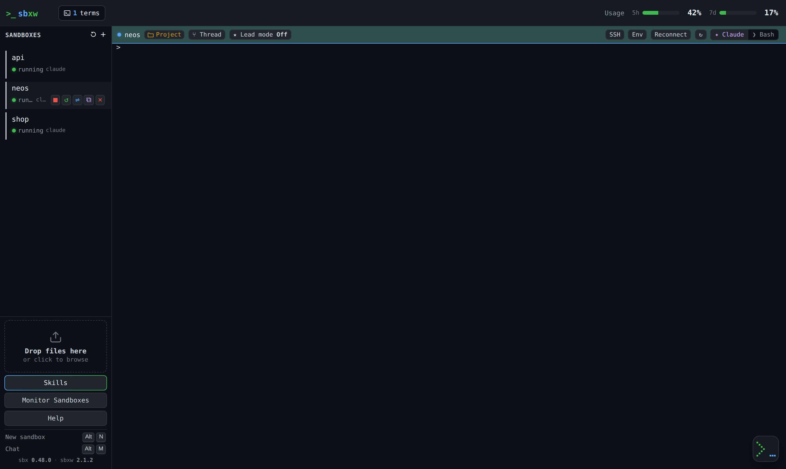
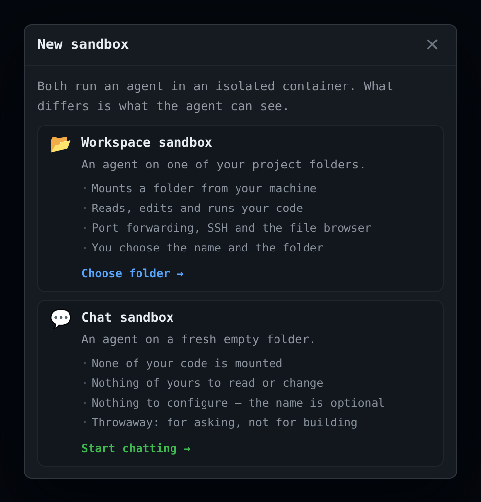
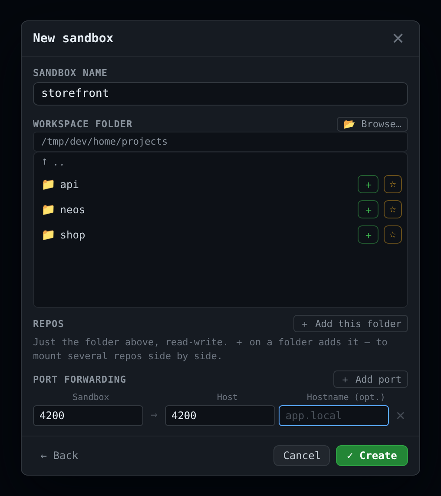
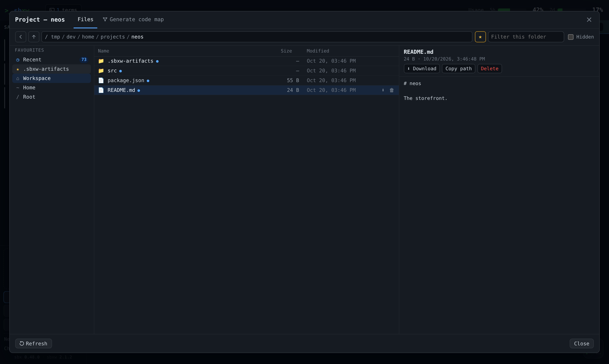
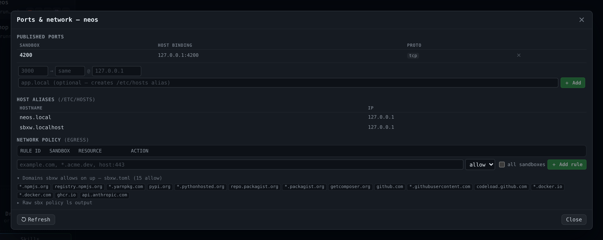
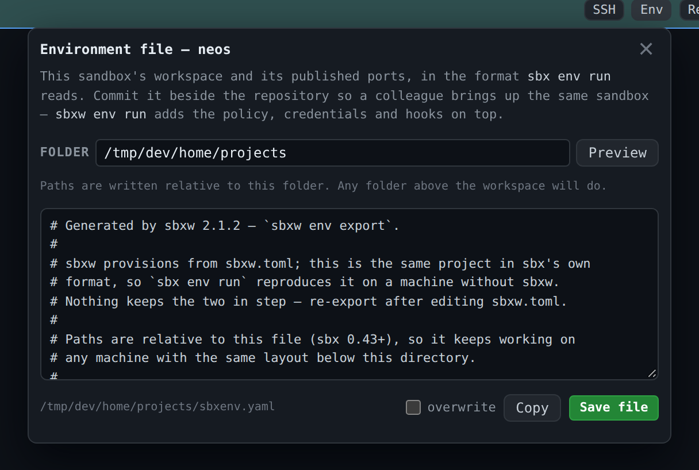
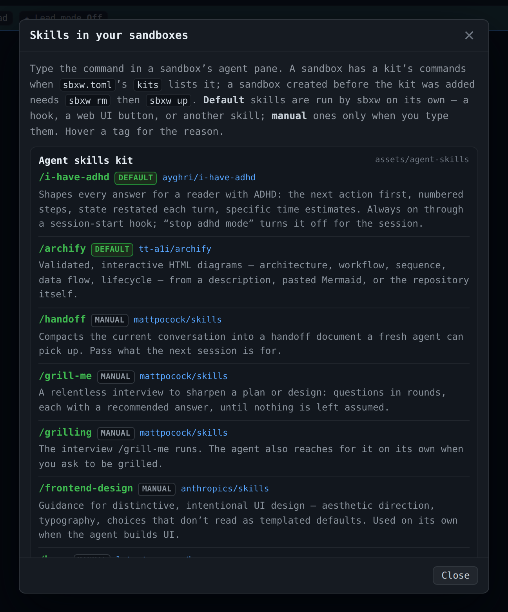
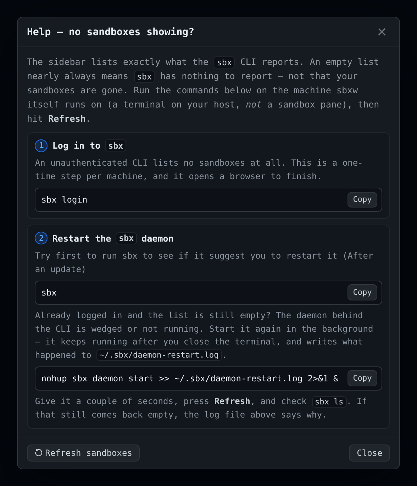

# Web UI

[← Back to README](../README.md)

Served at <http://sbxw.localhost:7681> by default (`web_addr` in
[`sbxw.toml`](configuration.md)). To open it, run `sbxw web` (or
`sbxw web <sandbox>`; `sbxw up` prints the same address) and open the sign-in
address it prints, `http://sbxw.localhost:7681/?t=<token>`. It signs this
browser in with a cookie and drops the token from the address bar. Typing the
bare address shows a page that says to run `sbxw web`. The token is new each
time the daemon starts: after a restart an open tab reloads onto that page,
and the newly printed address signs it in again. See
[Security: two listeners](security.md#two-listeners).
A paired phone has its own reduced page, over your tailnet: see
[Remote access](security.md#remote-access).



- [Layout at a glance](#layout-at-a-glance)
- [Creating sandboxes](#creating-sandboxes)
- [Remote hosts (experimental)](#remote-hosts-experimental)
- [The pane bar](#the-pane-bar)
- [The Kanban](#the-kanban)
- [The Project panel: files and code map](#the-project-panel)
- [Ports and network policy](#ports-and-network-policy)
- [Environment file and SSH cards](#environment-file-and-ssh-cards)
- [The sidebar footer](#the-sidebar-footer)
- [Screenshots from the browser side panel](#screenshots-from-the-browser-side-panel)
- [Keyboard shortcuts](#keyboard-shortcuts)

## Layout at a glance

| Area | What's there |
|---|---|
| **Header** | The terminal-count switch (1 to several panes), the terminal colour picker, the [**Kanban**](#the-kanban) button, for the background, the bar above it and the text (kept in this browser; the defaults come from [`terminal_color`, `terminal_bar_color` and `terminal_text_color`](configuration.md)), the relay badge when an agent's question waits for you, and your **Claude subscription usage** |
| **Sidebar** | Every sandbox `sbx ls` reports, grouped by workspace folder (and first by host, when [remote hosts](#remote-hosts-experimental) are registered). Chat sandboxes go under **💬 Chats**. In each group, and among the sandboxes outside any group, the ones on screen come first, in pane order. A sandbox's [threads](threads-and-lead.md) are listed under its row. Clicking a row opens it in the focused pane; a row that is in no pane has a **+** at its top right, which opens it in the first empty pane, or adds a pane for it |
| **Panes** | One terminal each. A sandbox's panes sit next to each other in a shared colour |
| **Bottom right** | Background-job cards (bring-ups, code maps, relay requests) and the [chat dock](chat.md#the-chat-dock) button |

Each sandbox row has buttons to **stop**, **reload**, open **ports and network**
(⇌), **duplicate**, and **remove** (✕). Beside the name: its age (hover for the
creation time).

A sandbox made by an sbx older than 0.51 carries a small amber ring beside its age (read
once from `sbx inspect`, which records the creating version since 0.51). It
keeps running but takes no kit; **⟲ recreate** removes it and creates it again
from what sbxw recorded — workspace, config, mounts, Remote Control — after
asking, since everything outside the workspace folder is lost. A chat is never
recreated: its workspace goes with it.

**⚑ N** beside a row's age means sbx is waiting for you to decide something
for that sandbox (`sbx policy approval`, 0.51): a host it reached that no
rule allows, or a kit asking to publish a host port (that one lapses after
45 s). Click it to see each request with the options sbx offers — **Allow**,
**Dismiss**… — and answer there; the list refreshes while it is open. sbxw
never answers on its own.

**Usage.** The 5-hour and weekly percentages are account-wide, the same numbers
as Claude Code's `/usage`. They turn amber at 75% and red at 90%. They are
hidden with API-key auth, which has no subscription windows. How they're
collected is in [Dynamic Island](island.md#subscription-usage).

## Creating sandboxes

**＋** (or **⌃⌥N** on a Mac, **Alt+N** elsewhere) asks which kind you want:



The **workspace sandbox** dialog asks for a name and a project folder, then
lists the optional settings below: extra folders, ports, Remote control. It goes through the same pipeline as `sbxw up`.



- **Ports** rows: sandbox port → host port, optional host IP, optional
  `/etc/hosts` alias.
- **Several repos in one sandbox.** **＋** on a folder (or **＋ Add this
  folder**) adds it to **Extra folders**. The first is the workspace, always read-write;
  threads put their worktrees there. Others are mounted beside it at the same
  path, read-only by default or read-write.
- **Restricted sub-folders.** Under the folder list, **＋ Restrict a sub-folder**
  keeps a folder inside the workspace (or inside a read-write extra folder)
  out of the agent's reach. Pick it in the folder list, which stays inside the
  parent, or type a path that is inside it. Each restriction is a row with the
  path relative to its parent, **No access** or **Read-only**, **Strict** or
  **Soft**, and a remove button. You can add several per folder.
  - **Strict** (the default): the folder never enters the sandbox. sbxw does not
    share the parent as a whole but mounts its sub-folders one by one. The cost:
    files lying directly in the parent (and at each level down to the folder)
    are not visible in the sandbox, and nothing new can be created at those
    levels. It fits a folder of projects.
  - **Soft**: the parent is shared whole and the folder is covered by an empty
    folder (or mounted read-only). No such cost, but an agent that uses root in
    its sandbox can remove the cover, so it guards against mistakes, not against
    a hostile agent. It fits a repository that has files at its root.
  - A live preview under the rows says, for example, "14 folders mounted,
    1 excluded, 3 files not visible in the sandbox". Open it to see those files
    and any warnings. If a strict restriction hides files, its row says so and
    offers **Switch to soft**; nothing is switched for you. If the preview
    reports an error (too many mounts, for example), the row shows it and
    **Create** stays disabled until it is fixed. Nothing is sent when there are
    no restrictions. The same rules can be set in `sbxw.toml`.
- **Favourite folders.** ☆ on a folder pins it as a shortcut chip above the
  picker. Star the folder you keep projects in, not each project. Favourites
  live on the host in `~/.sbxw/state/favourites.json` (hand-editable, up to 12).
  A favourite that is missing right now (an unplugged drive) is shown greyed,
  not dropped.

With remote hosts registered, the dialog starts with a **Host** field (see
[Remote hosts](#remote-hosts-experimental)).

The **chat sandbox** dialog is the browser version of `sbxw chat`. See
[Chat](chat.md).

### The automatic template

The automatic template is the default: a project with no `sbxw.toml`, or one
that never sets `template`, behaves as `template = "auto"`. **Create** uses the
template for the configured kits when it is up to date. If it was made by another version of
sbx, or the kits' specs changed since (an sbxw release that leaves the kits
alone does not count), or there is none yet, nothing is asked: the sandbox is
created from sbx's image and opens as usual, and the daemon builds a new
template in the background.

The background build uses a sandbox of its own, `sbxw-tpl-…`, on an empty
workspace: it waits for the new sandbox's kits to finish installing (so it
copies from the kit cache), creates the builder with the same kits, waits for
its installs, saves it as the template, and removes it. The builder is left
out of the sandbox list while it runs (`sbx ls` shows it; one a stopped daemon
left behind shows in the list, so it can be removed). It gets no token, no
project environment and no port. The old template is removed once the new one is saved, and so is any
automatic template no sandbox was created from for a month. A build that
fails is reported in the daemon's log, once, and tried again by the first
creation that wants it after 10 minutes; the wait doubles at each failure in
a row, up to 12 hours. A creation that went without a template says so at the
end of its summary line (`No template: none existed yet for these kits; one
is being built in the background`), so a slow one explains itself.

The first creation with a template and a kit list costs about 11 s more:
sbx assembles an image of the template and the kits and caches it. The
daemon pays that in the background: once a template is saved, and at its
start for a template whose kits' files or sbx changed since (after an sbxw
update, say), it creates a sandbox of its own from the template with the same
kits, `sbxw-warm-…`, and removes it at once. It is created only, never
started, and left out of the sandbox list like the builder. One at a time per
host, never while a creation from that template runs (that creation warms it
anyway), and one that fails is not tried again for the same kits and sbx
until the daemon restarts. The daemon log times each (`warmed sbx's kit image
for …`); `~/.sbxw/state/template-warm.json` records what was warmed. A
sandbox given more kits than the template's (your kept skills, `volumes`) is
assembled anew by sbx at its creation: the warm does not cover it.

What it costs: disk for one saved image per kit list, and a builder sandbox in
the background after the first creation with a kit list. To turn it off, set
`template = ""` in `sbxw.toml`: every sandbox is then created from sbx's image
and installs its kits (sbxw's own Node.js included, about 12 s) at each
creation.

To save the sandbox being created as the template instead, and wait for it,
tick **Rebuild the starting template** at the bottom of the create dialog. The
sandbox then opens only once its kits have installed and it is saved, its
agent token and credentials taken out for the snapshot and put back after.

### Watching the bring-up

A first creation can take minutes while the image downloads. A card in the
bottom-right corner lists every step up front and ticks them off, with `sbx`'s
own output streaming under the running one:

```
sbxw  myapp                     Creating… 2/5
      ✓ Preparing the workspace
      ● Creating the sandbox
          pulling docker.io/…/sandbox-claude: 214.7MB / 512.3MB
        Waiting for the sandbox to start
        Installing the agent tooling
        Publishing ports and host aliases
```

- The network policy step appears only when `sbxw.toml` has a policy. *Applying
  kits* appears only for an existing sandbox (a new one gets its kits inside the
  create step).
- It survives a page reload: the steps come over the UI's event stream.
- Every way of creating a sandbox reports here: the create and chat dialogs,
  **Duplicate**, and the island's chat.
- A failed `sbx create` shows sbx's own error, not just "exited with status 1".
- **Hosts sbx refused.** When a create or a kit install fails because sbx
  denied network access, the card lists each host (sbx 0.54 names them;
  before, sbxw reads them off the sandbox's policy log since the step began)
  and stays until you dismiss it. Each host has one button, scoped as the
  daemon says: **Allow for this sandbox** when the sandbox exists, or **Allow
  for all sandboxes**, with a line saying the rule applies to every sandbox on
  this machine, when the create left no sandbox to scope a rule to. Both ask
  for a confirmation and add a rule through the same route as the network
  panel. **Retry** (on the tab that clicked Create) sends the same request again.

### Where the time goes

Every bring-up is timed: each step, each `sbx` call, and what follows the
end of the card until the agent can be typed into. The timing only measures;
it changes nothing a bring-up does or waits for.

| Where | What |
|---|---|
| The end of `sbxw up` | One line under the steps: `ready in 41 s: create 28 s, boot 6.0 s, tooling 3.1 s` |
| The daemon log (`sbxw logs <name>`, `~/.sbxw/run/daemon.log`) | The same line, then `agent ready ... after the request` once the agent's prompt is up, then `kit startups finished after ...` |
| `GET /api/timings` (UI token, like every `/api` route) | The last 50 timelines in full, newest first |
| `~/.sbxw/state/timings.json` | The same 50, kept across daemon restarts |

The progress stream's `done` event carries the line as `summary`; the
desktop create card does not show it yet. From a terminal on the Mac:

```sh
curl -s -H "Authorization: Bearer $(cat ~/.sbxw/run/ui-token)" \
  http://sbxw.localhost:7681/api/timings | python3 -m json.tool
```

**Three numbers answer "where does the time go"**, each counted from the
request:

1. **Creation**: `ready_ms`, the time to the end of the card. Inside it,
   `sbx_create` is `sbx create` itself (its detail names the template, if any,
   and the number of kits passed); the rest is sbxw's own work and its small
   `sbx` calls (`sbx_ls`, `template_check`, `boot` with its number of `sbx ls`
   polls, `tooling`, `policy_allow`).
2. **From creation to a usable agent**: `agent_ms` minus `ready_ms`. Inside
   it, `attach` is sbxw opening the pane (its `sbx ls`, the `sbx run` spawn),
   `agent_session_start` Claude Code's first `SessionStart` hook, and
   `agent_idle` the first time the session waits at its prompt (today the
   same event, so the same time).
3. **The kits' startups after that**: `startups_ms`, when the last of the
   kits' startup commands ended in the guest. They run in the background
   after `sbx create` returns, beside the agent, so the agent may be usable
   long before they end.

A creation from a template against one without (`template = ""`, or a new
name with the automatic template skipped) says whether the template pays
off: compare `sbx_create` and `startups_ms`.

**Inside `sbx create`.** When sbx's output says so, the timeline's `create`
holds `image` (`cached` or `assembled`: whether sbx found its image of the
template and the kits, or built it) and `installs`, one per kit install
command, each with its `kit` (a local kit by its folder's name only), `what`
(the kit's own description, cut to 60 characters, path-like words left out)
and `ms`. Installs of a second or more show in the summary line:
`ready in 28 s: create 27 s (Node.js install 12.1 s), tooling 640 ms`. The
lines are sbx's and may change: one that does not read is ignored. A timeline
of a creation that went without the automatic template carries `no_template`,
the reason, which also ends the summary line. `sbx_ls` holds `sbx template
ls` too when a creation from the automatic template is likely: the two are
asked side by side.

Reading a timeline:

- `start_ms` and `ms` are milliseconds after the request. `tooling` and
  `policy_allow` run side by side, so they overlap.
- `kind`: `new`; `stopped` (sbx starts it at the attach, so its `boot` is
  empty and its kits' startups are watched from the agent's start);
  `running`; or empty when the bring-up failed before it looked.
- `calls`: every `sbx` call the bring-up made, by subcommand only, with its
  wall time and whether it exited 0. `sbx` calls outside a bring-up go to the
  daemon's debug log (`sbx <class> took N ms`).
- A step marked `unfinished` was running when the bring-up failed; `error`
  names that step (`failed during create`), never the message.
- The attach and the agent's events count for the first attach within 30
  minutes of the bring-up.
- Step names, in order: `remote_link`, `git_clone`, `remote_config` (remote
  host, `--git`), `prepare`, `sbx_ls`, `template_check`,
  `setting_remote_control`, `record`, `setting_chrome`, `create_prepare`,
  `sbx_create`, `run_detached`, `boot`, `tooling`, `policy_allow`,
  `policy_deny`, `kits_add`, `secret`, `aliases`, `template_save`, `done`,
  then `attach`, `attach_ls`, `attach_setting`, `agent_session_start`,
  `agent_idle`, `kit_startups`. A step that does not apply is absent.

A timeline holds the sandbox's name, its host, the template's tag, the
number of kits and the sbx version: no workspace path, no environment value,
no token.

The kit-startup watch looks every 10 seconds, from the end of the card
until the last startup command ends or 20 minutes pass. Each look is an
`sbx ls`, then, only while the sandbox runs, an `sbx exec` listing its
processes. It never starts a sandbox: one found stopped ends the watch
("the sandbox stopped before the startups ended"), and stopping or removing
it from sbxw ends the watch first. The `kit_startups` step's detail says how
many looks it took and how long those `sbx` calls ran in total.

## Remote hosts (experimental)

sbxw can run sandboxes on other machines over SSH ([Remote
hosts](remote-hosts.md)). This part of the UI is **experimental**, like the
feature. With no host registered, none of it shows.

**The sidebar, by host.** With at least one host in `~/.sbxw/hosts.toml`, the
sidebar is one section per host: `local` (this machine) first, then each host
by name, each with its own workspace groups. Click a host's header to fold it;
the folded ones are remembered in this browser. Rows under a remote host show
the bare sandbox name; its full ref is `host~name` (hover the name).

Each host's header shows:

| Part | Meaning |
|---|---|
| Dot and text | Green with a latency (`12 ms`, the last round trip over the SSH link, timed again every 30 s or so): the link is up. Red, **down HH:MM**: it was up and dropped at that time; sbxw keeps retrying. Grey, **never**: sbxw has not reached it yet. Hover the dot for the full sentence |
| Count | Sandboxes sbxw holds a record of there |
| **⋯** | **Test** runs `sbx version` over the link and times a round trip. **Provision** shows the command that installs `sbx` on the host, `sbxw host provision <host>`, to copy and run in a terminal on this machine: it asks for your sudo password on the host and for a Docker token, which the page never sees. **Edit** opens **Setup → Hosts** on that host |

**Unreachable sandboxes.** While a host's link is down, its sandboxes stay
listed, greyed, with **unreachable since HH:MM** (your browser's time) in place
of their status. Their buttons are disabled, and hovering one says why. They
come back on their own when the link does.

**Creating on a host.** In the workspace dialog, **Host** picks where the
sandbox runs (default: the one you picked last, in this browser). On a remote
host, the folder browser lists that host's folders, and **Or clone a git URL**
clones a repo there instead, into `~/sbxw-repos/<repo>` on the host (a folder
already there is used as it is). Favourites, the native **Browse…** picker and
kit folders are this machine's, so they are hidden. The automatic-template
question is not asked for a remote host.

**Setup → Hosts** lists the hosts with their link and sandbox count, and edits
`hosts.toml` (the same file `sbxw host` edits):

- **Add a host**: a name, then an SSH alias from `~/.ssh/config` or an address
  (with optional user, port and identity file path), the agent port (default
  7682) and the `sbx` path on the host (default: detected). If the host key is
  not in `~/.ssh/known_hosts`, its fingerprint is shown first: check it on the
  host (`ssh-keygen -lf /etc/ssh/ssh_host_ed25519_key.pub`), then **Trust and
  save**. If the key changes between the two steps, nothing is saved.
- **Trust this host with secrets** (`trust_secrets`): sbxw then sends that
  host your Anthropic API key and your kept skills. Anyone with root on the host can
  read them. Only for a machine you control.
- **Edit** changes any of these; a new address asks about its key again.
  **Remove** unregisters a host; one with sandboxes is refused unless you
  confirm a second time (their records stay on disk). Nothing on the host is
  touched.
- **Reload file** re-reads `hosts.toml` after you edit it by hand or with
  `sbxw host`. A host whose settings changed gets a new SSH link.

## The pane bar

Each pane has a bar. On the left, things about the **workspace**; on the right,
things about the **session** in the pane.

| Button | What it does |
|---|---|
| **Project** | Opens the [Project panel](#the-project-panel): files and code map |
| **⑂ Thread** | Opens another Claude session in its own git worktree. See [Threads](threads-and-lead.md) |
| **★ Lead mode** | Turns the main session into a planner. Reads Off, Waiting (for an idle agent), Starting (until the session confirms), On, or No lead (a plan under way that no session leads); a click while Waiting or Starting cancels. See [The lead](threads-and-lead.md#the-lead) |
| **⋯** | A menu: **SSH** (connection details for SSH clients), **Environment file** (export the sandbox as `sbxenv.yaml`), both [below](#environment-file-and-ssh-cards), and **Reconnect** (reopen the WebSocket) |
| **↻** | Rebuild the terminal widget, then reconnect. Reconnect and ↻ both replay the last 256 KB of the session |
| **Claude ↔ Bash** | Switch between the agent and a shell. Both keep running server-side, with their scrollback |

**Names in the New thread and New session dialogs.** The name field fixes
what is typed or pasted instead of refusing it: lower case, accents folded
(`é` becomes `e`), every run of spaces, underscores, dots, slashes and other
characters one hyphen, no hyphen at either end, at most 40 characters. Pasting
normalizes the whole field at once. While you type, only capitals and
separators change, and a hyphen at the end stays so `fix-` can become
`fix-login`; the caret stays after the letter you typed. Leaving the field and
opening the thread apply the full rule. A line under the field, *Will be
created as `fix-login-bug`*, shows the name used when it differs from the
field, and the worktree and branch lines use it. A name that normalizes to
nothing (`!!!`) only keeps **Open** disabled; a name already taken by another
kind of session is still refused. The daemon checks the name again. The rule is
`normalizeName` in `assets/js/util.js`; sandbox names (the create form) keep
their own stricter check.

Notes:

- **Bash on a stopped sandbox** starts it: `sbx exec` starts a stopped
  sandbox before running the shell (sbx 0.50). Busy host ports are released
  first, as for the agent.
- **Replays are repainted, never re-answered.** Terminal queries in the replay
  (`CSI 6n`, `CSI c`) are stripped, so a reconnect doesn't type
  `37;3R37;3R…` onto your command line.

### Files and terminal panes

Two things work on a file, in every pane. The code is `assets/js/pane-files.js`;
it adds no route, origin or permission, changes nothing in the CSP, the token,
the WebSocket protocol or what the daemon accepts, and loads no new library
(it uses xterm's own `registerLinkProvider`).

**A file or folder path in the terminal is a link.** Hover it: it is underlined, the
pointer shows a hand, and a tooltip gives the resolved absolute path and the
sandbox (and thread) a press would look in. **Cmd + click** (macOS) or
**Ctrl + click** (elsewhere) opens the [Project panel's Files tab](#files) on
that file or folder, in that pane's sandbox, through the same `fxOpenPath` the
[chat's file links](chat.md) use. A plain click and a text selection keep
working. Terminal web links have no click gesture of their own here (plain URLs
are not links; OSC 8 hyperlinks keep their behaviour, http and https only), so
Cmd/Ctrl + click is the one this adds.

- **What counts as a path** is the chat's rule (`chatFilePath`): ASCII path
  characters, a slash in it, no scheme, no `..`, at most 300 characters, and
  one of three shapes. A file with an extension from the same list, with an
  optional `:line` (ignored by the preview). A **folder**, written with a
  trailing slash (`/tmp/x/`, `src/app/`, `./build/`, `~/projects/`): the Files
  tab lists it, no row selected. An **anchored path with no extension**
  (starting with `/`, `~/` or `./`, at least two segments deep, such as
  `/tmp/sbxw-chat/test/graph-lookup` or `~/dev/sbxw/Makefile`): its folder's
  listing decides; a folder is listed, a file selected and previewed, neither
  says *Not found*. So `and/or`, `TCP/IP`, `Rust/Luau` and URLs never link.
  Trailing punctuation (`.` `,` `;` `:` `!` `?` `*`) is not part of a path.
  The cases are one table, `tests/js/file-link-cases.json`, that the desktop
  app's terminal tests read too.
- **Relative paths** are relative to the shell's current directory, which the
  page cannot know. They are read against the sandbox's workspace, as the Files
  tab does; in a thread's pane (agent or shell) against that thread's worktree,
  `<workspace>/.sbxw-worktrees/<thread>`, when the thread has a worktree of its
  own. A session on the main checkout uses the workspace. A shared plan's
  threads use a worktree whose folder name the page does not hold, so the
  workspace is used there. A shell where you `cd` somewhere else can therefore
  resolve a relative path to the wrong place: the tooltip shows where before you
  press, and the Files tab says *Not found* when the file is not there. Absolute
  and `~/` paths are exact.
- **Wrapped lines**: a path the terminal cut across rows links as one when
  xterm reports the rows as one wrapped line (up to 12 rows, 2,000 characters;
  a longer line gives no link).
- **Nothing is requested** on render or hover. The provider runs on demand for
  the line under the pointer, in linear time. Terminal output is data: a path
  is shown as text and passed as a value; it never enters HTML, an attribute or
  a URL.

**Dropping files on a pane.** Drag files over a pane and it shows *Drop to
send to `<sandbox>`* (and the thread). A drag with no file (text, a link) does
what it did. On drop, before any byte is sent, the same checks as the
[chat attach](chat.md#attaching-files): empty files, over 128 MB, folders and
more than 10 files are refused with a reason, and a name that looks like a
secret waits for the tick *I have looked at these files and want to attach
them*. The files then upload to that pane's sandbox through the sidebar Upload's
route, with progress on the pane; a failure shows its message and **Retry**.
When all are uploaded, the paths the daemon answered are typed at the pane's
prompt, shell-quoted where needed and separated by spaces, with **no Return**:
you read the line and press Enter. The line is built only from the daemon's
answers, never from the dropped file's own name.

If the pane cannot take keys at that moment, nothing is typed; a notice on the
pane gives the reason, the line, and a **Copy** button. The cases: terminals
held while you review a Jarvis high-risk proposal; the pane is not on screen;
the pane shows another session now; the terminal is not connected
(reconnecting or closed); a dialog is open over the terminals; a path with a
control character. The sidebar Upload box uses the same function, so it no
longer says *attached* when the paths were not typed.

While Jarvis holds the terminals, the hold guard still stops a dropped or
pasted file, anywhere. The window-level guard from the chat attach still stops
the browser opening a file dropped outside any target, including over the panes.

## The Kanban

The tickets of a sandbox, or of every sandbox, in five columns: **Planned**,
**In progress**, **In test**, **Ready to merge** and **Merged**. It is the
same board as the desktop app's Kanban, drawn from the same daemon route; how
a ticket moves between columns is in
[Tickets and the Kanban](threads-and-lead.md#tickets-and-the-kanban).

**Opening it.** The **Kanban** button in the header opens it on the focused
pane's sandbox; the picker beside its title switches to another sandbox or to
**All sandboxes** (each card then names its sandbox). The worktree graph (and a
shared plan's claims board, the same dialog) has **Open the Kanban** in its
footer, for that sandbox. The claims board keeps its name: it is the threads'
file claims and feed, not the tickets.

**The board.** Each column has its count and scrolls on its own, so its
heading stays in view. The page draws what the daemon answers (the column of
each card, its labels, marks, counts and the summary line) and works out none
of it. A card shows its number (or *thread* for a thread with no ticket), its
title (short or long, as the column's width allows; the whole title is its
tooltip), its marks (a mark's tooltip says what it means), its thread with
the thread's colour, and its age. A red left edge means failed or refused
work. Merged shows its 12 newest; **Show n older** reads the rest. Under about
700 px each column takes most of the width and the row scrolls sideways,
snapping to a column. The board is read again (after 300 ms of quiet) on every
`tickets` and `plan` event of the stream, keeping each column's scroll and an
open ticket.

**A ticket.** Pressing a card opens it in a panel on the right, over the
board: its column, marks, title, description (plain text, line breaks kept),
pictures (up to four, read from the daemon as blobs), its files as chips with
name and size (a press downloads the file through the daemon, which serves it
as an attachment), its thread with **Terminal**, **Plan** (while the plan
waits for approval or a merge) and **Worktrees**, and its history. Escape or a
press outside the panel closes it and gives the keyboard back to the card; a
second Escape closes the Kanban.

**A new ticket.** **＋ New ticket** opens a form: the sandbox, a title (160
characters), a description (8,000), a priority, and files by **Attach…** or
by dropping them on the form. Before anything is sent:

- each file is checked against the daemon's limits (20 MB a file, 20 files and
  100 MB a ticket) and by its first bytes: archives (zip, tar, gzip, 7z, rar,
  xz, bzip2, zstd), native programs (ELF, Mach-O, PE) and empty files are
  refused as they are handed in, with the reason, as the daemon would;
- a file whose name looks like a secret (`.env*`, `*.pem`, `*.key`, `id_rsa*`,
  `id_ed25519*`, `*.p12`, `*.pfx`, `credentials*`, `.npmrc`, `.netrc`,
  `*.kdbx`, the desktop app's list), more than 10 files or more than 25 MB in
  all need the box **I have looked at these files and want to attach them**
  ticked: Save sends nothing until it is. A page is not told a file's folder,
  so the desktop's check for `.ssh`, `.aws` and `.gnupg` folders is not made
  here.

Save creates the ticket, then attaches the files one at a time, each marked
*sending*, *attached* or *refused*. A file the daemon refuses stops the run:
the form stays open and says what was attached and what was not, the ticket
keeps the files that went, and **Attach the rest** sends the remaining ones to
the same ticket (it never makes a second). **Close, keep T-n** leaves the
ticket as it is. Escape closes the form only while it is empty.

**Not in the web view:** moving a ticket, changing its priority, editing it,
marking it validated, removing a file, deleting a ticket and **Send to the
lead**. They are in the desktop app, and the web view shows no control for
them. A planned ticket's panel says: *Send it to the lead from the desktop app,
or ask the lead to read the planned tickets.*

**Text stays text.** Titles, descriptions, file names, marks and history lines
go into the page escaped, never as markup; a file's link is built from the id
the daemon gave, not its name; nothing of a ticket is logged.
`tests/js/kanban.test.mjs` draws the board and tickets from the daemon's own
answers (`desktop/fixtures/kanban/*.json`) and checks that hostile text adds
no element or attribute.

## Status pills

When an agent writes a status label such as `[[Done]]` or
`[[Failed: 3 tests]]`, each terminal draws it as a discreet capsule over the
same cells, the brackets left out (their cells are its rounded ends), with
the desktop app's colours: a 10% tint of its colour over the row's own
background, the word in the terminal's text tinted toward the colour and the
detail in plain text, both kept readable (4.5:1), never bold, no outline.
Green for done, red for failed, amber for what needs you, a filled red with
white text for what cannot be undone, blue for context, cyan for the kind of
work, purple for the team. Copying or selecting gives the text as written,
brackets included; while a selection is on screen the pills step aside so it
can be seen. The words, colours and switches are in the daemon's
`sbxw.toml` (see [Status pills](configuration.md#status-pills)), and a change
Jarvis applies redraws every open terminal without a reload.

Each pill is attached to its line, so it scrolls with the text in the same
frame, and stays on lines in the scrollback (up to 1,000 per terminal; past
that, the ones farthest from what you are reading go first). Rows brought
into view by a scroll are read in that frame; only a burst of output
repainting the whole screen is read once it settles (60 ms).

The pills are drawn in the terminals only, not yet in the requests panel or
the session activity lines.

## The Project panel

**Project** in a pane's bar opens a near-full-window panel with two tabs.

### Files



A file browser over the sandbox's **own** filesystem, opening on
`.sbxw-artifacts/`, where agents put deliverables. A hook sends a new
document there (Markdown, PDF, an image, a lone `.html` report); a project's
own web pages stay where they are: an `index.html`, a page under a folder
such as `public/`, `src/` or `templates/`, or one beside web code.

- **Navigate:** breadcrumb (click its empty space to type a path, `~` works),
  back and up, a filter, and a **Hidden** toggle for dotfiles.
- **Preview:** text, images, Markdown (rendered, see below), and HTML (in a
  sandboxed iframe), with **Download** and **Copy path**. A folder with a
  README opens on it.
- **Markdown:** a `.md` or `.markdown` file opens rendered, with a
  **Rendered | Source** switch in the preview's header (the choice holds for
  the browser session; Source is the plain text view). The preview widens
  while a document is read; the text keeps a readable width, tables and code
  blocks scroll sideways inside themselves, and an **outline** of the headings
  sits beside the text when there is room (a menu above it otherwise). The
  renderer (`assets/js/markdown.js`) covers headings, paragraphs, emphasis,
  strikethrough, code spans and blocks (the language as a label), quotes,
  lists and task lists, tables with alignment, rules, links and images. Raw
  HTML and entities are shown as typed, never interpreted. A file past the
  preview's 1 MB cap is rendered from its head and says so at its end.
- **Links in a document** act only on a press. `http`/`https` links open in a
  new tab (`noopener noreferrer`) and show their address on hover. A relative
  link (`web-ui.md`, `./chat.md#the-chat-dock`, `../README.md`) opens that
  file in this Files tab, resolved against the document's folder (never above
  `/`), and lands on the heading it names; `#anchor` scrolls this document.
  Any other scheme (`javascript:`, `data:`, `file:`, `mailto:`…) is not a
  link: its text and address are shown as text.
- **Images in a document:** a relative image of this sandbox (png, jpg, gif,
  webp, svg, bmp, ico, avif) is loaded through the same file route as the
  preview, capped at 24 MB, at most 24 per document. A remote image is never
  loaded: its description and address are shown as text.
- **Downloading a folder:** a folder row has a ⬇ button, as a file row
  does, and a folder's preview (↑/↓ onto it) shows its file count and size
  and **⬇ Download folder**. It downloads as `<folder>.tar.gz`, which holds
  the folder by its own name (a double click on a Mac unpacks it). The
  daemon packs it with `tar` where it reads files: inside the sandbox when it
  runs, else from the workspace on the host (a stopped sandbox, workspace
  only). Links are stored as links, never followed out of the folder;
  nothing in it is left out, as for a single file (`~/.ssh` or `~/.claude`
  download as files do today: the explorer has never hidden them). **The cap
  is 256 MB** of files in the folder (the daemon's `MAX_ARCHIVE`, the same
  memory bound as a single file's 256 MB): the folder is counted first, and
  one over the cap is refused with its size and the cap ("too large to
  download here: N bytes (M files), over the 268435456 bytes a folder
  download allows"); the page says so before it saves anything, and the
  button is off in the preview. An archive that still grows past the cap
  while it is packed is refused too, never handed over cut. The desktop
  app's cap is lower, 128 MB (its own download limit). The daemon packs the
  whole folder before it answers, so the browser's download starts only then.
- **Keyboard:** ↑/↓ move and preview, Return opens a folder or downloads a
  file, Backspace goes up (in **Recent**, back to the previous view).
- **Favourites:** `.sbxw-artifacts`, the workspace, the agent's home and `/` are
  built in. ★ pins any other folder (per sandbox, in this browser). Extra repos
  mounted at creation show up here too.
- **Kit logs** opens `/var/log` on `sbx-kit-startup.log`, the output of every
  kit's startup commands on every boot; `sbx-kits/<kit>/install-<n>.log` beside
  it holds each install hook's. When a kit seems to have done nothing, the
  reason is there.
- **◷ Recent** lists the files written in the last 7 days across the
  workspace, read-write mounts, home and `/tmp` (minus `.git`, dependency and
  cache folders), newest first, up to the 300 most recent. Each has a **Show in folder** button: an agent's
  file is not always where you asked for it. The badge counts the last hour's
  files, and a blue dot marks them in any listing.
- **Delete:** 🗑 on a row, **Delete** in the preview, or the Delete key, after a
  confirmation. Allowed only under the workspace, a read-write mount, home or
  `/tmp`, never on those folders themselves, `.sbxw-artifacts` or `.git`. The
  daemon re-checks the resolved path, so a symlink is no way out.

**File paths in chat.** In an agent's reply, a path such as
`.sbxw-artifacts/foo.md`, `./a/b.json:12`, `~/notes/x.txt` or `/var/log/y.log`
becomes a small file button (dotted underline, 📄, monospace). Pressing it (Tab,
Enter or click) opens this panel for **that message's sandbox**, in the file's
folder, with the file selected and previewed: the same listing and preview as a
click in the list (`fxOpenPath` in `files.js`). A file the folder lacks shows
"Not found in <sandbox>: <path>" in the panel's notice line. Hovering shows the
full resolved path and the sandbox. Nothing is requested until a press.

Detection is strict: a token of ASCII path characters with a `/` (or a leading
`./`, `~/`, `/`), no `..` or `//`, no scheme (`http:`, `file:`, `javascript:`),
at most 300 characters, ending in a file name with an extension from a short
list (md, markdown, txt, html, htm, json, csv, log, pdf, png, jpg, jpeg, gif,
webp, svg, js, mjs, ts, tsx, jsx, py, rs, go, toml, yaml, yml, sh, css, xml,
sql, rb, java, c, h, cpp), optionally `:line` (the preview does not scroll to
it). It must stand alone in the text or be the whole content of a backtick
span. Nothing inside a multi-line code fence, a markdown link label, or the
person's own messages. Relative paths resolve against the sandbox's workspace,
`~/` against its home. It works in the chat dock and in Jarvis's panel (agent
cards and question rounds); the browser extension's side panel and the
request popup show the path as plain text. The button carries only an index
into the paths of its own message; the path is never put in markup, an
attribute or a URL, and the daemon alone decides what may be read.

A running sandbox is read through `sbx exec`, so you see what the agent sees. A
stopped one shows its workspace from the host and says so, rather than being
started to list a folder. Every file is served with
`Content-Security-Policy: sandbox`, so an HTML file an agent wrote never runs
with the daemon's origin.

### Code map

The second tab reads the project's code map, the linked Markdown in
`.sbxw-artifacts/codemap/` written by the [codemap kit](kits-and-skills.md#bundled-kits):

- `[[wiki links]]` are clickable, each section lists its **backlinks**, an
  outline jumps within a file, and search spans the whole map.
- A **Diagram** tab shows the map's [Archify](https://github.com/tt-a1i/archify)
  architecture diagram, live, in a sandboxed iframe. A map without one shows the
  graph of its links.
- A **dead link** is drawn struck through in red, so a map that drifted from the
  code shows it.

**Generate code map** appears on a project without one. It runs `/codemap` in a
**background session** of that sandbox, so your agent pane stays yours. While it
runs, the sandbox row shows an amber `map…` badge and a corner card names the
run. The agent reports completion by POSTing to `$SBXW_CODEMAP_DONE`; the
session's exit is the fallback.

**Write a lens…** retells the map for one reader, such as *"a product owner:
what each part delivers, for whom, and what it costs to change"*. The agent runs
`/codemap-lens` in the background, names the lens itself, and writes it to
`.sbxw-artifacts/codemap-lenses/<slug>/`. The lens then appears in the map
picker.

The button refuses up front, rather than failing minutes later, when: the
sandbox is stopped; the codemap kit isn't applied; or a map or lens is already
being written (one at a time, since a lens reads the map).

## Ports and network policy

**⇌** on a sandbox row opens **Ports & network**:



**Published ports and aliases.** View, add and remove mappings, including host
IP and `/etc/hosts` alias. The host port is optional: left empty, sbx 0.54
picks a free one on 127.0.0.1 (`sbx port publish NAME 3000`); an older sbx
publishes on the sandbox port, as before. sbx picks a host port only on the
loopback address, so a host IP other than 127.0.0.1 needs a host port: the form
says so and sends nothing. The line under the form says the port it got and, on
an older sbx, why it is not an automatic one. On sbx 0.54 publishing on a
stopped sandbox starts it first.

**Network policy.** No single `sbx` call answers "what can this sandbox reach?",
so the panel combines three:

| Section | From | Answers |
|---|---|---|
| **Blocked recently** | `sbx policy log <name> --format json` | Each host this sandbox was refused, newest first, with a count and an **Allow** button |
| **Rules** | `sbx policy ls <name> --wide` | Which domains are allowed or denied (with a filter, since a global policy can have hundreds) |
| **Recent egress** | `sbx policy log <name>` | What was actually allowed or blocked, and why. Click the **ACTION** header to put denies (or allows) first |
| **Policies governing this sandbox** | `sbx policy ls <name>` | Each policy with its source (`local`, `kit`, `org`) and rule counts |

Plus the **domains sbxw allows on up**, from `sbxw.toml`.

If one call fails, only its section goes. Output sbxw can't parse is shown
verbatim rather than as a misleading empty list.

**Adding and removing rules:**

- The form takes sbx's syntax (`example.com`, `*.acme.dev`, `host:443`,
  comma-separated) with allow or deny. It's scoped to this sandbox unless you
  tick **all sandboxes**, which asks for confirmation.
- **Only some HTTP requests** narrows the rule: methods (`GET, HEAD`), a path
  glob (`/v1/**`) and query parameters every request must carry
  (`org=acme, label=release*`), sent as `--method`, `--path` and `--query`
  (sbx 0.50). Allow `api.example.com` only for `org=acme`, for instance.
- **✕ on a rule** runs `sbx policy rm network --id <rule-id> --force`, after a
  confirmation. It appears only when sbx reports a rule id. Rules from an `org`
  source show 🔒: sbx won't let you remove them.
- **Allow on a blocked host** adds an allow rule for that host (without its
  port), for this sandbox only, after a confirmation. A host blocked by
  organisation policy shows 🔒 instead.
- **Why?** beside an allowed host in **Recent egress** runs `sbx policy check
  network --sandbox <name> <host[:port]>` (sbx 0.54) and shows the rule sbx names
  and its answer as text. When that rule is one the **Rules** table can remove,
  **Remove this rule…** presses that row's ✕, with its confirmation. Before
  0.54 it says it needs sbx 0.54.
- **↻ Re-read policy now** runs `sbx policy refresh`: the policy is
  re-read at once, after an AI Governance change say, instead of at the next
  poll. Open connections stay open.

Rules changed here are **not** written to `sbxw.toml`; the next `sbxw up`
re-applies the configured allowlist. For a permanent change, edit
`network_allow` / `network_deny`.

## Environment file and SSH cards

**⋯ → Environment file** opens a card that exports the sandbox as an `sbxenv.yaml`: live
preview, an editable target folder, **Copy** and **Save file**. It reads the
ports the sandbox *actually* has, including ones you added in the UI. See
[Environment files](environment-files.md#sbxw-env-export-write-the-file).



**⋯ → SSH** opens a card with one copy button per field of an *Add SSH connection*
form: **Name**, **SSH Host** (`<name>.sbx`), and **SSH Port** / **Identity
File** shown as *leave empty* (the managed `Host *.sbx` block supplies them).
The last row is the whole command, `ssh <name>.sbx`. See [SSH](ssh.md).
On sbx 0.54, until the SSH configuration has been written again, the card
starts with a reminder and **Rewrite SSH configuration**, which runs `sbx setup
ssh` (`POST /api/ssh/setup`); it shows only where `~/.ssh/config` already has
the `*.sbx` block.

Both cards close with Escape or a click outside.

## The sidebar footer

| Item | What it does |
|---|---|
| **Drop files here** | Drop or pick a file, choose a sandbox, and it is copied in. Its path is typed into that sandbox's Claude prompt, not submitted, so you can say what it's for. Up to 128 MB |
| **Setup → Skills** | Lists the commands the bundled kits put in every sandbox, which run on their own (*default*) and which only when typed (*manual*); above them, **Your skills** keeps a skill made in a sandbox for every new one ([details](kits-and-skills.md#keeping-a-skill-you-made)) |
| **Setup → Templates** | Lists the saved templates (`sbx template ls`), marking the one `template` in `sbxw.toml` names (*in use*) and the ones `template = "auto"` keeps (*automatic*). **Remove** deletes one. Pick a sandbox and a tag, then **Save**, to snapshot it as a new template: its agent token and Claude credentials are taken out first and put back after, as with `sbxw template save`. sbx may stop the sandbox for the snapshot; sbxw starts it again |
| **Setup → Kits** | Edits the `kits` line of an `sbxw.toml` sbxw uses — the daemon's own, or the one a sandbox was created from; no other file. Bundled kits are checkboxes (`sbxw:<name>`); any other reference (a path, a `.zip`, an OCI ref, a git URL) a list with **Add** and **Remove**. Only that line is rewritten: comments, `[[ports]]` and the rest stay as written. A file without the line shows the defaults; **Save** writes them out, **Use defaults** removes it. New sandboxes from this page get the change at once; an existing one at its next `sbxw up` |
| **Setup → MCP** | The MCP servers registered on this host (`sbx mcp ls`). **Add** registers one: a remote URL with optional headers (a `${key}` in a header is a secret, typed in the dialog and stored as `mcp:<name>:<key>` through `sbx secret set`, never on a command line), or a host command (stdio) with arguments and a working directory. Remote servers are added with `--skip-auth`: authorize an OAuth one with **Sign in**, which runs `sbx mcp auth <name>` on the host: its browser opens, and the token serves every sandbox. **Edit** is a remove then an add, since sbx has no edit — it drops the server's OAuth token, and an empty secret field keeps the stored secret. **Inspect** shows `sbx mcp inspect`; **Remove** unregisters it (sandboxes that loaded it keep it until unloaded). **Load** / **Unload** attach it to or detach it from the running sandbox picked at the top, without restarting its agent; sbx does not say which servers a sandbox has loaded, so both are always offered. On sbx 0.54 a line under the picker shows that sandbox's MCP mode (`static`, `dynamic`, or `unknown`) and the servers connected now, from one `sbx inspect` when the panel opens or the picker moves; before 0.54 it says it needs sbx 0.54 |
| **Setup → Hosts** | Remote hosts (experimental): see [Remote hosts](#remote-hosts-experimental) |
| **Setup → Mac** | The [virtual Mac](../assets/terminal-mac/README.md): install terminal-mac, start, pause, shut down or open the VM, follow the guest's one-time setup checklist, see who holds the lease and the ports opened for it, and take the lease back |
| **Setup → Secrets** | The token sbx's proxy presents to GitHub for every sandbox (`git push` over HTTPS, `gh`): sbx's global `github` secret. Write-only — the page says whether one is set, never what it is; the value goes to `sbx secret set github` on stdin and is cleared from the field. **Use my gh login** (shown when `gh` is in Homebrew's or the system's `bin`, never looked up on `PATH`) stores `sbx secret set github --command '<path>/gh auth token'` instead: sbx runs it on this machine and refreshes the token itself. **Other services** stores a key for a service sbx does not know (`sbx secret set-custom --host … --env … --value-stdin`, 0.51): the sandbox sees a placeholder in the variable, the proxy puts the value in requests to the listed hosts only — hosts are required, since 0.51 substitutes nothing without them. The list shows names and scopes, never values. A token scoped to a single sandbox (`--sandbox`) is not counted as set. **Remove** runs `sbx secret rm github` |
| **Monitor** | Runs `monitor_cmd` (default: `sbx`, its all-sandboxes dashboard) on the host, in a window nearly the size of the screen, over the panes. ✕, a click outside it or the button again closes it; Escape goes to the TUI. `monitor_cmd = []` hides it |
| **?** (Help) | Fixes for an empty sandbox list (below) |
| Shortcuts | The [keyboard shortcuts](#keyboard-shortcuts) for this platform |
| Versions | `sbx` and `sbxw`, for bug reports and for "is my sbx too old?" |



**Monitor** is deliberately one fixed configured command, not a "run anything on
the host" box. It is filed under a pseudo-sandbox (`__host__`) that no real
sandbox name can collide with.

### Help: an empty sandbox list

The sidebar shows exactly what `sbx ls` reports, so an empty list means either
you have no sandboxes or the CLI can't see them. **Help** offers the two
host-side fixes, each with a copy button:



1. `sbx login`. An unauthenticated CLI lists nothing.
2. Still empty? Restart the sbx daemon:
   `nohup sbx daemon start >> ~/.sbx/daemon-restart.log 2>&1 &`, then
   **Refresh**.

Run them in a terminal on the host, not in a sandbox pane.

## Jarvis

Jarvis sits in the middle of the top bar. It is two things at once:

- **The voice of sbxw**, apart from the chat dock: dictation, agents'
  messages read aloud, your words sent to a sandbox. This part runs on your
  machine and has no language model.
- **sbxw's assistant**: a Claude session in a sandbox of its own,
  `sbxw-jarvis`, that can propose changes to sbxw's configuration. Nothing
  it proposes is applied until you approve it. See [Jarvis](jarvis.md).

From left to right in the bar:

| Part | What it does |
|---|---|
| Microphone, green when voice is set up | Click to talk, click again to send; **F8**, held, does the same from the keyboard. Red while it listens |
| Destination, in blue | Where your words go: **Jarvis** (the default), or a running sandbox. Click it to pick another |
| Speaker | Turns the voice on and off. Blue while a message is read; crossed out when the voice is off. Click to stop the reading and mute; click again to hear the next messages (what was missed is not replayed) |
| **Open** | Opens the panel under the bar (**Close** closes it): what was sent, agents' messages, errors |
| **Jarvis · N to review** | Shown while Jarvis has proposals waiting for you. Click it to see them |

While a **high-risk** proposal is on screen, the terminals are held: a dimmed
layer covers them and no key, paste, click, wheel or file drop reaches them
until it is answered or closed ([why](jarvis.md#how-approval-works)).

Rings leave the border while someone talks: blue when the voice reads, red
when the microphone listens. The panel never opens by itself: a message
read aloud, a question or an error leaves a blue dot on **Open** (an error is
also a toast), and you open the panel when you want to see it.

In the panel, hold the microphone beside the text box, or hold
**F8** anywhere on the page (terminals included; `[voice] push_to_talk_key`
changes it), speak, and release: the speech is turned into text on this
machine. The audio is never kept, and neither is the text. The microphone's
tooltip says so, and says why it is off when it is (a build without voice,
models not installed, a page not on `127.0.0.1`).

Two local models do the work, and no language model sits between you and
the agent: Parakeet turns speech into text, and Voxtral TTS reads an agent's
message aloud as it was written. Nothing is reworded in either direction.

Until the models are downloaded the panel shows the command that downloads
them, `sbxw voice install`, and an **Install voice** button that asks first,
then shows the download's progress, with Cancel. A cancelled download picks up
where it stopped. A build without `--features voice` says so.

The browser lends the microphone only to a page on `127.0.0.1` (or HTTPS):
with `web_addr` on a LAN address, the panel says why it cannot listen.

Reading aloud runs in a local server the daemon starts on the first
sentence and stops after five idle minutes (`mlx-audio`, fetched by `uvx`
during the install). It needs a Mac with Apple Silicon and
[uv](https://docs.astral.sh/uv/); elsewhere the panel listens and types but
stays silent. A message is read a few sentences at a time, and the sound
plays as it is made rather than once a batch is finished. Symbols are said
in words (`>=`, `@`, `/`, a file name's dot…), in French for a French voice
and in English for the others. A word the voice says badly can be given its
own pronunciation in `[voice.words]`, or by asking Jarvis
([Words read aloud](configuration.md#words-read-aloud)). The speaker in the bar, or the same one in the
panel's header, switches the voice off: nothing is read, Jarvis's own
prompts included, until you switch it back on, and the choice is remembered
in this browser. Talking stops the current reading without muting. The voice is `[voice]
tts_voice`.

What you dictate is masked before it goes anywhere: an e-mail address, a
phone number, an IBAN or a key becomes `[email]`, `[phone]`, `[iban]` or
`[secret]`, and the names you list in `~/.sbxw/anonymise.toml` become the
aliases you chose. A card edited by hand is masked again as it is sent, and
then shows what left.

```toml
patterns = ["email", "phone", "iban", "secret"]   # optional: the default

[replace]
"Jeanne Martin" = "Personne A"
"Projet Atlas" = "Projet X"
```

Case, accents and hyphens are ignored, and a name only matches as a whole
word. The file is read each time, so a name added is hidden from the next
sentence on; a file that does not parse sends nothing until it is fixed.
A name you did not list goes through, and a recogniser may spell a name
another way; a message is sent as soon as it is said, so the list is the
only guard. What you type straight into a
terminal is not filtered. `sbxw voice status` shows what is in force.

Pick where your words go in the panel's header (the name there is the
picker), or with the name in the bar. **Jarvis** comes first, and is the
default. A project sandbox works as before. What you say with nothing to
answer becomes a message for that agent: it is masked and typed into the
agent at once, with nothing to confirm. Your words show on the right of the
panel; a line under them shows what left only when the masking changed it. The same
goes for your answer to an agent's question. With no sandbox picked, or if
sending fails, the words wait in an editable card (**Send** or *oui*,
**Discard** or *non*). You can also type, and typing needs no voice: it
works in a build without the voice models. Enter sends the text, masked like
speech. If it cannot be sent (no sandbox picked, Jarvis not running, the
masking or the send failed), the panel says why and the text stays in the
input.

**Talking to Jarvis.** Jarvis's sandbox is created the first time you ask
for it, never before. Pick **Jarvis** while it is not running and the panel
offers **Start Jarvis**, then shows its progress (the first start creates
the sandbox and takes a minute or two; a later one starts the stopped
sandbox and opens its session). Your words reach its Claude session
the way they reach any agent, masked first; its answers are shown in the
panel and read aloud. They read as a conversation: plain text on the left,
in full, with only the panel scrolling, and a small speaker on each answer
that reads it again (shown once the voice is set up). With Jarvis picked,
your next words always go to Jarvis, so there is nothing to arm, and
**Follow** is hidden: it only applies to a sandbox.

**Jarvis's proposals.** When Jarvis proposes a change, a dialog opens under
the bar. It does not take the keyboard: a terminal you are typing into keeps
it, and you click into the dialog to use it. It shows the summary, a risk
badge (**Low risk** or **High risk**) and each change with its title and its
diff, as plain text in a scrollable box. **Approve** applies it; **Refuse**
drops it, with an optional reason Jarvis is told. Then the dialog shows what
happened to each change, and the error if one failed. **✕** means later: the
bar's **Jarvis · N to review** brings it back.

With the voice on, Jarvis reads the summary of a new proposal:

- **Low risk:** it asks whether to apply it. *Oui* (or *yes*) approves it,
  *non* (or *no*) refuses it. Anything else is a message to Jarvis, and the
  proposal waits in its dialog.
- **High risk:** it says that this one must be read and approved on screen.
  A spoken *oui* does not approve it: Jarvis only says that again. The
  daemon also refuses a voice approval of a high-risk proposal.

Spoken prompts are in French with a French voice (`fr_*`) and in English with
the others.

A `/grill-me` in the picked sandbox (in its main agent, or in a thread or
session sbxw opened there) engages Jarvis on its own: the panel
gets each round, and reads it aloud. **Follow**, in the header when a
sandbox is picked, does
the same for every turn any of its agents ends (off by default: that is a
lot of talking for ordinary work). A round the agent asks with the relay's `ask_user_questions` tool (what
`/grill-me` does in sbxw) is not Jarvis's: it opens the
[relay popup](relay.md#questions-for-you) on one form, where you answer it or
route it to another sandbox, and its **Read aloud** button uses
Jarvis's voice. With the voice on, Jarvis says a short cue when
such a round arrives. A round the agent only wrote out in its terminal is
answered here, by typing into its session. Such a grill round is
taken **one question at a time**: the panel shows and
reads Q1 with the agent's recommendation, waits for your answer, then
moves to Q2 (*répète* reads it again, *passe* skips it, *précédente* goes
back). Once every question is answered, the answers are listed as one
message ("Q1 : …", as you said them), shown, and sent at once on your
*oui*. Any other message that arrives is read aloud as written (code blocks
left out), and shown as a card with a thin rule on its left, amber while
what you say next answers it: your words are masked and typed into that
session. A multiple-choice question is read with its options, and what you
say picks one (its number, "la deux"; its rank, "la dernière"; or its
words), shown, and sent on your *oui*. **Not an answer** on a card makes your
next words a message of your own instead; **Answer it** arms it again.

**Dictation into a terminal.** Click the microphone in a pane's bar, speak,
and click it again — or hold **F9** in the pane that has focus and release:
the words are typed into that
terminal as if from the keyboard — Claude's prompt, or a shell. No Enter is
pressed, so you can read and fix them first; end with *entrée* (or
*envoie*) and Enter is pressed for you. The button shows once the voice
models are installed.

**Words as you say them.** While you speak, to Jarvis or into a
terminal, what has been heard so far is shown about once a second: in the
Jarvis panel, above its bar when the panel is closed, or in a strip at
the foot of the pane. It is a preview, transcribed again from the start each
time (the model reads a whole recording, not a stream), so a word can change
as the sentence goes on. Nothing is typed or sent until you stop; a dictation
longer than half a minute previews its last half minute.

Nothing said is kept: not the audio, not the text. **Clear** empties the
panel.

## The relay popup

Requests from agents that only you can settle open a popup over the page,
one at a time (the others wait behind it, counted in its header and in the
header badge). It never takes the keyboard from a terminal: click into it
to type. There are four kinds, described in [the relay](relay.md): a
question for another sandbox, a screenshot request, a virtual Mac request,
and a round of questions for you from `ask_user_questions`, answered on one
form (or routed to another sandbox for a draft you review), with a **Read
aloud** button when Jarvis's voice is set up.

## Files dropped on a chat

The chat dock and the browser side panel take files by drop or by their
**Attach** button (see [Attaching files](chat.md#attaching-files)). The code is
one block at the end of `assets/js/chat-core.js` (`chatAttachTray`,
`chatAttachMount`), shared by both pages: it uses the Upload box's route, adds
no route, origin or permission, and changes nothing in the CSP, the token or
the Origin and Host checks.

- File names are data: shown with `textContent`, never in HTML; the name sent
  is encoded and cut (last path component, control characters dropped) and the
  daemon's own sanitising decides the name on disk. Contents are never read
  or logged, and no preview is drawn.
- The secret-name list is `kanban.js`'s (the side panel does not load it);
  `tests/js/chat-drop.test.mjs` keeps the two equal.
- The page also stops the browser opening a file dropped outside a chat.

## Screenshots from the browser side panel

When the agent beside your app's tab calls `ask_user_for_screenshot`, the
[side panel](chat.md#the-browser-side-panel) shows the request above the
message box: which agent asks, its question, and a **Send a screenshot of
this tab** button. One click captures the tab beside the panel and sends it to
that agent; the transcript shows a thumbnail of what it got. Until you click,
nothing leaves, and the request also waits in sbxw's relay popup.

**Send the screenshots Claude asks for without asking me**, in the panel's
⋯ menu, is off until you turn it on, and is remembered in this browser only.
When it is on, the panel answers on its own, at most one request per sandbox
every 10 seconds; the requests after that wait for your click. Either way it
only answers screenshot requests from the sandbox the panel talks to, and only
with the tab beside it.

## Keyboard shortcuts

| Action | macOS | Windows / Linux |
|---|---|---|
| New sandbox | ⌃⌥N | Alt+N |
| Toggle the chat dock | ⌃⌥M | Alt+M |
| Talk to Jarvis (hold) | F8 | F8 |
| Dictate into the focused terminal (hold) | F9 | F9 |
| Write the lens (in its dialog) | ⌘↩ | Ctrl+Enter |
| Open a file path printed in a terminal (hover to see where) | ⌘ + click | Ctrl + click |

On a Mac, Option alone types characters (⌥N is the `~` dead key), so the app
uses ⌃⌥. Elsewhere Alt alone stays, because Ctrl+Alt is AltGr on many Windows
layouts.
